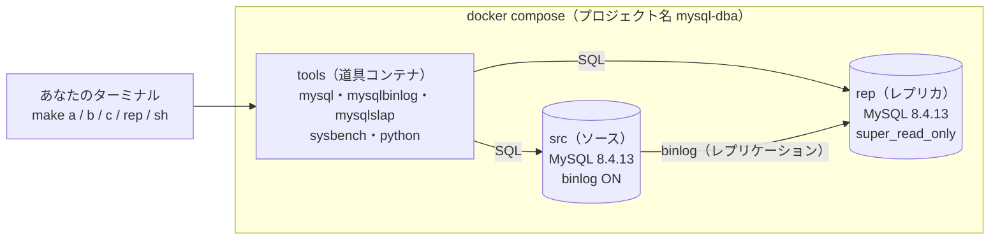

# 00 準備

## この章で分かるようになること

- この実験環境に何があって、どうつながっているか
- セッションの開き方と、実験で何かを壊したときの戻し方
- 業務の Aurora のバージョンの確かめ方（以降の章で、どの注記を読めばよいかが決まる）

## 解説

### 環境の全体

この環境は、MySQL のサーバー2台と、道具を入れたコンテナ1台でできている。全部 `docker compose` で動いていて、プロジェクト名は `mysql-dba`。ルートの Spark の環境（JupyterLab と MySQL）とは別のもので、お互いに影響しない。



MySQL はクライアントとサーバーに分かれたソフトウェアで、SQL を受け付けて実行するのがサーバー（`mysqld` というプログラム）、SQL を送るのがクライアント（`mysql` コマンドや、GUI のツールや、アプリケーション）になる。この環境では、`src` と `rep` がサーバー、`tools` がクライアントの役をする。

### 3つのコンテナの役割

**src（ソース）** は、書き込みを受けるサーバー。中には、ルートの SQL の問題と同じ架空の EC サイトの注文データが `lab` データベースに入っている（`customers`、`orders`、`order_items` など。中身は [`../../data/`](../../data/README.md) にある）。変更を記録する binlog と、トランザクションに番号を付ける GTID が ON になっている。どちらも後の章の主役になる。

**rep（レプリカ）** は、src の変更を受け取って、同じ変更を自分にも反映するサーバー。この仕組みをレプリケーションと呼ぶ。rep は空の状態から始めて、src の binlog を最初から全部受け取ることで、src と同じ中身になっている。rep には `super_read_only` が設定してあって、root でも直接は書き込めない。レプリカに直接書くとソースとずれてしまうので、それを防ぐための設定（[31章](31_replication_trouble.md)で、わざとずらして何が起きるかを見る）。

**tools（道具コンテナ）** には、MySQL のクライアントと、binlog を読む `mysqlbinlog`、負荷をかける `mysqlslap` と `sysbench`、実験のスクリプトを動かす Python が入っている。サーバーとは別のコンテナにしているのは、次の2つの理由から。

- 公式の MySQL のイメージには、`mysqlbinlog` と `mysqlslap` が入っていない
- 道具を1か所にまとめて、どのサーバーにも同じ道具で繋ぐため

tools からは、src と rep のデータディレクトリ（MySQL がデータやログのファイルを置く場所）を読み取り専用で覗ける。`/var/lib/mysql-src/` が src の、`/var/lib/mysql-rep/` が rep のデータディレクトリになる。binlog や redo ログのファイルを直接見るのに使う。

この3つのほかに、特定の章だけで立てるものがある。

| 名前 | 何 | 使う章 |
|---|---|---|
| `nobin` | binlog を OFF にした MySQL 8.4 | [20章](20_binlog_basics.md) |
| `blue`・`green` | MySQL 8.0 と 8.4（バージョンをまたぐ移行の実験） | [32章](32_upgrade.md) |
| `kafka`・`connect` | Kafka と Debezium（CDC の実験） | [42章](42_debezium.md) |

### セッション

`make a` で、src にクライアントで繋いだ状態（セッション）になる。プロンプトが `A [lab]>` になって、SQL を打てる。終わるときは `exit`。

ロックやトランザクションの実験では、セッションを2つか3つ同時に使う。ターミナルを複数開いて、それぞれで `make a`・`make b`・`make c` を打つ。プロンプトの `A`・`B`・`C` で、どのセッションかを見分ける。レプリカには `make rep`（プロンプトは `REP [lab]>`）、道具コンテナのシェルには `make sh` で入る。

手元の GUI のクライアントから繋ぐこともできる。src は `localhost:3311`、rep は `localhost:3312`、ユーザーは `root`、パスワードも `root`。

### 実験の後の戻し方

実験では `SET GLOBAL` でサーバーの設定を変えたり、テーブルを作ったりする。各章の最後に元に戻す手順を書いてあるけれど、戻し忘れると次の章の実験で、解説と違う結果が出てしまう。

`make state` は、次のことを確かめて、ずれがあれば一覧にする。

- src の主な設定が、既定の値（`bin/defaults.txt`）から変わっていないか
- 実験用のスキーマ（`dba` で始まる名前）が残っていないか
- レプリケーションがエラーなく動いているか

戻し方が分からなくなったら `make reset` を使う。コンテナとデータを全部消して、初期状態から作り直す。作り直しには1〜2分かかる。止めるだけなら `make down`（データは残って、次の `make up` で続きから使える）。

### メモリ

Docker Desktop を使っているなら、メモリを 4GB 以上割り当てる。ルートの Spark の環境と同時に動かすと足りなくなるので、こちらを使うときは、ルートで `make down` して止めておく。

## 手を動かして確かめる

### 実験1: 2つのサーバーを見比べる

**予想:** ソースとレプリカで、`@@server_id` と `@@server_uuid` は同じ？ 違う？ `@@super_read_only` はどうなっている？

```bash
make up
make a
```

```sql
SELECT @@version, @@server_id, @@server_uuid, @@read_only, @@super_read_only;
```

別のターミナルで `make rep` を打って、同じ SQL を流す。それから、レプリカでデータベースを作ってみる。

```sql
CREATE DATABASE test_on_replica;
```

ここを見る: 2つのサーバーで違う値になっている列と、レプリカでの `CREATE DATABASE` の結果。

<details>
<summary>何が起きたか</summary>

バージョンはどちらも 8.4.13。`@@server_id` は src が 1、rep が 2 になる。この番号は設定ファイル（`docker/mysql/src.cnf` と `rep.cnf`）で決めていて、レプリケーションをするサーバー同士では重複してはいけない。binlog の中の変更に「どのサーバーで起きたか」として記録されるので、重複すると、自分の変更か他人の変更かを区別できなくなる。

`@@server_uuid` も2つで違う。こちらは最初に起動したときに自動で作られる番号で、GTID（トランザクションの通し番号）の前半に使われる（[21章](21_binlog_events.md)）。

レプリカでの `CREATE DATABASE` は、次のエラーになる。

```text
ERROR 1290 (HY000): The MySQL server is running with the --super-read-only option so it cannot execute this statement
```

`read_only` は一般のユーザーの書き込みを止める設定で、管理者の権限を持つユーザーは書けてしまう。`super_read_only` は、管理者も含めて止める。レプリカに入る変更は、レプリケーションの仕組みを通したものだけにしたいので、こちらを使う。

</details>

### 実験2: ほかのセッションから、お互いが見えるか

**予想:** A で `SHOW PROCESSLIST` を流すと、いくつの接続が見える？ どんな接続が見える？

ターミナルを2つ開いて、それぞれで `make a` と `make b` を打つ。A で次の SQL を流す。

```sql
SHOW PROCESSLIST;
SELECT CONNECTION_ID();
```

ここを見る: `User`・`Command`・`State` の列。自分の接続はどれか。

<details>
<summary>何が起きたか</summary>

次のような接続が見える（`Id` や `Host` の値は環境によって違う）。

```text
Id   User             Command           State
5    event_scheduler  Daemon            Waiting on empty queue
630  repl             Binlog Dump GTID  Source has sent all binlog to replica; waiting for more updates
654  root             Query             init           ← A（SHOW PROCESSLIST を流している自分）
655  root             Sleep                            ← B（何もしていない）
```

- `root` の2つが、A と B のセッション。`SELECT CONNECTION_ID()` の値と `Id` が一致するほうが自分。何もしていない B は `Sleep` になっている
- `repl` は、レプリカ（rep）がソースに繋いでいる接続。`Binlog Dump GTID` は「binlog を GTID の順に送っている」という意味で、`State` は「全部送り終わって、次の変更を待っている」と言っている。レプリケーションは、レプリカがソースに普通のクライアントとして繋いで、binlog を受け取り続ける仕組みになっている（[30章](30_replication.md)）
- `event_scheduler` は、MySQL 自身の裏方（決まった時刻に SQL を流す機能）。ユーザーの接続ではない

接続1本ごとに、MySQL の中では処理を担当するスレッドが1つ割り当てられる。この話は[01章](01_overview.md)で続ける。

</details>

### 実験3: 設定を変えて、make state で見つける

**予想:** `max_connections` を変えた後に `make state` を打つと、何が表示される？

A で設定を変える。

```sql
SET GLOBAL max_connections = 200;
```

別のターミナルで確かめる。

```bash
make state
```

確かめたら、A で元に戻して、もう一度 `make state` を打つ。

```sql
SET GLOBAL max_connections = 151;
```

ここを見る: ずれの表示と、戻した後の表示。

<details>
<summary>何が起きたか</summary>

変えた後は、次のように表示される。

```text
ずれ: src max_connections=200（既定 151）
```

戻した後は `ずれなし` になる。`SET GLOBAL` は動いているサーバーの値を変えるだけで、再起動すると設定ファイルの値に戻る（再起動しても残す方法は[02章](02_parameters.md)）。各章の最後で値を戻したら、`make state` で戻ったことを確かめる。

</details>

## Aurora ではどうなる？

### 同じところ

- クライアントがサーバーに繋いで、セッションの中で SQL を流す、という形は同じ。`SHOW PROCESSLIST` や `CONNECTION_ID()` も同じように使える
- `@@version` で、互換の MySQL のバージョンが分かる

### 違うところ

- Aurora はマネージドサービスなので、サーバーのファイルやプロセスには触れない。設定ファイルの代わりにパラメータグループで設定を変える（[02章](02_parameters.md)）
- Aurora のクラスターにはライター（書き込み用）とリーダー（読み取り用）のインスタンスがあるけれど、リーダーはこの環境の rep のような binlog のレプリカではない。ストレージを共有して同じデータを見ている（[01章](01_overview.md)・[30章](30_replication.md)）
- バージョンの番号が2つある。`@@version`（または `VERSION()`）は互換の MySQL のバージョンで、`AURORA_VERSION()` は Aurora 自身のバージョン
  - Aurora MySQL v3 は MySQL 8.0 互換で、Aurora のバージョンは `3.05.2` のような3つの番号になる。対応する MySQL のバージョンはリリースノートに書いてある
  - 8.4 互換版からは、Aurora のバージョンが互換の系列にそろって、`8.4.7` のような番号になる（8.4.7 が最初の版）
- この環境は MySQL 8.4 で動いている。業務の Aurora が v3（8.0 互換）なら、名前が変わったコマンドがある（たとえば `SHOW BINARY LOG STATUS` は 8.0 では `SHOW MASTER STATUS`）。各章で注記するので、自分の Aurora の側の名前で読み替える

### 業務の Aurora で見てみるなら

業務の Aurora を触れる立場なら、ライターに繋いで、次の SQL を流してみる。

```sql
SELECT @@version, AURORA_VERSION();
```

`@@version` が `8.0.` で始まれば v3（8.0 互換）、`8.4.` で始まれば 8.4 互換版。以降の章の「違うところ」は、これに合わせて読む。

業務の Aurora で見た値はこのリポジトリに書かない（`notes/` も含めて。このリポジトリは公開している）。

出典:

- [Checking Aurora MySQL version numbers（AWS）](https://docs.aws.amazon.com/AmazonRDS/latest/AuroraUserGuide/AuroraMySQL.Updates.Versions.html)
- [Aurora MySQL version 8.4 compatible with MySQL 8.4（AWS）](https://docs.aws.amazon.com/AmazonRDS/latest/AuroraUserGuide/AuroraMySQL.MySQL84.html)

## 説明できるか確かめる

1. この環境の3つのコンテナは、それぞれ何をしている？ 道具を別のコンテナにしているのはなぜ？
2. レプリカは、最初どうやってソースと同じデータになった？（「3つのコンテナの役割」）
3. `read_only` と `super_read_only` は何が違う？ レプリカで後者を使うのはなぜ？
4. `make state` は何を確かめている？ ずれていて戻し方が分からないときはどうする？
5. 業務の Aurora のバージョンはどうやって確かめる？ 2つの番号は、それぞれ何を表している？

## この章のキーワード

- **ソース（source）**: 書き込みを受けて、その変更を binlog に記録するサーバー。以前は master と呼ばれていた
- **レプリカ（replica）**: ソースの binlog を受け取って、同じ変更を反映するサーバー。以前は slave と呼ばれていた
- **セッション（接続）**: クライアントがサーバーに繋いでいる1本の線。SQL はセッションの中で流れる
- **server_id と server_uuid**: サーバーを見分ける番号。レプリケーションをするサーバー同士で重複してはいけない
- **super_read_only**: 管理者も含めて書き込みを止める設定。レプリカで使う
- **パラメータグループ**: Aurora で、設定ファイルの代わりにサーバーの設定を管理するもの
- **AURORA_VERSION()**: Aurora 自身のバージョンを返す関数。互換の MySQL のバージョン（`@@version`）とは別
