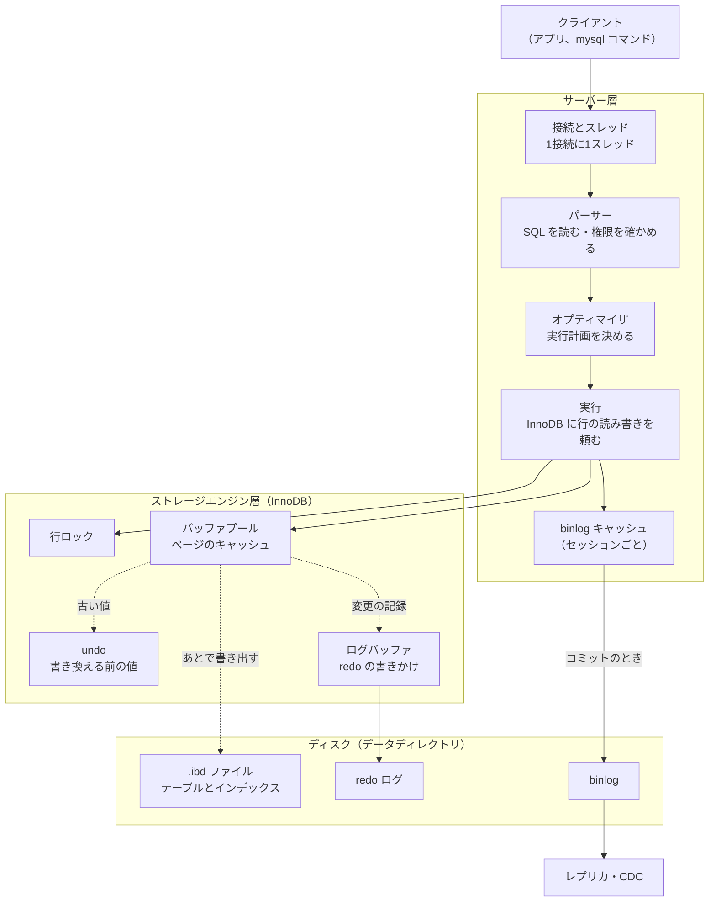
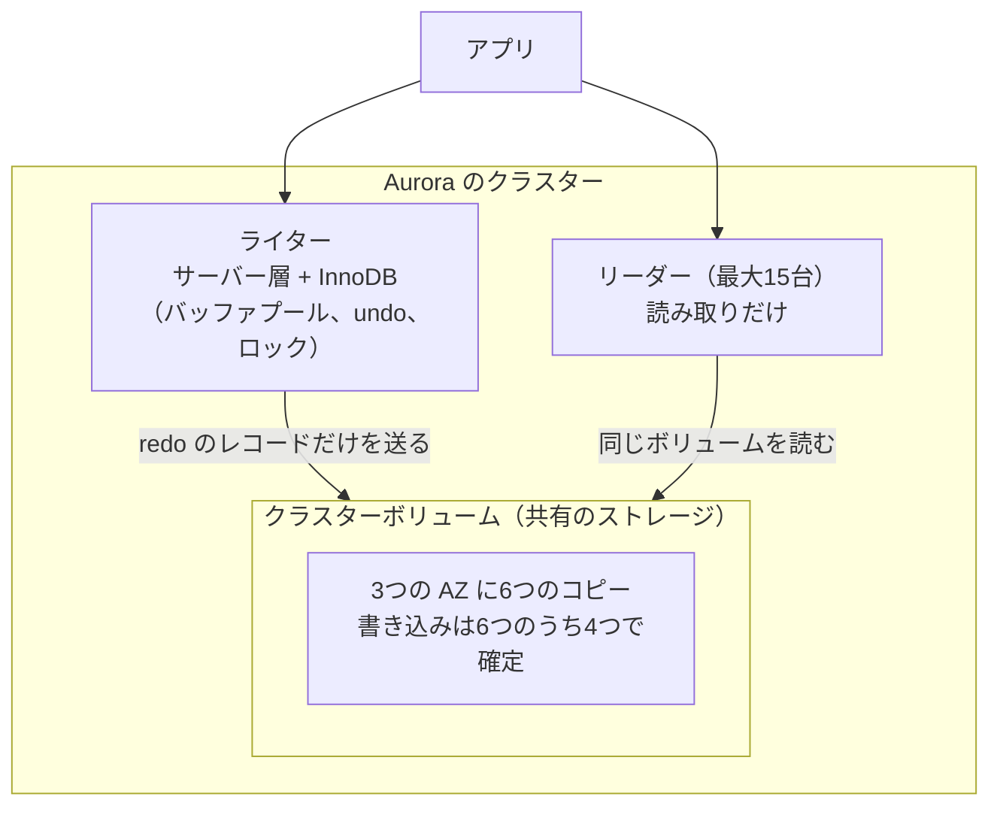

# 01 全体像

## この章で分かるようになること

- MySQL がどんな部品でできていて、1回の `UPDATE` がどの部品をどの順で通るか
- 後の章が、この地図のどこを詳しく見る章なのか
- Aurora では、地図のどの部品が置き換わっているか

## 解説

### 2つの層: サーバー層とストレージエンジン

MySQL のサーバー（`mysqld`）は、大きく2つの層に分かれている。

- **サーバー層**: クライアントからの接続を受けて、SQL を解析し、どうやって実行するかを決めて、実行する。binlog もこの層が書く
- **ストレージエンジン層**: データを実際に置いて、読み書きする。今はほぼ必ず **InnoDB** が使われる。トランザクション、行ロック、MVCC（古い版の読み取り）、redo ログ、undo ログは、どれも InnoDB の仕組み

2つの層の間には決まった約束（ストレージエンジン API）があって、サーバー層は「主キーがこの値の行を探して」「この行をこう書き換えて」と InnoDB に頼む。昔は MyISAM などほかのエンジンも使われていて、エンジンを差し替えられるようにこの形になった。

この分かれ方は、後の章を読むうえで大事になる。**binlog はサーバー層のログ、redo ログは InnoDB のログ** で、同じ変更を2つの層がそれぞれの目的で記録している。コミットのときにこの2つを食い違わないようにそろえる仕組みが、[22章](22_commit.md)の主役になる。

### 地図



### 1回の UPDATE の旅

自動コミットで、次の1文を流したとする。

```sql
UPDATE orders SET coupon_code = 'CH01' WHERE order_id = 1;
```

この1文は、次の順に部品を通っていく。

1. **接続**: クライアントは接続を1本持っていて、MySQL の中では、その接続専用のスレッドが SQL を受け取る（この章の後半）
2. **パースと権限の確認**: SQL の文を解析して、テーブルや列があるか、この操作をする権限があるかを確かめる
3. **最適化**: 行をどうやって探すかを決める。`order_id` は主キーなので、主キーのインデックスをたどって1行を探す、という計画になる（EXPLAIN の読み方は [`rdbms/`](../../rdbms/README.md) で扱う）
4. **実行**: 実行の部品が、InnoDB に「`order_id = 1` の行を探して、書き換えて」と頼む
5. **行ロック**: InnoDB は、書き換える行にロックをかける。ほかのトランザクションが同じ行を同時に書き換えられないようにするため（[14章](14_locks.md)）
6. **バッファプール**: 行が入っているページがメモリ（バッファプール）になければ、`.ibd` ファイルから読み込む。行は、主キーの順に並んだ B+tree という木の葉のページに入っている（[10章](10_storage.md)・[11章](11_buffer_pool.md)）
7. **undo**: 書き換える前の値を undo に残す。取り消す（ROLLBACK）ときと、ほかのトランザクションが古い値を読むときのため（[13章](13_undo_mvcc.md)）
8. **ページの書き換えと redo**: メモリ上のページを書き換える。このページは、まだディスクに書かれていないダーティページになる。同時に「どのページをどう変えたか」を redo ログのバッファに書く（[12章](12_redo.md)）
9. **binlog キャッシュ**: 「どの行がどう変わったか」を、そのセッションの binlog キャッシュにためる（[20章](20_binlog_basics.md)・[21章](21_binlog_events.md)）
10. **コミット**: redo ログと binlog の両方を、食い違わないようにそろえてディスクに書いてから、クライアントに OK を返す（[22章](22_commit.md)）
11. **あとで起きること**: ダーティページは、少し後でまとめて `.ibd` に書き出される（[11章](11_buffer_pool.md)・[12章](12_redo.md)）。undo に残した古い値は、読む人がいなくなったら消される。これを purge と呼ぶ（[13章](13_undo_mvcc.md)）
12. **レプリカと CDC へ**: binlog に書かれた変更は、レプリカに送られて同じように反映される（[30章](30_replication.md)）。CDC のツールも、同じ binlog を受け取って外のシステムに流す（[40章](40_cdc_mechanics.md)）

ここで大事なのは、**コミットの時点でディスクに書き終わっているのは、redo ログと binlog の追記だけ** という点。テーブルのデータそのもの（`.ibd` のページ）は、まだ書かれていない。ログはファイルの末尾に順に足していくだけなので速く書けるし、もし MySQL が途中で落ちても、ログを読み直せば変更をやり直せる。データより先にログを書くこの考え方を **WAL（Write-Ahead Logging）** と呼ぶ。速さと安全を両立させる、データベースの基本の仕組みになっている（[12章](12_redo.md)）。

### 部品と章の対応

| 部品 | 何をしているか | よく話題になるパラメータ | 章 |
|---|---|---|---|
| 接続とスレッド | 1接続に1スレッドで SQL を受ける | `max_connections`、`wait_timeout` | 01 |
| オプティマイザ | 実行計画を決める | — | [`rdbms/`](../../rdbms/README.md) |
| ページと B+tree | 行とインデックスの置き方 | — | 10 |
| バッファプール | ページをメモリに置いておく | `innodb_buffer_pool_size` | 11 |
| redo ログ | 変更を先にログに書く | `innodb_flush_log_at_trx_commit`、`innodb_redo_log_capacity` | 12 |
| undo と MVCC | 古い版を残して、ほかのトランザクションに読ませる | `transaction_isolation` | 13 |
| ロック | 同時の書き換えを防ぐ | `innodb_lock_wait_timeout`、`lock_wait_timeout` | 14・15 |
| binlog | サーバー層の変更の記録 | `binlog_format`、`sync_binlog`、`binlog_row_image` | 20〜22 |
| レプリケーション | binlog を受け取って反映する | `replica_parallel_workers` | 30〜32 |
| CDC | binlog を外のシステムに流す | `binlog_row_metadata` | 40〜42 |

### データディレクトリ: 部品がディスクに置くもの

MySQL は、データとログのファイルをデータディレクトリ（この環境では `/var/lib/mysql`）に置く。主なものは次のとおり。

| ファイル | 何 | 章 |
|---|---|---|
| `lab/orders.ibd` など | テーブル1つにつき1つのファイル（表領域）。行とインデックスのページが入っている | 10 |
| `#innodb_redo/#ib_redoN` | redo ログ。決まった数のファイルを順に使い回す。名前に `_tmp` が付いているのは予備 | 12 |
| `undo_001`、`undo_002` | undo の表領域 | 13 |
| `#ib_16384_0.dblwr` など | doublewrite バッファ。ページを書き出すときの保険 | 12 |
| `binlog.000001` …、`binlog.index` | binlog と、そのファイルの一覧 | 20 |
| `mysql.ibd` | データディクショナリ（テーブルの定義など） | — |
| `ibdata1` | システム表領域（change buffer など） | — |
| `ib_buffer_pool` | 止めるときのバッファプールの中身の一覧。再起動した後に読み直して、すぐに速く動けるようにする | 11 |
| `auto.cnf` | `server_uuid` | 00 |

### 接続とスレッド

MySQL は、クライアントが繋ぐたびに、その接続専用のスレッドを1つ割り当てる（1接続1スレッド）。スレッドごとにメモリ（並べ替え用の領域など）を使うし、同時に動くスレッドが多すぎると CPU の取り合いになるので、接続の数には上限 `max_connections`（既定は151）がある。

上限に達すると、新しい接続は `ERROR 1040 (HY000): Too many connections` で断られる。ただし、管理者の権限（`CONNECTION_ADMIN`）を持つユーザーのために、1本だけ余分に空けてある。接続があふれる障害のときでも、管理者が繋いで原因を調べられるようにするため。

何もしていない接続も、スレッドとメモリを持ったまま残る。`wait_timeout`（既定は8時間）を過ぎると切られる。アプリケーションの接続プールは接続を開けたままにしておくので、プールの大きさの合計が `max_connections` を超えないように設計する。

接続の様子は、次のステータス変数で分かる。

| ステータス変数 | 意味 |
|---|---|
| `Threads_connected` | 今繋がっている接続の数 |
| `Threads_running` | 今まさに SQL を実行している数。負荷を見るならこちら |
| `Max_used_connections` | 起動してからいちばん多かったときの接続の数 |
| `Connection_errors_max_connections` | 上限に当たって断った回数 |

接続のスレッドのほかに、MySQL の中では裏方のスレッドがいくつも動いている。redo ログを書くスレッド、ダーティページを書き出すスレッド、purge のスレッド、レプリカなら binlog を受け取るスレッドと反映するスレッド。どれも後の章で出てくる。

### Spark や Snowflake と比べると

SQL を受けて、解析して、実行計画を作って、実行する、という流れは、Spark（Catalyst が論理計画を最適化して物理計画にする）や Snowflake（クラウドサービス層が SQL をコンパイルする）と同じ。違うのは、何を速くしたいか。MySQL のオプティマイザは「主キーやインデックスで少しの行を素早く探す」ことに向いていて、Spark や Snowflake は「たくさんの行をたくさんのマシンで読む」ことに向いている。

データの置き方も逆になっている。InnoDB は1行のすべての列を 16KB のページにまとめて置く（行指向）。「注文1件の全部の項目を読む・書く」には向いているけれど、「1,000万行の金額の合計」には向いていない。Parquet や Snowflake のマイクロパーティションは列ごとにまとめて置く（列指向）ので、得意なことが逆になる。

もう1つ、普通の MySQL は、SQL を処理する部分とストレージが1つのサーバーの中にある。Aurora はここを分けて、ストレージを独立したサービスにしている。ストレージとコンピュートを分けるのは Snowflake と同じ発想で、次の「Aurora ではどうなる？」で見る。

## 手を動かして確かめる

### 実験1: データディレクトリを覗く

**予想:** テーブル `orders` のデータは、どのファイルに入っている？ redo ログと binlog は、どんな名前のファイルになっている？

```bash
make sh
ls -la /var/lib/mysql-src/
ls -la /var/lib/mysql-src/lab/
ls /var/lib/mysql-src/#innodb_redo/
```

ここを見る: ファイルの名前と大きさ。テーブルの数と `.ibd` の数。

<details>
<summary>何が起きたか</summary>

`lab/` の下に、テーブルごとの `.ibd` が並んでいる（`orders.ibd`、`order_items.ibd` など）。行が多い `order_items.ibd` がいちばん大きい。テーブル1つにつき1つのファイルになるのは、`innodb_file_per_table`（既定で ON）のため。

`#innodb_redo/` の中には、`#ib_redo6` のような名前のファイルと、`_tmp` が付いた予備のファイルが合わせて32個ある。redo ログは、決まった大きさの中で古いところから使い回す（どこまで使い回してよいかは[12章](12_redo.md)のチェックポイントで決まる）。

binlog は `binlog.000001`、`binlog.000002` … と番号が増えていく。使い回さずに、新しいファイルを足していく。どこまで残すかは保持期間で決める（[20章](20_binlog_basics.md)）。この「使い回す redo」と「たまっていく binlog」の違いも、2つのログの目的の違いから来ている。

</details>

### 実験2: 1回の UPDATE の跡を追う

**予想:** `UPDATE` を1回流すと、redo の LSN、binlog の位置、GTID の番号、レプリカの値のうち、どれが変わる？

A で、変える前の値を見ておく。

```sql
SHOW GLOBAL STATUS LIKE 'Innodb_redo_log_current_lsn';
SHOW BINARY LOG STATUS;
SELECT coupon_code FROM orders WHERE order_id = 1;
```

1回だけ書き換えて、もう一度見る。

```sql
UPDATE orders SET coupon_code = 'CH01' WHERE order_id = 1;
SHOW GLOBAL STATUS LIKE 'Innodb_redo_log_current_lsn';
SHOW BINARY LOG STATUS;
```

`make rep` でレプリカに入って、同じ行を読む。

```sql
SELECT coupon_code FROM orders WHERE order_id = 1;
```

最後に、A で最初に見た値に戻す（`NULL` だったなら `SET coupon_code = NULL`）。

ここを見る: `Innodb_redo_log_current_lsn` の値、`SHOW BINARY LOG STATUS` の `Position` と `Executed_Gtid_Set`、レプリカで読んだ値。

<details>
<summary>何が起きたか</summary>

4つとも変わる。

- `Innodb_redo_log_current_lsn` が増える。LSN（Log Sequence Number）は、redo ログを書き始めてから何バイト書いたかを表す番号で、InnoDB の「ログのどこまで書いたか」になる
- `SHOW BINARY LOG STATUS` の `Position` が増える。今の binlog ファイルの何バイト目まで書いたかで、サーバー層の「ログのどこまで書いたか」になる
- `Executed_Gtid_Set` の最後の番号が1つ増える。トランザクション1つにつき GTID が1つ付く（[21章](21_binlog_events.md)）
- レプリカでも `CH01` が読める。binlog に書かれた変更が、すぐにレプリカに届いて反映されている

redo と binlog が両方とも動いたことが、「同じ変更を2つの層がそれぞれ記録している」ことの証拠になる。

なお、MySQL 8.0（Aurora v3）では、`SHOW BINARY LOG STATUS` の代わりに `SHOW MASTER STATUS` を使う。

</details>

### 実験3: 裏方のスレッドを見る

**予想:** 誰も SQL を流していないときにも、MySQL の中で動いているスレッドはある？ どんな名前のものがある？

A で、ソースのスレッドを一覧にする。

```sql
SELECT NAME, TYPE FROM performance_schema.threads ORDER BY TYPE, NAME;
```

`make rep` で、レプリカの側も見る。

```sql
SELECT NAME FROM performance_schema.threads WHERE NAME LIKE 'thread/sql/replica%';
```

ここを見る: `TYPE` が `BACKGROUND` のものと `FOREGROUND` のもの。名前の中の `innodb` や `log` や `replica`。

<details>
<summary>何が起きたか</summary>

`FOREGROUND` は接続のスレッド（`thread/sql/one_connection`）で、`BACKGROUND` が裏方。ソースには、たとえば次のような裏方がいる。

| スレッド | 何をしている | 章 |
|---|---|---|
| `thread/innodb/log_writer_thread`、`log_flusher_thread` | redo ログを書く・ディスクに同期する | 12 |
| `thread/innodb/log_checkpointer_thread` | チェックポイントを進める | 12 |
| `thread/innodb/page_flush_coordinator_thread` | ダーティページを書き出す | 11・12 |
| `thread/innodb/srv_purge_thread` | 古い版の undo を消す（purge） | 13 |
| `thread/innodb/io_read_thread`、`io_write_thread` | ディスクの読み書き | 11 |

レプリカには、`thread/sql/replica_io`（binlog を受け取る）、`thread/sql/replica_sql`（反映を取りまとめる）、`thread/sql/replica_worker`（反映する係。既定で4本）がいる（[30章](30_replication.md)）。

</details>

### 実験4: 接続の上限を超える

**予想:** `max_connections` を 3 にすると、管理者ではないユーザー（`app`）で何本まで繋げる？ そのとき管理者（root）は繋げる？

A で上限を下げる。

```sql
SET GLOBAL max_connections = 3;
```

別のターミナルで、`app` ユーザーで断られるまで繋ぎ続けるスクリプトを流す。

```bash
make sh
python /lab/labs/01/connections.py
```

A に戻って、断った回数を見てから、上限を戻す。

```sql
SHOW GLOBAL STATUS LIKE 'Connection_errors_max_connections';
SET GLOBAL max_connections = 151;
```

ここを見る: スクリプトが出す `opened`（app で開けた本数）、`refused_code`（断られたときのエラー番号）、`root_extra_ok`（上限に達した後で root が繋げたか）。

<details>
<summary>何が起きたか</summary>

`refused_code=1040` で断られる。`opened` の本数は、3 から「すでにある接続」を引いた数になる。レプリカの `repl` の接続と、A のセッションが1本ずつ使っているので、A を開いたままなら1本になる。

それでも `root_extra_ok=1` で、root は繋げる。管理者の権限を持つユーザーのために1本空けてあるため。`Connection_errors_max_connections` は、断るたびに増える。

本番で接続があふれたときに上限を上げるのは、その場しのぎになりやすい。接続が多すぎる原因（接続プールの設定、終わらないクエリ、閉じ忘れ）を探すほうが先になる。

</details>

## Aurora ではどうなる？

### 同じところ

- サーバー層（接続、パーサー、オプティマイザ、実行）と、InnoDB のトランザクション、行ロック、MVCC、バッファプールは、MySQL のものがそのまま動いている。「1回の UPDATE の旅」の1〜9は同じ
- 1接続1スレッドで、`max_connections` を超えると `ERROR 1040` になる。管理者のための1本もある

### 違うところ

Aurora は、InnoDB のディスクとの読み書きの部分を、独立したストレージのサービスに置き換えている。



- **ディスクに書くもの**: ライターがストレージに送るのは redo のレコードだけで、ページそのものは送らない。ページは、ストレージの側で redo から組み立てる。データは3つのアベイラビリティゾーン（AZ）に6つのコピーとして置かれて、6つのうち4つが受け取った時点で書き込みが確定する。手元の `.ibd` や redo のファイルを管理することはなく、チェックポイントや doublewrite の考え方も変わる（[12章](12_redo.md)）
- **リーダー**: 最大15台のリーダー（Aurora レプリカ）は、ライターと同じクラスターボリュームを読む。binlog を受け取って反映する仕組みではないので、遅れはふつう100ミリ秒より短い（[30章](30_replication.md)）
- **binlog**: リーダーに binlog は要らないので、Aurora では binlog が既定で無効になっている。binlog が要るのは、別のリージョンへのレプリカ、Aurora の外へのレプリケーション、Blue/Green デプロイ、CDC を使うとき（[20章](20_binlog_basics.md)・30〜[32章](32_upgrade.md)・[40章](40_cdc_mechanics.md)）
- **接続の上限**: `max_connections` の既定値は、インスタンスクラスのメモリから計算する式になっている。インスタンスを大きくすると、既定の上限も増える。値はインスタンスのパラメータグループで変える（[02章](02_parameters.md)）

- **8.4 互換版**: 同じ。AWS は、8.4 互換版は最新の v3 と同じ Aurora の機能を持つ、としている（違うのは例外の一覧にあるものだけ。[00章](00_setup.md)）

### 業務の Aurora で見てみるなら

業務の Aurora を触れる立場なら、ライターで次の SQL を流してみる。どれも軽い読み取りだけ。

```sql
SELECT @@max_connections, @@log_bin;
SHOW GLOBAL STATUS WHERE Variable_name IN
  ('Threads_connected', 'Threads_running', 'Max_used_connections', 'Connection_errors_max_connections');
```

- 上限（`@@max_connections`）に対して、いま（`Threads_connected`）とピーク（`Max_used_connections`）がどれくらいか
- `Connection_errors_max_connections` が 0 でなければ、起動してから上限に当たったことがある
- `@@log_bin` が 1 なら binlog が有効、0 なら無効

業務の Aurora で見た値はこのリポジトリに書かない。

出典:

- [Replication with Amazon Aurora（AWS）](https://docs.aws.amazon.com/AmazonRDS/latest/AuroraUserGuide/Aurora.Replication.html)
- [Managing performance and scaling for Amazon Aurora MySQL（max_connections の既定値）（AWS）](https://docs.aws.amazon.com/AmazonRDS/latest/AuroraUserGuide/AuroraMySQL.Managing.Performance.html)
- [Amazon Aurora under the hood: quorums and correlated failure（AWS Database Blog）](https://aws.amazon.com/blogs/database/amazon-aurora-under-the-hood-quorum-and-correlated-failure/)

## 説明できるか確かめる

1. MySQL のサーバー層とストレージエンジン層は、それぞれ何をしている？ binlog と redo ログは、どちらの層のもの？（「2つの層」）
2. 1回の `UPDATE` のコミットの時点で、ディスクに書き終わっているものと、まだ書かれていないものは何？ それで困らないのはなぜ？（「1回の UPDATE の旅」）
3. 接続の上限に達すると何が起きる？ 管理者のための1本が空けてあるのはなぜ？（「接続とスレッド」）
4. Aurora のリーダーが、binlog を使わずに、ほとんど遅れずにライターと同じデータを読めるのはなぜ？
5. Aurora で置き換わっているのは、地図のどの部品？ 置き換わっていないのはどれ？

## この章のキーワード

- **サーバー層**: 接続、SQL の解析と最適化、実行、binlog を受け持つ、MySQL の上半分
- **ストレージエンジン（InnoDB）**: データを実際に置いて読み書きする下半分。トランザクション、ロック、MVCC、redo、undo はここの仕組み
- **ページ**: InnoDB がデータを読み書きする単位。既定は 16KB
- **ダーティページ**: メモリ上で書き換えられて、まだディスクに書き出されていないページ
- **WAL（Write-Ahead Logging）**: データより先に、変更の記録（ログ）をディスクに書く考え方。速さと安全を両立させる
- **LSN**: redo ログを何バイト目まで書いたかを表す番号
- **max_connections**: 同時に繋げる接続の上限。超えると `ERROR 1040`
- **クラスターボリューム**: Aurora のライターとリーダーが共有するストレージ。3つの AZ に6つのコピーを持つ
