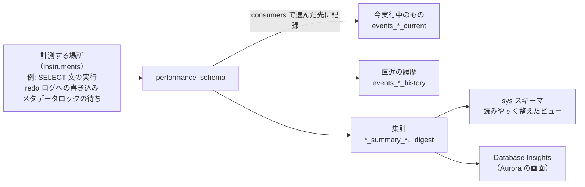

# 03 観察の道具

## この章で分かるようになること

- MySQL の中で何が起きているかを見る5つの道具と、それぞれが得意なこと
- ステータス変数を「差分」で見る、という見方
- Aurora の Database Insights（旧 Performance Insights）に出る待機イベントやクエリの集計が、何を元にしているか

## 解説

### 5つの道具

この先の章では、実験のたびに「中で何が起きたか」を数字で確かめる。使う道具は次の5つ。

| 道具 | 何が分かる | 向いている問い |
|---|---|---|
| ステータス変数 | サーバー全体の回数と状態 | この操作で、何がどれくらい起きた？ |
| performance_schema | SQL、待ち、ロック、スレッドの細かい計測 | どのクエリが時間を使っている？ 何を待っている？ |
| sys スキーマ | performance_schema を読みやすくしたビュー | 上と同じことを手早く |
| `SHOW ENGINE INNODB STATUS` | InnoDB の今の様子の報告書 | トランザクション、ログ、バッファプールは今どうなっている？ |
| スロークエリログ | 遅かったクエリの記録 | あとから、遅かったクエリを集めて調べる |

### ステータス変数は「差分」で見る

ステータス変数の多くは「起動してからの合計」になっている。`Innodb_rows_read` が 122643 と言われても、それだけでは何も分からない。分かるのは、何かの前と後の **差** を取ったとき。

- あるクエリの前と後で `Innodb_rows_read` の差を取ると、そのクエリが InnoDB から何行読んだかが分かる。結果が10行なのに10万行読んでいたら、全件を読んでいる（インデックスが使えていない）
- 一定の時間の前と後で `Questions` の差を取って秒数で割ると、1秒あたりの文の数（QPS）になる

`Threads_connected` のように「今の値」を表すものもある。どちらの種類かは、名前と意味から判断する。`SHOW SESSION STATUS` にすると、自分の接続の分だけが見られる。

### performance_schema: MySQL の中の計測器

performance_schema は、MySQL のプログラムのあちこちに埋め込まれた計測器の集まりで、結果を `performance_schema` データベースのテーブルとして見せる。2つの設定で、何を記録するかを決める。

- **instruments（計測する場所）**: 「SELECT 文の実行」「redo ログのファイルへの書き込み」「メタデータロックの待ち」のような、計測する箇所。`performance_schema.setup_instruments` で、どれを有効にするかを決める
- **consumers（記録する先）**: 計測した結果を、どのテーブルに残すか。「今実行中のもの」「直近の履歴」「集計」などがあって、`performance_schema.setup_consumers` で決める



既定では、SQL の文とトランザクションの履歴、集計（digest など）は記録する。待ちを1件ずつ記録するのは、負荷がかかるので既定では OFF になっている。ただし、待ちの **集計** は既定でも取られている。

計測器の名前は、`/` で区切った階層になっている。たとえば `wait/io/file/innodb/innodb_log_file` は「待ち／I/O／ファイル／InnoDB／redo ログのファイル」と読む。Aurora の待機イベントの名前も、この形をしている。時間はピコ秒（1兆分の1秒）で記録される。

この先の章で使う主なテーブルは次のとおり。

| テーブル | 何が分かる | 章 |
|---|---|---|
| `events_statements_summary_by_digest` | クエリの形ごとの集計 | 03 |
| `events_statements_history` | 各接続の直近の文（既定で10件） | 03 |
| `events_waits_summary_global_by_event_name` | 待ちの種類ごとの集計 | 03 |
| `threads` | 接続と裏方のスレッド | 01 |
| `variables_info` | 変数の値の出どころ | 02 |
| `data_locks`、`data_lock_waits` | 行ロックと、その待ち | 14 |
| `metadata_locks` | メタデータロック | 15 |
| `replication_*` | レプリケーションの状態 | 30 |

#### digest: クエリの形ごとの集計

`events_statements_summary_by_digest` は、クエリを「形」でまとめて集計する。`WHERE quantity > 3` と `WHERE quantity > 1` は、値を `?` に置き換えると同じ形（`... WHERE quantity > ?`）になるので、1つにまとめて数える。この置き換えた形を digest と呼ぶ。

主な列は、実行した回数（`COUNT_STAR`）、合計の時間（`SUM_TIMER_WAIT`）、読んだ行の合計（`SUM_ROWS_EXAMINED`）、返した行の合計（`SUM_ROWS_SENT`）。**読んだ行と返した行の比** を見ると、無駄に読んでいるクエリが分かる。1行返すのに1万行読んでいたら、インデックスを考える（`rdbms/` で扱う）。

### sys スキーマ: performance_schema の読みやすい窓

performance_schema のテーブルは、ピコ秒やバイトのままで読みにくい。sys スキーマは、それを「1.00 s」「10.47 ms」のように整えて見せるビューの集まり。`sys.statement_analysis`（重いクエリ）、`sys.waits_global_by_latency`（時間を使っている待ち）、`sys.innodb_lock_waits`（14章）、`sys.schema_table_lock_waits`（15章）などがある。

気をつけることが2つある。

- 整えた列は文字列なので、`ORDER BY total_latency` のように並べ替えると、文字の順になってしまう。ビューは最初から時間の順に並んでいるので、そのまま `LIMIT` を付ける。数値のまま欲しいときは、名前の前に `x$` が付いたビュー（`sys.x$statement_analysis` など）を使う
- クエリの文は、長いと途中が「 ... 」で省略される。`LIKE` で探すときは、performance_schema のテーブルを直接見る

### SHOW ENGINE INNODB STATUS: InnoDB の報告書

InnoDB の今の様子を、長い文章にまとめて出す。節ごとに読む。

| 節 | 何が分かる | 章 |
|---|---|---|
| `TRANSACTIONS` | 動いているトランザクションと、それが持っているロック。`History list length`（purge を待っている古い版の量） | 13・14 |
| `LOG` | `Log sequence number`（どこまで書いたか）、`Log flushed up to`（どこまでディスクに同期したか）、`Last checkpoint at`（どこまでデータに反映したか） | 12 |
| `BUFFER POOL AND MEMORY` | バッファプールのページの数、空いているページ、ダーティページ（`Modified db pages`）、ヒット率 | 11 |
| `ROW OPERATIONS` | 行の挿入・更新・削除・読み取りの合計と、1秒あたりの数 | — |
| `LATEST DETECTED DEADLOCK` | 最後に起きたデッドロックの詳しい記録（起きたことがあるときだけ出る） | 14 |

1秒あたりの数は、前にこの報告を出したときからの平均になっている。報告は「今の瞬間」の様子なので、時間を追って見たいときは、ステータス変数の差分や performance_schema を使う。

### スロークエリログ

`long_query_time`（秒）より時間がかかったクエリを、ファイル（またはテーブル）に記録する。`slow_query_log` で ON・OFF を切り替える。1件ごとに、かかった時間、ロックを待った時間、返した行、読んだ行が残る。`mysqldumpslow` や pt-query-digest のような道具は、このログをクエリの形でまとめて集計する（digest と同じ考え方）。

記録するかどうかは、そのクエリを実行したセッションの `long_query_time` で決まる。02章のスコープの話がそのまま効くので、`SET GLOBAL` で値を下げても、今繋いでいるセッションのクエリは記録されない。

### どの道具を使うか

| 知りたいこと | 道具 |
|---|---|
| 今、誰が何をしている？ | `SHOW PROCESSLIST`、`sys.processlist` |
| 何を待っている？ | 待機イベント（`sys.waits_global_by_latency`） |
| どのクエリが重い？ | digest（`sys.statement_analysis`）、スロークエリログ |
| InnoDB の中は今どうなっている？ | `SHOW ENGINE INNODB STATUS` |
| この操作で、何がどれだけ起きる？ | ステータス変数の差分 |

## 手を動かして確かめる

### 実験1: ステータス変数の差分で、読んだ行の数を測る

**予想:** `SELECT COUNT(*) FROM orders WHERE status = 'completed'` は、InnoDB から何行を読む？ 結果の件数と同じくらい？

```sql
SHOW GLOBAL STATUS LIKE 'Innodb_rows_read';
SELECT COUNT(*) FROM orders WHERE status = 'completed';
SHOW GLOBAL STATUS LIKE 'Innodb_rows_read';
SELECT COUNT(*) FROM orders;
```

ここを見る: 2回の `Innodb_rows_read` の差と、`orders` の行の数。

<details>
<summary>何が起きたか</summary>

差は、`completed` の件数ではなく、`orders` の全部の行の数（6,082行）とほぼ同じになる（ほかの処理の分が少し混ざることがある）。この環境のテーブルには、主キー以外のインデックスをわざと張っていない（`rdbms/` の実験で自分で足すため）。`status` で絞り込むには、全部の行を読んで1行ずつ確かめるしかない。

結果の件数ではなく、読んだ行の数を見る。これが、ステータス変数の差分で分かることの典型になる。

</details>

### 実験2: digest で、同じ形のクエリをまとめて見る

**予想:** 値だけが違う3つのクエリを流すと、digest はいくつできる？ 読んだ行と返した行の比はどうなる？

```sql
TRUNCATE TABLE performance_schema.events_statements_summary_by_digest;
SELECT COUNT(*) FROM order_items WHERE quantity > 3;
SELECT COUNT(*) FROM order_items WHERE quantity > 1;
SELECT COUNT(*) FROM order_items WHERE quantity > 4;
SELECT DIGEST_TEXT, COUNT_STAR, SUM_TIMER_WAIT, SUM_ROWS_EXAMINED, SUM_ROWS_SENT
FROM performance_schema.events_statements_summary_by_digest
WHERE DIGEST_TEXT LIKE '%order_items%';
```

`sys` でも見る。

```sql
SELECT query, exec_count, total_latency, rows_examined_avg FROM sys.statement_analysis LIMIT 5;
```

ここを見る: `DIGEST_TEXT` と `COUNT_STAR`、`SUM_ROWS_EXAMINED` と `SUM_ROWS_SENT` の比、`sys` での見え方。

<details>
<summary>何が起きたか</summary>

digest は1つにまとまる。`DIGEST_TEXT` は次のようになっていて、値が `?` に置き換わっている。

```text
SELECT COUNT ( * ) FROM `lab` . `order_items` WHERE `quantity` > ?
```

`COUNT_STAR` は 3、`SUM_ROWS_EXAMINED` は 3 × 14,570（`order_items` の全部の行の3回分）、`SUM_ROWS_SENT` は 3。1行返すのに14,570行読んでいる。`SUM_TIMER_WAIT` はピコ秒なので、10,000,000,000（10の10乗）なら10ミリ秒になる。

`sys.statement_analysis` では、時間が「10.47 ms」のように読める形になる。一方で、クエリの文は `` SELECT COUNT ( * ) FROM `lab`  ... er_items` WHERE `quantity` > ? `` のように途中が省略される。

</details>

### 実験3: 自分の接続で直前に流した文を見る

**予想:** performance_schema には、自分が流した文の履歴が残っている？ 時間や読んだ行も分かる？

```sql
SELECT 'hello';
SELECT COUNT(*) FROM customers;
SELECT EVENT_ID, SQL_TEXT, TIMER_WAIT / 1000000000 AS ms, ROWS_EXAMINED
FROM performance_schema.events_statements_history
WHERE THREAD_ID = PS_CURRENT_THREAD_ID()
ORDER BY EVENT_ID;
```

ここを見る: 直前の2つの文が出ているか。`ms` と `ROWS_EXAMINED`。

<details>
<summary>何が起きたか</summary>

自分の接続（スレッド）が直前に流した文が、新しいものから10件まで残っている。1件ごとに、かかった時間（ピコ秒を1,000,000,000で割るとミリ秒）と読んだ行が分かる。`PS_CURRENT_THREAD_ID()` は、自分の接続の performance_schema の中での番号を返す関数。ほかのセッションの履歴を見たいときは、`performance_schema.threads` の `PROCESSLIST_ID`（`SHOW PROCESSLIST` の `Id`）から `THREAD_ID` を引く。

</details>

### 実験4: INNODB STATUS を読む

**予想:** 何も書き込んでいないとき、LOG の節の3つの数字（`Log sequence number`、`Log flushed up to`、`Last checkpoint at`）はどうなっている？

```sql
SHOW ENGINE INNODB STATUS\G
```

ここを見る: `TRANSACTIONS` の `History list length`、`LOG` の3つの数字、`BUFFER POOL AND MEMORY` の `Buffer pool size` と `Modified db pages`。

<details>
<summary>何が起きたか</summary>

何も書き込んでいなければ、LOG の3つの数字は同じになっている。

```text
Log sequence number          22886686
Log flushed up to            22886686
Last checkpoint at           22886686
```

「ここまで書いた」「ここまでディスクに同期した」「ここまでデータファイルに反映した」が全部そろっている、という意味。書き込みが続くと、3つの間に差ができる（12章で見る）。

`Buffer pool size` はページの数で、約8,190ページ × 16KB ≒ 128MB になる。`Modified db pages` はダーティページの数で、静かなときは 0 に近い。`History list length` は、purge を待っている古い版の量（13章）。

</details>

### 実験5: スロークエリログに残す

**予想:** `long_query_time` を 0.5 秒にしてから `SELECT SLEEP(1)` を流すと、ログに残る？ 同じセッションで流したときと、新しいセッションで流したときで違いはある？

A でログを有効にして、そのまま A で遅いクエリを流す。

```sql
SET GLOBAL slow_query_log_file = '/var/lib/mysql/slow.log';
SET GLOBAL long_query_time = 0.5;
SET GLOBAL slow_query_log = ON;
SELECT 'from A', SLEEP(1);
```

`make b` で新しく繋いだ B でも流す。

```sql
SELECT 'from B', SLEEP(1);
```

`make sh` でログを見る。

```bash
tail -20 /var/lib/mysql-src/slow.log
```

最後に、A で元に戻す。

```sql
SET GLOBAL slow_query_log = OFF;
SET GLOBAL long_query_time = 10;
```

ここを見る: `from A` と `from B` のどちらがログにあるか。1件の記録に何が書いてあるか。

<details>
<summary>何が起きたか</summary>

ログに残るのは `from B` だけ。A のセッションの `long_query_time` は、繋いだときにコピーした 10 秒のままなので、1秒のクエリは記録されない（02章のスコープ）。B は `SET GLOBAL` の後に繋いだので 0.5 秒になっている。

1件の記録は次のような形になる。

```text
# Time: 2026-11-20T15:22:18.758495Z
# User@Host: root[root] @  [172.18.0.2]  Id:    91
# Query_time: 1.000349  Lock_time: 0.000000 Rows_sent: 1  Rows_examined: 1
SET timestamp=1795188137;
SELECT 'from B', SLEEP(1);
```

`Rows_examined` に対して `Rows_sent` が極端に少ないものは、実験2の digest と同じく、読みすぎを疑う。

</details>

### 実験6: サーバーが何を待っているかを見る

**予想:** サーバー全体で、いちばん時間を使っている待ちは何？

```sql
SELECT events, total, total_latency FROM sys.waits_global_by_latency LIMIT 5;
```

ここを見る: 待ちの名前と、合計の時間。

<details>
<summary>何が起きたか</summary>

たとえば、次のような待ちが上位に並ぶ（数字は環境と、それまでの実験による）。

```text
events                                    total    total_latency
wait/io/file/innodb/innodb_data_file      1271     113.90 ms
wait/io/file/innodb/innodb_log_file        204      57.93 ms
wait/io/table/sql/handler               122645      18.35 ms
wait/io/file/innodb/innodb_dblwr_file       13      12.24 ms
```

- `innodb_data_file`: `.ibd` ファイルの読み書き（11章）
- `innodb_log_file`: redo ログのファイルへの書き込み（12章）
- `io/table/sql/handler`: サーバー層がストレージエンジン API を通して行を読み書きした待ち（01章の2つの層の境目）
- `innodb_dblwr_file`: doublewrite のファイル（12章）

Aurora の Database Insights に出る待機イベントも、こういう名前の待ちを、時間を追って集計したものになっている。

</details>

## Aurora ではどうなる？

### 同じところ

- ステータス変数、performance_schema、sys、`SHOW ENGINE INNODB STATUS`、スロークエリログは、どれも MySQL の機能なので、同じ SQL で見られる（performance_schema が有効になっていれば）
- digest の考え方も同じ。Database Insights の「上位の SQL」は、クエリを digest でまとめて表示している

### 違うところ

- **画面で見る道具**: AWS は Performance Insights の終了を告知していて、CloudWatch Database Insights（Advanced モード）への移行を案内している。どちらも、データベースの負荷（同時に動いているセッションの数の平均）を、待機イベントごと、SQL ごと、ユーザーごとなどに分けて、時間を追って見せる。中身は、この章の performance_schema の待ちとクエリの集計を、時間ごとに取ったものと考えてよい
- **performance_schema の扱い**: Aurora では、performance_schema を Performance Insights（Database Insights）に自動で管理させるか、自分で管理するかを選ぶ。performance_schema の有効・無効を変えると、再起動が要る。無効だと、細かい待機イベントは見られない
- **Aurora 独自の待機イベント**: ストレージの作りが違うので、Aurora にしかない待ちがある
  - `io/redo_log_flush`（v3 の名前。v2 では `io/aurora_redo_log_flush`）: コミットのときに、redo を Aurora のストレージに書き終わるのを待っている。小さいコミットが多いと増える。書き込みをまとめて、コミットの回数を減らすのが対策になる（12章）
  - `io/aurora_respond_to_client`: 結果をクライアントに送り終わるのを待っている。クライアント側やネットワークが遅いと増える
  - メタデータロックの待ち（`synch/cond/sql/MDL_context::COND_wait_status`）のように、普通の MySQL と同じ名前のものも多い（15章）
- **スロークエリログ**: `slow_query_log` や `long_query_time` はパラメータグループで設定する。ログのファイルはコンソールから見たり、CloudWatch Logs に送ったりする
- **INNODB STATUS**: 使えるけれど、LOG の節の数字（チェックポイントなど）は、ストレージの作りが違うので、普通の MySQL と同じ意味では読めない（12章）

### 業務の Aurora で見てみるなら

業務の Aurora を触れる立場なら、ライターで次の SQL を流して、Database Insights の画面と見比べる。どれも集計済みのビューを読むだけの、軽い読み取り。

```sql
SELECT @@performance_schema;
SELECT events, total, total_latency FROM sys.waits_global_by_latency LIMIT 10;
SELECT query, exec_count, total_latency, rows_examined_avg FROM sys.statement_analysis LIMIT 10;
```

- `@@performance_schema` が 0 なら、performance_schema は無効
- 画面の上位の待機イベントと、`sys.waits_global_by_latency` の上位は似ているか（画面は時間の区切りごと、sys は起動してからの合計、という違いがある）

業務の Aurora で見た値はこのリポジトリに書かない。

出典:

- [Aurora MySQL wait events（AWS）](https://docs.aws.amazon.com/AmazonRDS/latest/AuroraUserGuide/AuroraMySQL.Reference.Waitevents.html)
- [io/redo_log_flush（AWS）](https://docs.aws.amazon.com/AmazonRDS/latest/AuroraUserGuide/ams-waits.io-redologflush.html)
- [待機イベントを使用した Aurora MySQL のチューニング（AWS）](https://docs.aws.amazon.com/ja_jp/AmazonRDS/latest/AuroraUserGuide/AuroraMySQL.Managing.Tuning.wait-events.html)
- [Monitoring DB load with Performance Insights on Amazon Aurora（終了の告知）（AWS）](https://docs.aws.amazon.com/AmazonRDS/latest/AuroraUserGuide/USER_PerfInsights.html)

## 説明できるか確かめる

1. ステータス変数の値をそのまま見ても、意味がないことが多いのはなぜ？ どう見ればよい？（「差分で見る」）
2. performance_schema の instruments と consumers は、それぞれ何を決めている？
3. digest で「読んだ行」と「返した行」を比べると、何が分かる？
4. `SET GLOBAL long_query_time = 0.5` をしたのに、今のセッションで流した遅いクエリがスロークエリログに残らなかった。なぜ？
5. Aurora の Database Insights で `io/redo_log_flush` が多いとき、何が起きている？ 何を疑う？

## この章のキーワード

- **ステータス変数の差分**: 起動してからの合計の、前と後の差。ある操作で何がどれくらい起きたかが分かる
- **performance_schema**: MySQL に埋め込まれた計測器。結果をテーブルとして見せる
- **instruments と consumers**: 何を計測するかと、結果をどこに記録するかの設定
- **digest**: 値を `?` に置き換えたクエリの形。同じ形のクエリをまとめて集計する
- **sys スキーマ**: performance_schema を読みやすくしたビューの集まり。`x$` が付いたものは数値のまま
- **SHOW ENGINE INNODB STATUS**: InnoDB の今の様子をまとめた報告書。節ごとに読む
- **スロークエリログ**: `long_query_time` を超えたクエリの記録
- **待機イベント**: スレッドが何を待って時間を使ったかの計測。Database Insights の負荷の内訳になる
