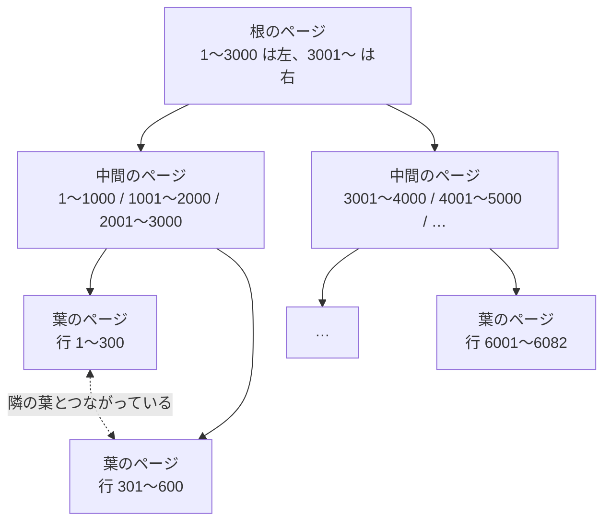

# 10 データの置き方

## この章で分かるようになること

- InnoDB が行を、どんな形でディスクとメモリに置いているか（ページ、B+tree、クラスタインデックス）
- セカンダリインデックスの葉には主キーが入っていることと、そこから来る「主キーは短く、増える順に」という考え方
- 主キーの選び方で、ページの詰まり方と書き込みの速さが変わること

## 解説

### ページ: 読み書きの単位

InnoDB は、データを **ページ** という単位で読み書きする。大きさは既定で 16KB（`innodb_page_size`。データディレクトリを作るときに決まって、後から変えられない）。1行だけを読むときでも、その行が入っている 16KB のページを丸ごとメモリ（バッファプール）に読み込む。

テーブルは、テーブルごとの表領域のファイル（`.ibd`）に入っていて、ファイルの中はページの並びになっている。1つのページの中身は、だいたい次のようになっている。

```text
┌──────────────── 16KB のページ ────────────────┐
│ ページの見出し（ページの番号、前後のページ、LSN など） │
├───────────────────────────────────────────────┤
│ 行 ─▶ 行 ─▶ 行 ─▶ 行 ─▶ …（キーの順につながっている）  │
│                                                 │
│ 空き                                            │
├───────────────────────────────────────────────┤
│ ページの中の目次（二分探索で行を探すため）        │
│ 末尾（壊れていないかを確かめるチェックサム）      │
└───────────────────────────────────────────────┘
```

ページの見出しには、そのページを最後に書き換えたときの LSN（[01章](01_overview.md)）も入っている。クラッシュした後に、どのページに redo をやり直せばよいかを判断するのに使う（[12章](12_redo.md)）。

### B+tree: ページをつないだ木

インデックスは、ページを木の形につないだ **B+tree** になっている。



- 根と中間のページには「このキーの範囲は、このページの下にある」という道案内だけが入っている
- 葉のページに、本当のデータが入っている。葉は隣どうしでつながっていて、範囲の検索（`BETWEEN` や `ORDER BY`）は葉を横にたどって読む
- 1つのページに道案内が数百個入るので、数百万行のテーブルでも木の高さは3〜4段で済む。主キーで1行を探すのに、ページを3〜4枚読めばよい

### クラスタインデックス: テーブルそのものが主キーの木

InnoDB では、**テーブルそのものが主キーの B+tree** になっている。主キーの木の葉のページに、行のすべての列がそのまま入っていて、行は主キーの順に並んでいる。これを **クラスタインデックス** と呼ぶ。行の置き場所と、主キーのインデックスが同じもの、ということ。

- 主キーがないテーブルでは、NULL を許さない UNIQUE のインデックスがあればそれを使う。それもなければ、InnoDB が見えない6バイトの行の番号を作って、それで並べる。この番号はサーバー全体で共有のカウンタから振られるので、主キーがないテーブルは何かと不利になる（[41章](41_mini_cdc.md)では、レプリケーションと CDC でも困ることを見る）
- 行には、見えない列が付いている。最後にその行を書き換えたトランザクションの番号（`DB_TRX_ID`）と、書き換える前の値（undo）への道しるべ（`DB_ROLL_PTR`）。[13章](13_undo_mvcc.md)の MVCC は、この2つを使って古い版を読む

PostgreSQL のように、行を順番のない置き場所（ヒープ）に置いて、インデックスはそこを指すだけ、というデータベースもある。InnoDB は違う、という点が、次の話に効いてくる。

### セカンダリインデックス: 葉には主キーが入っている

主キー以外のインデックス（**セカンダリインデックス**）も B+tree だけれど、葉には行のすべての列ではなく、**インデックスにした列と、主キーの値** が入っている。行がどのページにあるかという場所ではなく、主キーの値で行を指す。

```text
セカンダリインデックス（customer_id）        クラスタインデックス（主キー order_id）
┌─────────────────────────┐            ┌──────────────────────────────────┐
│ customer_id=5 → order_id=12 │ ──探す──▶ │ order_id=12 の行（全部の列）         │
│ customer_id=5 → order_id=87 │ ──探す──▶ │ order_id=87 の行（全部の列）         │
└─────────────────────────┘            └──────────────────────────────────┘
```

- セカンダリインデックスで行を探すと、まずセカンダリインデックスの木で主キーの値を見つけて、次にその値でクラスタインデックスの木をたどる。木を2回たどることになる
- クエリに必要な列が、セカンダリインデックスの列と主キーだけで足りるなら、2回目は要らない。これを **カバリングインデックス** と呼ぶ。EXPLAIN の `Extra` に `Using index` と出る
- 主キーの値は、セカンダリインデックスのすべての項目にコピーされる。主キーが長い（たとえば UUID を `CHAR(36)` の文字列で持つ）と、すべてのセカンダリインデックスが大きくなる

場所ではなく主キーで指しているのは、行が別のページに移っても（次の「ページの分割」で起きる）、セカンダリインデックスを書き換えなくて済むようにするため。

### 主キーの選び方とページの分割

行は主キーの順に並ぶので、新しい行は、主キーの値に合った葉のページに入る。ページがいっぱいなら、ページを分割して場所を作る。この動き方が、主キーの選び方で大きく変わる。

- **増えていく主キー（`AUTO_INCREMENT` など）**: 新しい行は、いつもいちばん右の葉に入る。右端のページがいっぱいになったら、右に新しいページを足す。すでにある行は動かないので、ページはほぼいっぱい（16分の15程度）まで詰まる
- **ランダムな主キー（UUID のバージョン4、乱数など）**: 新しい行は、木のあちこちの葉に入る。いっぱいのページに入れようとすると、ページを半分ずつに分けて、中身の半分を新しいページに移す。ページは平均すると7割くらいしか詰まらないので、同じ行数でもページが増える。書き込むページもあちこちに散らばる

ランダムな主キーの害がいちばん大きいのは、テーブルがバッファプールに収まらないとき。書き込むたびに、あちこちのページをディスクから読み直すことになる（[11章](11_buffer_pool.md)）。

MySQL の `UUID()` が返すのは時刻から作るバージョン1の UUID だけれど、文字列の先頭が時刻の細かい部分なので、そのままでは並びの順がほぼランダムになる。主キーに使うなら、`UUID_TO_BIN(UUID(), 1)` で時刻の部分を前に並べ替えて、16バイトの `BINARY(16)` にする。アプリケーションで作るなら、時刻の順に並ぶバージョン7の UUID も選べる。

### Spark や Snowflake と比べると

InnoDB は行指向で、1つのページに行のすべての列をまとめて置く。Parquet や Snowflake のマイクロパーティションは列指向で、列ごとにまとめて置く。

並び順の考え方も似ているようで違う。InnoDB は、行が **いつも** 主キーの順に並ぶように、1件入れるたびにページを分割してでも並びを保つ。Snowflake のクラスタリングキーや、Delta Lake の Z-ORDER・Liquid Clustering は、データをある程度まとめて並べ替える作業を、後から（まとめて）やる。並べ替えの手間を、書き込みのたびに払うか、後でまとめて払うかの違いになっている。

## 手を動かして確かめる

### 実験1: テーブルのページの数を数える

**予想:** `orders`（6,082行）と `order_items`（14,570行）は、それぞれ何ページくらいになっている？ 1ページに何行くらい入っている？

```sql
ANALYZE TABLE orders, order_items;
SELECT table_name, n_rows, clustered_index_size, sum_of_other_index_sizes
FROM mysql.innodb_table_stats
WHERE database_name = 'lab';
```

データが入っている葉のページの数も見る。

```sql
SELECT table_name, stat_name, stat_value
FROM mysql.innodb_index_stats
WHERE database_name = 'lab' AND table_name IN ('orders', 'order_items')
  AND index_name = 'PRIMARY' AND stat_name IN ('size', 'n_leaf_pages');
```

ここを見る: `clustered_index_size`（主キーの木に割り当てたページの数）と `sum_of_other_index_sizes`（セカンダリインデックスのページの数）。`n_leaf_pages`（データが入っている葉のページの数）との違い。

<details>
<summary>何が起きたか</summary>

| テーブル | 行の数 | 割り当てたページ（`size`） | 葉のページ（`n_leaf_pages`） | セカンダリインデックスのページ |
|---|---|---|---|---|
| `orders` | 6,082 | 20 | 19 | 0 |
| `order_items` | 14,570 | 97 | 38 | 0 |

葉のページで割ると、`orders` は1ページに約320行、`order_items` は約380行入っている。1行が数十バイトの小さいテーブルなので、16KB に多く入る。セカンダリインデックスのページが 0 なのは、この環境のテーブルに主キー以外のインデックスを張っていないため。

`order_items` で、割り当てたページ（97）が葉のページ（38）よりずっと多いのは、InnoDB が場所を確保する単位のため。小さいうちは1ページずつ確保するけれど、ある程度大きくなると64ページ（1MB）ずつまとめて確保する。まだ使っていないページも「割り当てたページ」に数えられる。データが実際に入っているページの数を知りたいときは `n_leaf_pages` を見る（[11章](11_buffer_pool.md)で、`order_items` を全部読むとバッファプールに載るのが39ページ = 葉38 + 根1 になることを確かめる）。

`mysql.innodb_table_stats` の数字は、`ANALYZE TABLE` をしたときに数えた統計で、ふだんはオプティマイザが実行計画を決めるのに使っている。

</details>

### 実験2: 主キーが増えていく場合とランダムな場合を比べる

**予想:** 同じ20万行を、`AUTO_INCREMENT` の主キーのテーブルと、ランダムな16バイトの主キーのテーブルに入れる。ページの数、分割の回数、時間は、それぞれどうなる？

```bash
make sh
python /lab/labs/10/pk_compare.py --rows 200000
```

ここを見る: `seq_pages` と `rand_pages`、`seq_splits` と `rand_splits`、`seq_ms` と `rand_ms`。

<details>
<summary>何が起きたか</summary>

確かめたときの結果は、次のようになった。

| | ページ | 分割の回数 |
|---|---|---|
| 増えていく主キー | 1,700 | 1,683 |
| ランダムな主キー | 2,919 | 2,520 |

入れ終わるまでの時間は、ランダムな主キーのほうが長くかかった（確かめたときは1.5倍くらい）。時間は環境によって変わるので、自分の環境で測って比べる。

ランダムな主キーは、同じ行数なのにページが約1.7倍になる。ページが平均して7割くらいしか詰まっていないため。

増えていく主キーでも、分割の回数はページの数とほぼ同じだけ数えられている。右端のページがいっぱいになるたびに「新しいページを足す」ことも、分割として数えられるため。ただし、このときは行を動かしていない。ランダムな主キーの分割は、いっぱいのページの中身を半分移すもので、同じ「分割」でも重さが違う。

この実験では、20万行のテーブルがバッファプール（128MB）に収まっているので、差は2倍に届かない。テーブルがバッファプールより大きくなると、ランダムな主キーの書き込みは、あちこちのページをディスクから読み直すようになって、差がもっと開く。

</details>

### 実験3: セカンダリインデックスに主キーが入っていることを確かめる

**予想:** `k` だけにインデックスを張ったテーブルで、`SELECT id … WHERE k = 5` と `SELECT v … WHERE k = 5` は、どちらがインデックスだけで済む？

実験2で作った `dba10` データベースに、テーブルを作って調べる。

```sql
CREATE TABLE dba10.sec (id INT PRIMARY KEY, k INT, v CHAR(50), KEY k (k));
INSERT INTO dba10.sec SELECT order_id, customer_id, status FROM orders;
EXPLAIN SELECT id FROM dba10.sec WHERE k = 5;
EXPLAIN SELECT v FROM dba10.sec WHERE k = 5;
```

終わったら、`dba10` を消す。

```sql
DROP DATABASE dba10;
```

ここを見る: 2つの EXPLAIN の `Extra` の列。

<details>
<summary>何が起きたか</summary>

`SELECT id` のほうだけ、`Extra` に `Using index` と出る。インデックスにしたのは `k` だけなのに、`id`（主キー）もインデックスだけで返せている。セカンダリインデックスの葉に、主キーの値が入っている証拠になる。

`SELECT v` は、`k` のインデックスで主キーの値を見つけてから、クラスタインデックスをたどって `v` を取りに行くので、`Using index` にならない。

</details>

### 実験4: 大きいテーブルを作る（次の章の準備）

**予想:** `orders` を200回なぞった約120万行のテーブルは、何 MB くらいになる？ バッファプール（128MB）と比べてどう？

```bash
make big
```

```sql
SELECT TABLE_ROWS, ROUND(DATA_LENGTH / 1024 / 1024) AS data_mb
FROM information_schema.TABLES
WHERE TABLE_SCHEMA = 'lab_big';
SELECT COUNT(*) FROM lab_big.orders_big;
```

ここを見る: `data_mb`。`TABLE_ROWS` と `COUNT(*)` の違い。

<details>
<summary>何が起きたか</summary>

約143MB になって、バッファプール（128MB）より大きい。[11章](11_buffer_pool.md)では、このテーブルを使ってバッファプールの動きを見る。

`TABLE_ROWS` は約120万の近い値になるけれど、`COUNT(*)` の正確な値（1,216,400）とは少しずれる。`information_schema.TABLES` の行の数は、いくつかのページを見て見積もった統計の値で、正確な件数ではない。

</details>

## Aurora ではどうなる？

### 同じところ

- ページの形、B+tree、クラスタインデックス、セカンダリインデックスの葉に主キーが入ること、主キーの選び方が効くことは、全部同じ。Aurora のストレージに置かれているのも、InnoDB のページになっている
- だから「主キーは短く、増える順に」という考え方は、そのまま Aurora にも当てはまる。ランダムな UUID の主キーは、ページの数もセカンダリインデックスも大きくする

### 違うところ

- **ページを置く場所**: Aurora では、ページはクラスターボリューム（共有のストレージ）にあって、インスタンスは手元のファイルにページを書かない（[01章](01_overview.md)・[12章](12_redo.md)）。バッファプールにないページを読むときは、ネットワーク越しにストレージから読むことになる（[11章](11_buffer_pool.md)）。ランダムな主キーで書き込む場所が散らばると、その分だけストレージからの読み込みが増える
- **費用**: Aurora のストレージは、使っている容量で課金される。ページの詰まり方が悪いテーブルは、そのまま費用にも効く。テーブルやデータベースを消す（`DROP TABLE`、`TRUNCATE TABLE`、`DROP DATABASE`）と、課金される容量も減る。`DELETE` で行を消しただけでは、空いた場所はそのテーブルの中で使い回されるだけで、容量は減らない。減らしたいときは、`OPTIMIZE TABLE` でテーブルを作り直す（`innodb_file_per_table` が ON のとき）。使っている容量は CloudWatch の `VolumeBytesUsed` で見られる

- **8.4 互換版**: 同じ。AWS は、8.4 互換版は最新の v3 と同じ Aurora の機能を持つ、としている（違うのは例外の一覧にあるものだけ。[00章](00_setup.md)）

### 業務の Aurora で見てみるなら

業務の Aurora を触れる立場なら、大きいテーブルと、主キーのないテーブルを探してみる。`mysql.innodb_table_stats` は統計の小さいテーブルなので、読むのは軽い。

```sql
SELECT database_name, table_name, n_rows, clustered_index_size, sum_of_other_index_sizes
FROM mysql.innodb_table_stats
ORDER BY clustered_index_size DESC
LIMIT 10;
```

主キーのないテーブル（テーブルが非常に多いデータベースでは少し重いので、混んでいない時間に）:

```sql
SELECT t.TABLE_SCHEMA, t.TABLE_NAME
FROM information_schema.TABLES t
LEFT JOIN information_schema.TABLE_CONSTRAINTS c
  ON c.TABLE_SCHEMA = t.TABLE_SCHEMA AND c.TABLE_NAME = t.TABLE_NAME AND c.CONSTRAINT_TYPE = 'PRIMARY KEY'
WHERE t.TABLE_TYPE = 'BASE TABLE' AND c.CONSTRAINT_NAME IS NULL
  AND t.TABLE_SCHEMA NOT IN ('mysql', 'sys', 'performance_schema', 'information_schema');
```

- セカンダリインデックスのページの合計が、主キーの木より大きいテーブルはあるか（インデックスが多い、または主キーが長い）
- 主キーのないテーブルはあるか（[41章](41_mini_cdc.md)で、CDC とレプリケーションでの困りごとを見る）

業務の Aurora で見た値はこのリポジトリに書かない。

出典:

- [Amazon Aurora storage（AWS）](https://docs.aws.amazon.com/AmazonRDS/latest/AuroraUserGuide/Aurora.Overview.StorageReliability.html)
- [Managing performance and scaling for Aurora DB clusters（ストレージの容量が減る操作）（AWS）](https://docs.aws.amazon.com/AmazonRDS/latest/AuroraUserGuide/Aurora.Managing.Performance.html)

## 説明できるか確かめる

1. 1行だけを読むのに、16KB を読むことになるのはなぜ？（「ページ」）
2. InnoDB で「テーブルそのものが主キーのインデックス」とはどういう意味？（「クラスタインデックス」）
3. セカンダリインデックスで行を探すと、B+tree を何回たどる？ 1回で済むのはどんなとき？
4. 主キーをランダムな UUID にすると何が起きる？ 増えていく主キーだと何がよい？（「主キーの選び方とページの分割」）
5. 主キーの長さが、セカンダリインデックスの大きさに効くのはなぜ？

## この章のキーワード

- **ページ**: InnoDB の読み書きの単位。既定は 16KB
- **B+tree**: ページを木の形につないだもの。葉に本当のデータがあって、葉は隣どうしでつながっている
- **クラスタインデックス**: 主キーの B+tree。葉に行のすべての列が入っていて、テーブルそのものになっている
- **セカンダリインデックス**: 主キー以外のインデックス。葉には、インデックスにした列と主キーの値が入っている
- **カバリングインデックス**: クエリに必要な列がインデックスだけで足りること。EXPLAIN の `Using index`
- **ページの分割**: ページがいっぱいのときに、新しいページを作って場所を空けること。ランダムな主キーでは中身の半分が移る
- **表領域（.ibd）**: テーブルのページが入っているファイル
- **DB_TRX_ID と DB_ROLL_PTR**: 行に付いている見えない列。最後に書き換えたトランザクションと、undo への道しるべ
