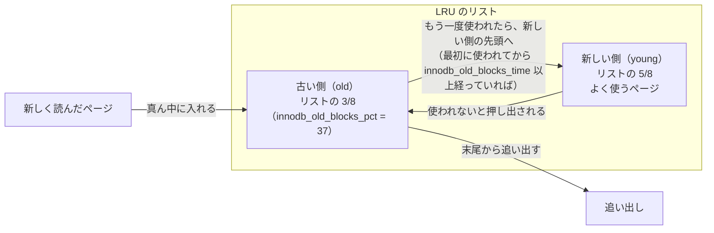

# 11 バッファプール

## この章で分かるようになること

- バッファプールとは何か。メモリの大半をここに使うのが定石になっている理由
- テーブルがバッファプールに収まるときと収まらないときで、何が変わるか
- 大きいテーブルを全部読んでも、よく使うページが追い出されにくい仕組み
- 書き換えたページ（ダーティページ）が、いつディスクに書かれるか

## 解説

### バッファプールとは

バッファプールは、InnoDB がページ（10章）を置いておくメモリの領域。行の読み書きは、必ずバッファプールの上のページで行う（01章）。

- 欲しいページがバッファプールにあれば、メモリの速さで済む（ヒット）
- なければ、ディスクから読んでくる（ミス）。メモリなら100ナノ秒くらいのところが、ディスクだと数百マイクロ秒から数ミリ秒かかる。数千倍から数万倍の差になる

この差が大きいので、データベース専用のサーバーでは、メモリの大半（5割から7割5分くらい）を `innodb_buffer_pool_size` に割り当てるのが定石になっている。よく使うデータ（ワーキングセット）がバッファプールに収まっていれば、ディスクを読むことはほとんどなくなる。

バッファプールのページは、次の3つのどれかになっている。

```text
バッファプール（この環境では 128MB = 8,192ページ）
├─ 空きのページ（free）
├─ データが入っているページ
│    ├─ ディスクと同じ中身のページ（クリーン）
│    └─ 書き換えたけれど、まだディスクに書いていないページ（ダーティ）
└─（どのページも LRU のリストのどこかにいて、いらなくなった順に追い出される）
```

読み取りのうち、何割がメモリで済んだかを **ヒット率** と呼ぶ。ステータス変数で計算できる。

- `Innodb_buffer_pool_read_requests`: バッファプールに対する読み取りの回数
- `Innodb_buffer_pool_reads`: そのうち、バッファプールになくてディスクから読んだ回数
- ヒット率 = 1 − `reads` ÷ `read_requests`

このほかに、InnoDB は順番に読んでいることに気づくと、先の64ページ（1MB）をまとめて読んでおく。これを **先読み**（read-ahead）と呼んで、`Innodb_buffer_pool_read_ahead` に数える。大きいテーブルを全部読むときは、ディスクからの読み込みの大部分が先読みになる。

### LRU と2つの区画

バッファプールがいっぱいになったら、いちばん長く使われていないページから追い出す（LRU、Least Recently Used）。ただし、素直な LRU には弱点がある。大きいテーブルを1回だけ全部読む処理（集計やダンプ）が来ると、そのページが次々に「最近使ったページ」になって、ふだんよく使っているページを全部追い出してしまう。

InnoDB は、LRU のリストを2つの区画に分けて、これを防いでいる。



- 新しく読んだページは、リストの先頭ではなく、古い側の先頭（真ん中）に入る
- 古い側にいる間にもう一度使われたら、新しい側の先頭に移る。ただし、最初に使われてから `innodb_old_blocks_time`（既定は1,000ミリ秒）より後に使われたときだけ
- 大きいテーブルを全部読むと、1ページに入っている数百行を続けて読むので、同じページを短い間に何度も使う。でも、1秒以内の使い直しなので、新しい側には移らない。読んだページは古い側を流れていって、そのまま追い出される

この仕組みのおかげで、夜中の集計やバックアップが大きいテーブルを読んでも、昼間のアプリケーションがよく使うページ（新しい側）は残る。

### ダーティページはいつ書かれるか

書き換えたページ（ダーティページ）は、コミットのときには書かれない（01章）。少し後で、裏方のスレッド（ページクリーナー）がまとめて `.ibd` に書き出す。書き出すきっかけは主に次の3つ。

- 空きのページが足りなくなった（LRU の末尾のダーティページは、書いてからでないと追い出せない）
- redo ログの空きが少なくなった。redo を使い回すには、その redo に対応するページを先に書き出しておく必要がある（12章のチェックポイント）
- ダーティページの割合が多くなった（`innodb_max_dirty_pages_pct`）

どれくらいの速さで書き出してよいかの目安が `innodb_io_capacity`。ダーティページの数は `Innodb_buffer_pool_pages_dirty` で見られる。

### 大きさを変える

`innodb_buffer_pool_size` は、動いている間に変えられる（02章で見たとおり動的）。変えるときは、`innodb_buffer_pool_chunk_size`（既定は128MB。この環境では16MB）の単位で増やしたり減らしたりする。進み具合は `Innodb_buffer_pool_resize_status` で見られる。減らすときは、追い出すページを片付けてから縮めるので、時間がかかることがある。

`innodb_buffer_pool_instances` は、バッファプールを内部でいくつかに分けて、取り合いを減らす設定。バッファプールが1GB 以上のときだけ効く。

### 再起動とウォームアップ

再起動した直後のバッファプールは空っぽで、しばらくはディスクを読んでばかりになって遅い。これを和らげるために、MySQL は止めるときに、よく使っていたページ（上位25%）の番号の一覧をデータディレクトリの `ib_buffer_pool` に書いておいて、起動した後に裏でそのページを読み直す（`innodb_buffer_pool_dump_at_shutdown`、`innodb_buffer_pool_load_at_startup`）。

## 手を動かして確かめる

### 実験1: バッファプールの中身を見る

**予想:** 今バッファプールにいちばん多く載っているテーブルは何？ ダーティページはどれくらいある？

```sql
SELECT object_schema, object_name, allocated, data, pages, pages_old
FROM sys.innodb_buffer_stats_by_table
ORDER BY pages DESC
LIMIT 5;
SHOW GLOBAL STATUS LIKE 'Innodb_buffer_pool_pages%';
```

このビューはバッファプールの全部のページを数えるので、大きいバッファプールでは重い。この環境（128MB）では問題ないけれど、本番では流さない。

ここを見る: `pages`（載っているページの数）と `pages_old`（そのうち古い側にいる数）。`Innodb_buffer_pool_pages_total`、`free`、`data`、`dirty`。

<details>
<summary>何が起きたか</summary>

10章で `make big` をした後なら、`lab_big.orders_big` が上位に来る。ページの多くが `pages_old`（古い側）にいるはずで、全部読んだテーブルのページが古い側を流れている様子が分かる。

`Innodb_buffer_pool_pages_total` は 8,192（128MB ÷ 16KB）。`free`（空き）と `data`（データが入っている）と、`dirty`（そのうちのダーティページ）の数が分かる。

</details>

### 実験2: バッファプールより大きいテーブルを2回読む

**予想:** バッファプールを 32MB（約2,000ページ）にして、約9,000ページのテーブルを2回続けて全部読む。2回目は、ディスクから読むページが減る？ バッファプールを 512MB にしたらどうなる？

```bash
make sh
python /lab/labs/11/scan.py --pool 32M
python /lab/labs/11/scan.py --pool 512M
```

時間の差も見たければ、`make a` で次の SQL を2回流して、表示される時間を比べる。

```sql
SELECT SUM(amount) FROM lab_big.orders_big;
```

ここを見る: `first_reads` と `second_reads`（ディスクから読んだページの数。必要になって読んだものと先読みの合計）。

<details>
<summary>何が起きたか</summary>

確かめたときの結果は、次のようになった。

| バッファプール | 1回目に読んだページ | 2回目に読んだページ |
|---|---|---|
| 32MB | 8,427 | 8,439 |
| 512MB | 7,042 | 0 |

32MB のときは、2回目もほぼ全部をディスクから読み直している。テーブルを先頭から順に読むと、新しいページを入れるたびにいちばん古いページを追い出す。読み終わる頃には、最初のほうのページはもう追い出されていて、2回目はまた先頭から全部ミスになる。キャッシュより大きいものを順に読むと、キャッシュは全く効かない。

512MB なら全部が収まるので、2回目はディスクを読まない（1回目が 9,000 ページより少ないのは、32MB のときに読んだページの一部が残っていたため）。テーブルやワーキングセットが収まるかどうかで、振る舞いががらっと変わる。

</details>

### 実験3: 大きいスキャンで、よく使うページが追い出されるか

**予想:** よく使っている `order_items` のページは、大きいテーブルを全部読んだ後もバッファプールに残っている？ `innodb_old_blocks_time` を 0 にするとどうなる？

```bash
python /lab/labs/11/scan_resistance.py --old-blocks-time 1000
python /lab/labs/11/scan_resistance.py --old-blocks-time 0
```

スクリプトは、バッファプールを 32MB にしてから、`order_items` を1秒以上あけて2回読んで（よく使うページにして）、大きいテーブルを全部読む。その前と後で、`order_items` のページがいくつ残っているかを数える。

ここを見る: `hot_before` と `hot_after`。

<details>
<summary>何が起きたか</summary>

| `innodb_old_blocks_time` | 前 | 後 |
|---|---|---|
| 1000（既定） | 39 ページ | 39 ページ |
| 0 | 39 ページ | 0 ページ |

既定では、`order_items` のページは1つも追い出されない。大きいテーブルのページは、1秒以内に何度も使われるだけなので新しい側に移らず、古い側だけを流れていく。

0 にすると、大きいテーブルのページが、2回目に使われた瞬間に新しい側の先頭へ移る。新しい側が大きいテーブルのページで埋まって、`order_items` のページは押し出されて消える。素直な LRU と同じ弱点が出る。

`order_items` が39ページなのは、データが入っている葉の38ページと、根の1ページの分（10章の実験1）。

</details>

### 実験4: ヒット率を計算する

**予想:** 起動してからのヒット率は何%？ 実験2の 32MB のスキャンの間のヒット率は何%？

```sql
SELECT
  (SELECT VARIABLE_VALUE FROM performance_schema.global_status
   WHERE VARIABLE_NAME = 'Innodb_buffer_pool_read_requests') AS read_requests,
  (SELECT VARIABLE_VALUE FROM performance_schema.global_status
   WHERE VARIABLE_NAME = 'Innodb_buffer_pool_reads') AS reads;
```

`1 − reads ÷ read_requests` を計算する。`SHOW ENGINE INNODB STATUS\G` の `Buffer pool hit rate` とも比べる。

ここを見る: 起動してからのヒット率の高さ。

<details>
<summary>何が起きたか</summary>

起動してからのヒット率は、99% を超える高い値になる。実験2で、32MB のプールでテーブル全部を2回読み直したのに、それが見えない。小さいテーブルへの読み取りの回数が多いので、大きいスキャンのミスが平均に埋もれてしまう。

起動してからの合計のヒット率は、ほとんど役に立たない。見るなら、03章の差分の考え方で、問題が起きた時間帯の前と後の差を取る。`SHOW ENGINE INNODB STATUS` の `Buffer pool hit rate` は、前の報告からの間の値なので、少しはましになる。

</details>

### 戻す

バッファプールを 128MB に戻して、`make state` で確かめる。

```sql
SET GLOBAL innodb_buffer_pool_size = 134217728;
```

## Aurora ではどうなる？

### 同じところ

- ライターとリーダーのインスタンスは、それぞれ自分のバッファプールを持っている。LRU の2つの区画、`innodb_old_blocks_time`、ヒット率の考え方は同じ
- だから「ワーキングセットがバッファプールに収まるか」が性能を大きく左右するのも同じ。インスタンスクラスを選ぶときに、メモリの大きさが効く

### 違うところ

- **既定の大きさ**: インスタンスのメモリの75%（パラメータグループの式で決まる）。インスタンスのパラメータグループの値なので、インスタンスクラスを変えると大きさも変わる
- **ミスしたとき**: バッファプールにないページは、ネットワーク越しにクラスターボリュームから読む（01章）
- **ダーティページ**: Aurora のライターは、ページをストレージに書き出さない（ストレージに送るのは redo だけ）。そのため、ダーティページを書き出すための調整（ページクリーナーまわり）は、普通の MySQL ほど意味を持たない（12章）
- **再起動しても冷えない**: Aurora MySQL のバッファプールは、データベースとは別のプロセスで管理されていて（survivable page cache）、データベースを再起動しても中身が残る。最初からキャッシュが温まっているので、`ib_buffer_pool` のようなウォームアップを待たなくてよい。ただし、フェイルオーバーでは、新しくライターになったインスタンス（それまでのリーダー）のキャッシュは残り、それまでのライター（リーダーになる）のキャッシュは残らない
- **リーダーのキャッシュ**: リーダーはそれぞれ自分のキャッシュを持つので、どのリーダーにどんな読み取りが行くかで、ヒット率が変わる
- **画面で見る**: CloudWatch の `BufferCacheHitRatio` で、時間ごとのヒット率が見られる（実験4の「合計ではなく差分で見る」を、画面がやってくれている）

### 業務の Aurora で見てみるなら

業務の Aurora を触れる立場なら、次の軽い読み取りを流してみる。

```sql
SELECT @@innodb_buffer_pool_size / 1024 / 1024 / 1024 AS buffer_pool_gb,
       @@innodb_old_blocks_time, @@innodb_old_blocks_pct;
SHOW GLOBAL STATUS WHERE Variable_name IN
  ('Innodb_buffer_pool_read_requests', 'Innodb_buffer_pool_reads', 'Innodb_buffer_pool_pages_dirty');
```

`sys.innodb_buffer_stats_by_table` と `information_schema.INNODB_BUFFER_PAGE` は、バッファプールの全部のページを数えるので重い。本番では流さない。ヒット率の移り変わりは、CloudWatch の `BufferCacheHitRatio` で見る。

業務の Aurora で見た値はこのリポジトリに書かない。

出典:

- [Amazon Aurora reliability（survivable page cache）（AWS）](https://docs.aws.amazon.com/AmazonRDS/latest/AuroraUserGuide/Aurora.Overview.Reliability.html)
- [Help prevent out-of-memory restarts on Aurora MySQL 8.4（バッファプールの既定の大きさ）（AWS Database Blog）](https://aws.amazon.com/blogs/database/help-prevent-out-of-memory-restarts-on-aurora-mysql-8-4/)

## 説明できるか確かめる

1. データベース専用のサーバーで、メモリの大半をバッファプールに使うのが定石なのはなぜ？
2. バッファプールより大きいテーブルを順に読むと、2回目もディスクから読むことになるのはなぜ？（実験2）
3. 大きいスキャンが来ても、よく使うページが追い出されにくいのはなぜ？ `innodb_old_blocks_time` は何を決めている？（「LRU と2つの区画」）
4. 起動してからのヒット率が 99.9% でも、安心できないのはなぜ？（実験4）
5. Aurora で再起動した直後から速いのはなぜ？ フェイルオーバーの後はどうなる？

## この章のキーワード

- **バッファプール**: InnoDB がページを置いておくメモリの領域。読み書きは必ずここを通る
- **ヒット率**: 読み取りのうち、メモリで済んだものの割合
- **ワーキングセット**: よく使うデータの量。バッファプールに収まるかどうかが性能を大きく左右する
- **LRU の新しい側と古い側**: よく使うページの区画と、新しく読んだページが入る区画。大きいスキャンから、よく使うページを守る
- **innodb_old_blocks_time**: 古い側のページが新しい側に移るのに必要な、最初の使用からの時間（ミリ秒）
- **ダーティページ**: 書き換えて、まだディスクに書いていないページ。ページクリーナーが後で書き出す
- **先読み（read-ahead）**: 順に読んでいることに気づいたときに、先のページをまとめて読んでおく仕組み
- **survivable page cache**: Aurora の、再起動しても中身が残るバッファプール
