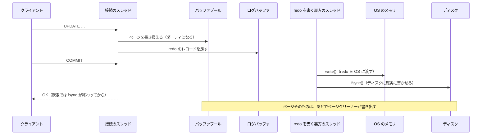

# 12 redo ログとクラッシュリカバリ

## この章で分かるようになること

- 「コミットした」とは、何がどこまで書かれた状態のことか
- `innodb_flush_log_at_trx_commit` の 0・1・2 で何が変わって、何を失いうるか
- チェックポイント、redo ログの大きさ、doublewrite の役割
- MySQL が落ちた後に、どうやって元に戻るか（クラッシュリカバリ）
- Aurora が、このあたりの仕組みをどう置き換えているか

## 解説

### WAL: 先にログを書く

01章で見たとおり、コミットの時点でディスクに書かれているのは redo ログ（と binlog）の追記だけで、書き換えたページ（ダーティページ）はまだバッファプールの中にある。ページは後でページクリーナーがまとめて書き出す（11章）。

なぜこうするのか。ページを書くには、ファイルのあちこちに 16KB ずつ書くことになって遅い。redo ログは「どのページのどこをどう変えたか」という小さな記録を、ファイルの末尾に順に足していくだけなので速い。そして、もし MySQL が落ちても、redo ログを読み直せば、書き出せていなかったページの変更をやり直せる。これが WAL（Write-Ahead Logging、先にログを書く）の考え方。



### write と fsync

ここで、ファイルに書く操作が2段階になっていることを押さえておく。

```text
MySQL のメモリ（ログバッファ）
   │ write()   … 速い。OS のメモリ（ページキャッシュ）に渡すだけ
   ▼
OS のメモリ
   │ fsync()   … 遅い（数百マイクロ秒〜数ミリ秒）。ディスクに確実に書かせる
   ▼
ディスク
```

- `write()` が終わった時点で、データは OS のメモリにある。mysqld のプロセスだけが落ちても、OS が生きていれば、OS が後でディスクに書いてくれるので消えない
- OS ごと落ちたり、電源が切れたりすると、OS のメモリにあって、まだディスクに書かれていなかったデータは消える
- `fsync()` が終われば、OS や電源が落ちても消えない

### innodb_flush_log_at_trx_commit の 0・1・2

コミットのときに、redo ログをどこまで書いてからクライアントに OK を返すかを決めるのが `innodb_flush_log_at_trx_commit`。

| 値 | コミットした接続が待つもの | 裏で起きること | mysqld だけが落ちたら | OS や電源が落ちたら |
|---|---|---|---|---|
| 1（既定） | `write()` と `fsync()` が終わるまで | — | 消えない | 消えない |
| 2 | `write()` が終わるまで | 約1秒ごとに `fsync()` | 消えない | 直前の最大約1秒分が消えうる |
| 0 | 何も待たない | 裏方のスレッドが `write()`、約1秒ごとに `fsync()` | まだ OS に渡していない直前の分が消えうる | 直前の最大約1秒分が消えうる |

- **1** は、コミットのたびに `fsync()` を待つので、コミットの速さが `fsync()` の速さで決まる。そのかわり、OK を返したものは何があっても消えない
- **2** は、`fsync()` を待たない分だけ速い。mysqld が落ちても消えないけれど、OS や電源が落ちると直前の分が消える
- **0** は、いちばん速い。ただし mysqld が落ちただけでも、まだ書いていない分が消える。マニュアルの説明は「1秒に1回書いて同期する」で、最大で約1秒分が消えうると考える。MySQL 8.0 以降は、redo を書く専用のスレッドがすぐに書いてくれるので、実際に消えるのは直前のわずかな分であることが多い（実験2）。ただ、それは保証ではない

0 や 2 を使うのは、消えても作り直せる場面（大量のデータの読み込み、作り直せるレプリカ、試験の環境など）に限るのが定石。binlog を使っているときは、`sync_binlog` も合わせて考える必要があって、安全な組み合わせは「両方1」になる（22章）。

### LSN とチェックポイント

redo ログには、書き始めてからのバイト数を表す番号 LSN が付いている（01章）。InnoDB は、3つの LSN を気にしている。

- **現在の LSN**: redo をログバッファにどこまで書いたか
- **同期した LSN**: どこまでディスクに同期したか
- **チェックポイントの LSN**: それより前の変更は、すべてページとして `.ibd` に書き出し済み、という位置。ここより前の redo は、クラッシュしてもやり直す必要がない

redo ログは決まった大きさ（`innodb_redo_log_capacity`。既定は100MB）の中で、古いところから使い回す。使い回せるのは、チェックポイントより前の部分だけ。

```text
redo ログ（100MB を使い回す）
  ───────────────────────────────────────────────▶ LSN が増える向き
  [ もう要らない ][ やり直しに要る部分 ][ これから書く ]
                 ▲                    ▲
          チェックポイントの LSN      現在の LSN
                 └──── チェックポイントの遅れ ────┘
```

現在の LSN とチェックポイントの LSN の差を、**チェックポイントの遅れ**（checkpoint age）と呼ぶ。書き込みが続くと遅れが大きくなって、redo ログの大きさに近づくと、InnoDB はダーティページを急いで書き出してチェックポイントを進めようとする。間に合わないと、書き込みが止まる。書き込みの多い環境で redo ログが小さすぎると、こうした詰まりが起きる。

redo ログを大きくすると、書き込みが集中したときの余裕が増える。そのかわり、クラッシュした後にやり直す redo が増えるので、起動に時間がかかるようになる。`innodb_redo_log_capacity` は 8.0.30 から、動いている間に変えられる。redo ログは、データディレクトリの `#innodb_redo/` の中に、32個のファイルに分けて置かれている。

### doublewrite: ページの書きかけに備える

InnoDB のページは 16KB だけれど、OS やディスクが一度に書ける単位はもっと小さい（4KB など）。ページを書いている途中で落ちると、前半は新しく後半は古い「書きかけのページ」ができてしまう。redo は「正しいページにこの変更を足す」という記録なので、壊れたページは redo では直せない。

そこで InnoDB は、ページを本来の場所に書く前に、まず doublewrite 用のファイル（`#ib_16384_0.dblwr` など）に順に書いておく。落ちた後に書きかけのページが見つかったら、doublewrite の写しから元に戻してから、redo をやり直す。書く量は増えるけれど、順に書くだけなので、2倍遅くなるわけではない。`innodb_doublewrite`（既定で ON）で切り替える。

### クラッシュリカバリの流れ

mysqld が落ちた後に起動すると、エラーログ（`docker compose logs src`）に次のような記録が残る（実験3で実際に見る）。

```text
[InnoDB] Database was not shutdown normally!
[InnoDB] Starting crash recovery.
[InnoDB] Starting to parse redo log at lsn = 1125218837, whereas checkpoint_lsn = 1125219075 …
[InnoDB] Doing recovery: scanned up to log sequence number 1125219355
[InnoDB] Applying a batch of 1 redo log records ...
[InnoDB] Apply batch completed!
[Server] Recovering after a crash using binlog
[Server] Starting XA crash recovery...
[Server] XA crash recovery finished.
[InnoDB] Starting in background the rollback of uncommitted transactions
[InnoDB] Rolling back trx with id 68890, 6082 rows to undo
[InnoDB] Rollback of non-prepared transactions completed
[Server] /usr/sbin/mysqld: ready for connections.
```

1. **落ちたことに気づく**: 普通に止まっていないと分かったら、復旧を始める
2. **やり直し（roll forward）**: チェックポイントから redo を読んで、書き出せていなかった変更をページに反映し直す。書きかけのページは doublewrite で直す
3. **binlog との突き合わせ**: コミットの途中（準備まで済んでいた）のトランザクションを、binlog に書かれていたかどうかで、確定するか取り消すかを決める（22章）
4. **取り消し（rollback）**: コミットしていなかったトランザクションを、undo を使って取り消す。これは裏で進めながら、接続を受け付け始める

redo で「コミット済みのものを確実に残す」、undo で「コミットしていないものを確実に消す」。この2つで、トランザクションの約束（コミットしたものは消えない、途中のものは残らない）が守られる。

## 手を動かして確かめる

### 実験1: 0・1・2 で、fsync の回数と時間を比べる

**予想:** 2,000件を1件ずつコミットすると、redo の `fsync()` は何回になる？ 0・1・2 で時間はどう変わる？

binlog の同期の影響を外すために、`sync_binlog` を 0 にしてから始める（binlog の話は22章）。A で設定を変える。

```sql
SET GLOBAL sync_binlog = 0;
SET GLOBAL innodb_flush_log_at_trx_commit = 1;
```

別のターミナルで、2,000件のコミットを流す。

```bash
make sh
bash /lab/labs/common/commit_bench.sh src 2000
```

A で `innodb_flush_log_at_trx_commit` を 2、0 に変えて、それぞれ同じように流す。

ここを見る: `elapsed_ms`（かかった時間）と `redo_fsyncs`（redo の fsync の回数）。

<details>
<summary>何が起きたか</summary>

確かめたときの結果は、次のようになった（時間は環境によって変わる。Docker Desktop では fsync が速く、差が小さく出ることがある）。

| 値 | 時間 | redo の fsync |
|---|---|---|
| 1 | 約1.1〜1.3秒 | 約2,000回以上 |
| 2 | 約0.4〜0.5秒 | 0回 |
| 0 | 約0.3〜0.4秒 | 0回 |

1 は、コミットのたびに fsync するので、回数がコミットの数と同じくらいになる（裏方の同期の分が少し加わる）。2 と 0 は、約1秒ごとの同期だけなので、0.5秒で終わる今回は1回も数えられなかった。1件ずつコミットする書き込みでは、fsync の速さがそのまま速さの上限になる。

</details>

### 実験2: kill -9 で、コミット済みのものが消えるか

**予想:** 0 にして、書き込みの途中で mysqld を kill -9 で落とす。コミット済みと返事をもらった行は、再起動した後に全部残っている？ 1 と 2 ではどう？

A で 0 にする。

```sql
SET GLOBAL innodb_flush_log_at_trx_commit = 0;
SET GLOBAL sync_binlog = 0;
```

ターミナルを2つ使う。1つ目で、1件ずつコミットし続けるスクリプトを流す。コミットが成功するたびに `acked=番号` を出す。

```bash
make sh
python /lab/labs/common/acked_inserts.py --host src --table dba12.acked0 --seconds 60
```

数秒たったら、2つ目のターミナルで mysqld を落として、起動し直す。

```bash
make crash
```

1つ目のターミナルの最後の `acked=` の番号と、`make a` で繋ぎ直して数えた件数を比べる。

```sql
SELECT COUNT(*) FROM dba12.acked0;
```

再起動すると設定ファイルの値（1）に戻るので、同じことを 1（テーブルは `dba12.acked1`）と 2（`dba12.acked2`）でも、A で設定し直してから試す。

ここを見る: 最後の `acked=` と、`COUNT(*)` の差。

<details>
<summary>何が起きたか</summary>

確かめたときの結果は、次のようになった。

| 値 | コミット済みと返った件数 | 再起動後に残った件数 |
|---|---|---|
| 0 | 11,387 | 11,370（17件消えた） |
| 1 | 3,944 | 3,944 |
| 2 | 8,562 | 8,562 |

0 だけ、コミット済みと返事をしたのに消えた行がある。消えたのは、redo を書く裏方のスレッドが、まだ OS に渡していなかった直前の分。消える件数は落ちた瞬間によって変わって、何回か試すと2件のときもあった。運が良いと0件のこともある。「たまたま消えなかった」と「消えない」は違う。

2 は、mysqld のプロセスが落ちただけなら、redo は OS のメモリに残っているので消えない。OS ごと落ちたときに消えうる、という違いはこの実験では試せない（Docker の中では、OS ごと落とせないため）。

コミットの数（`acked`）が設定ごとに違うのは、3秒で落とすまでに流せた件数が、設定の速さで違うから。1 がいちばん少ない。

</details>

### 実験3: コミットしていない変更は、落ちた後に取り消される

**予想:** コミットしないまま mysqld が落ちたら、その変更は、再起動した後にどうなる？

A で、コミットしないで6,082行を入れる。

```sql
CREATE TABLE dba12.u (id INT PRIMARY KEY);
BEGIN;
INSERT INTO dba12.u SELECT order_id FROM orders;
```

`COMMIT` はしないまま、別のターミナルで落とす。復旧の記録が表示される。

```bash
make crash
```

`make a` で繋ぎ直して数える。

```sql
SELECT COUNT(*) FROM dba12.u;
```

ここを見る: `make crash` が表示する記録と、件数。

<details>
<summary>何が起きたか</summary>

件数は 0。`make crash` の表示に、`Rolling back trx with id …, 6082 rows to undo` と `Rollback of non-prepared transactions completed` が出る。コミットしていなかったトランザクションの6,082行を、undo を使って取り消した記録になる。

解説の「クラッシュリカバリの流れ」の4つの段階が、`docker compose logs src` で順に見られる。

</details>

### 実験4: チェックポイントの遅れを見る

**予想:** 書き込みが続いている間、現在の LSN とチェックポイントの LSN の差（チェックポイントの遅れ）はどうなる？ 書き込みが止まった後は？

1つ目のターミナルで、長めの書き込みを流す。

```bash
make sh
bash /lab/labs/common/commit_bench.sh src 20000
```

その間に、A で次の SQL を何度か流す。書き込みが終わった後も、少し待ってから流す。

```sql
SELECT
  (SELECT VARIABLE_VALUE FROM performance_schema.global_status WHERE VARIABLE_NAME = 'Innodb_redo_log_current_lsn')
  - (SELECT VARIABLE_VALUE FROM performance_schema.global_status WHERE VARIABLE_NAME = 'Innodb_redo_log_checkpoint_lsn')
  AS checkpoint_age;
```

ここを見る: `checkpoint_age` の変わり方。redo ログの大きさ（100MB）と比べてどれくらいか。

<details>
<summary>何が起きたか</summary>

書き込みが続いている間は、数MB くらいの遅れが出る（確かめたときは最大で約3.3MB）。ページクリーナーがダーティページを書き出すにつれてチェックポイントも進むので、遅れはどこまでも増えるわけではない。書き込みが止まると、やがて遅れは 0 に戻る（03章の実験4で、何もしていないときに3つの LSN がそろっていたのと同じ状態）。

redo ログの 100MB に比べて遅れが十分小さければ、redo の大きさは足りている。遅れが大きさに近づくような書き込みの多い環境では、`innodb_redo_log_capacity` を大きくすることを考える。

</details>

### 実験5: redo ログと doublewrite のファイルを見る

**予想:** redo ログは何個のファイルに分かれている？ doublewrite のファイルはどこにある？

```bash
make sh
ls -la /var/lib/mysql-src/#innodb_redo/
ls -la /var/lib/mysql-src/ | grep dblwr
```

```sql
SELECT @@innodb_redo_log_capacity / 1024 / 1024 AS redo_mb, @@innodb_doublewrite;
```

ここを見る: ファイルの数と大きさ。

<details>
<summary>何が起きたか</summary>

`#innodb_redo/` には32個のファイルがあって、1つは約3.2MB（100MB ÷ 32）。名前に `_tmp` が付いていないものが、今使っている redo ログで、`_tmp` が付いているのは、使い回すときのための予備。doublewrite のファイルは `#ib_16384_0.dblwr` と `#ib_16384_1.dblwr` で、名前の 16384 はページの大きさ（16KB）を表している。`@@innodb_doublewrite` は `ON`。

</details>

### 戻す

A で設定を戻して、実験用のデータベースを消す。`make state` で確かめる。

```sql
SET GLOBAL innodb_flush_log_at_trx_commit = 1;
SET GLOBAL sync_binlog = 1;
DROP DATABASE dba12;
```

## Aurora ではどうなる？

### 同じところ

- コミットは「redo が確実に書かれてから OK を返す」、という WAL の考え方は同じ
- コミットしていなかったトランザクションを、undo で取り消すことも同じ
- `innodb_flush_log_at_trx_commit` というパラメータもある（ただし意味が変わる。次の節）

### 違うところ

- **redo の行き先**: ライターは redo のレコードを、手元のファイルではなく、クラスターボリュームに送る（3つの AZ に6つのコピー。01章）。コミットで待つのは、手元の fsync ではなく、ストレージが受け取ったという確認になる。03章で見た待機イベント `io/redo_log_flush` は、この待ち
- **ページを書かない**: インスタンスはページを書き出さない。ストレージに送るのは redo だけで、ページはストレージの側で、redo を使ってずっと組み立て続けている。そのため、インスタンスの側にはチェックポイントも、ページの書きかけに備える doublewrite もない。手元に redo のファイルを持たないので、その大きさ（`innodb_redo_log_capacity` のようなもの）を調整する、という話にもならない
- **クラッシュリカバリ**: redo はストレージで反映され続けているので、起動するときに redo をまとめてやり直す必要がない。落ちた後の起動がとても速い。コミットしていなかったトランザクションの取り消しは、普通の MySQL と同じように裏で行う
- **`innodb_flush_log_at_trx_commit` の意味**: Aurora では「ストレージの確認を待つかどうか」の設定になる
  - Aurora MySQL v2 では、0 か 2 なら待たない、1 なら待つ
  - v3 では、待たないのは 0 だけで、1 と 2 はどちらも待つ。普通の MySQL の「2 なら mysqld が落ちても消えない」という考え方は、そのまま当てはまらない
  - v3 で 1 以外にするには、先に `innodb_trx_commit_allow_data_loss` を 1 にして、データが消えうることを認める必要がある

### 業務の Aurora で見てみるなら

業務の Aurora を触れる立場なら、次の軽い読み取りを流してみる。

```sql
SELECT @@innodb_flush_log_at_trx_commit;
SELECT @@innodb_trx_commit_allow_data_loss;
```

2つ目は v3 にある変数で、環境によってはエラーになる。あわせて、Database Insights で `io/redo_log_flush` が負荷のどれくらいを占めているかを見る。大きければ、小さいコミットが多すぎないか（まとめてコミットできないか）を疑う（実験1の、1件ずつコミットすると fsync の速さが上限になる話と同じ構図）。

業務の Aurora で見た値はこのリポジトリに書かない。

出典:

- [Recommendations for MySQL features in Aurora MySQL（innodb_flush_log_at_trx_commit）（AWS）](https://docs.aws.amazon.com/AmazonRDS/latest/AuroraUserGuide/AuroraMySQL.BestPractices.FeatureRecommendations.html)
- [io/redo_log_flush（AWS）](https://docs.aws.amazon.com/AmazonRDS/latest/AuroraUserGuide/ams-waits.io-redologflush.html)
- [Introducing the Aurora Storage Engine（AWS Database Blog）](https://aws.amazon.com/blogs/database/introducing-the-aurora-storage-engine/)

## 説明できるか確かめる

1. コミットの時点で、ディスクに確実に書かれているのは何？ ページはいつ書かれる？（「WAL」）
2. `innodb_flush_log_at_trx_commit` の 0・1・2 では、それぞれ何がいつ起きる？ mysqld だけが落ちたときと、OS が落ちたときで、失うものはどう違う？
3. チェックポイントとは何？ redo ログが小さすぎると何が起きる？
4. doublewrite は何から守っている？ redo だけでは足りないのはなぜ？
5. Aurora では、なぜ起動するときに redo をまとめてやり直さなくてよい？ `innodb_flush_log_at_trx_commit` の意味は、どう変わる？

## この章のキーワード

- **redo ログ**: どのページをどう変えたかの記録。クラッシュした後に、変更をやり直すのに使う
- **WAL（Write-Ahead Logging）**: データより先にログを書く考え方
- **write と fsync**: OS のメモリに渡すことと、ディスクに確実に書かせること
- **innodb_flush_log_at_trx_commit**: コミットのときに、redo をどこまで書いてから OK を返すかの設定
- **チェックポイント**: それより前の変更はすべてページとして書き出し済み、という位置
- **チェックポイントの遅れ（checkpoint age）**: 現在の LSN とチェックポイントの LSN の差
- **innodb_redo_log_capacity**: redo ログの大きさ。8.0.30 から動いている間に変えられる
- **doublewrite**: ページを本来の場所に書く前に、写しを書いておく仕組み。書きかけのページに備える
- **クラッシュリカバリ**: redo でやり直して（roll forward）、undo でコミットしていないものを取り消す（rollback）
