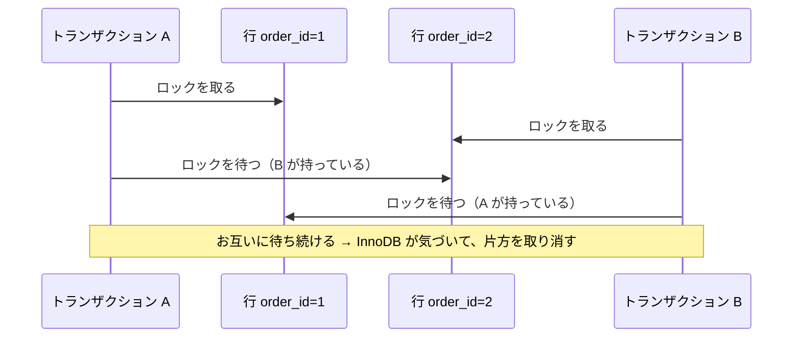

# 14 ロック

## この章で分かるようになること

- 行ロックが「行」ではなく「インデックスのレコード」にかかることと、そのせいで起きること
- レコードロック、ギャップロック、ネクストキーロックの違いと、それぞれが何から守っているか
- ロック待ちとデッドロックの見つけ方と、報告の読み方

## 解説

### ロックは何のためにあるか

普通の SELECT は、MVCC のおかげでロックなしで読める（[13章](13_undo_mvcc.md)）。けれど、2つのトランザクションが同じ行を同時に書き換えたら、どちらかの変更が消えてしまう。書く人同士は順番に並ばせる必要がある。これがロックの役目。

- **行ロック**: 共有ロック（S。読むためのロックで、S 同士はぶつからない）と、排他ロック（X。書くためのロックで、何ともぶつかる）がある。UPDATE と DELETE、`SELECT … FOR UPDATE` は X、`SELECT … FOR SHARE` は S を取る
- **インテンションロック**: 行にロックをかける前に、テーブルに「このテーブルの行をロックするつもり」という印（IS、IX）を付ける。テーブル全体をロックしたい操作が、行のロックを1つずつ確かめなくて済むようにするため
- ロックは、トランザクションが終わる（コミットかロールバック）まで持ち続ける。だから長いトランザクションは、ロックも長く持つ

### ロックは、行ではなくインデックスのレコードにかかる

InnoDB の行ロックは、「この行」という抽象的なものではなく、**SQL が行を探すときにたどったインデックスのレコード** にかかる。

- 絞り込みの列にインデックスがあれば、そのインデックスで当てはまるレコードだけをたどるので、ロックも当てはまる行のまわりだけで済む
- インデックスがなければ、テーブル（クラスタインデックス）を頭から全部たどることになる。たどったレコードには全部ロックがかかるので、**関係ない行まで全部ロックされる**。書き込みに対しては、テーブルをまるごとロックしたのと同じになる

この環境の `orders` は、`customer_id` にインデックスがない。`UPDATE … WHERE customer_id = 5` は6,082行を全部たどって、6,101個のロックを取った（実験1）。インデックスを足すと、ロックは63個になった（実験2）。本番で UPDATE や DELETE を流す前に、その WHERE がインデックスを使えるかを確かめる（EXPLAIN の読み方は `rdbms/` で扱う）のは、この理由から。

### レコードロック、ギャップロック、ネクストキーロック

インデックスのレコードにかかるロックには、範囲の違う3つの種類がある。`performance_schema.data_locks` の `LOCK_MODE` 列で見分けられる。

| 種類 | ロックする範囲 | `LOCK_MODE` の表示（X の場合） |
|---|---|---|
| レコードロック | そのレコードだけ | `X,REC_NOT_GAP` |
| ギャップロック | レコードとレコードの間のすき間だけ | `X,GAP` |
| ネクストキーロック | レコードと、その手前のすき間 | `X` |

**ギャップロック** は、すき間に新しい行が入ってくるのを止めるためのもの。REPEATABLE READ で、同じトランザクションの中で同じ範囲を2回読んだときに、2回目に新しい行が増えている（ファントム）ことがないようにする。INSERT は、入れたい場所のすき間に **挿入意図ロック** という特別なギャップロックを取ろうとして、ほかのトランザクションのギャップロックとぶつかると待たされる。

REPEATABLE READ で範囲を読むときは、基本がネクストキーロックになる。`customer_id` にインデックスを足したテーブルで、`SELECT … WHERE customer_id = 5 FOR UPDATE` をすると、次のようにロックがかかる（実験2）。

```text
customer_id のインデックス（customer_id と order_id の組で並んでいる）

… (4, 5585) │ (5, 115) (5, 601) … (5, 5594) │ (6, 99) (6, …) …
             └── X（ネクストキーロック）31個 ──┘    ▲
               レコードと、それぞれの手前のすき間    X,GAP（(5, 5594) と (6, 99) の間のすき間）

主キー（クラスタインデックス）
  order_id = 115, 601, …, 5594 の31行に X,REC_NOT_GAP（行だけ）
```

- 顧客5の31件のインデックスのレコードに、ネクストキーロック
- 顧客5の最後のレコードの後ろのすき間を、次のレコード（顧客6の先頭）のギャップロックで閉じる
- 実際の行（主キーのレコード）には、行だけのロック

こうして「顧客5の範囲」には、新しい行が入れなくなる。すき間の両端の都合で、顧客4の後ろのほうや顧客6の手前に入る INSERT まで待たされることがある点も覚えておく。

主キーや UNIQUE のインデックスで1行を `=` で指すときは、すき間に同じ値の行が入ってくることがないので、行だけのロック（レコードロック）で済む。

**READ COMMITTED** では、ギャップロックをほとんど使わない。ロックが減って、待ちやデッドロックも減る。その代わり、ファントムが起きうる（[13章](13_undo_mvcc.md)の「文ごとに新しく読む」と同じ考え方）。

### ロック待ちとタイムアウト

ほかのトランザクションが持っているロックとぶつかると、待つことになる。`innodb_lock_wait_timeout`（既定は50秒）待っても取れなければ、次のエラーになる。

```text
ERROR 1205 (HY000): Lock wait timeout exceeded; try restarting transaction
```

既定では、取り消されるのは **待っていた文だけ** で、トランザクションはそのまま続いている（`innodb_rollback_on_timeout` が OFF のため）。それまでの変更も、取ったロックも残っているので、アプリケーションはロールバックするかどうかを自分で決める必要がある。

待ちを調べる道具は次のとおり。

| 道具 | 何が分かる |
|---|---|
| `sys.innodb_lock_waits` | 誰が誰を待っているか。待っている側と原因の側の接続の番号とクエリ、待っている時間 |
| `performance_schema.data_locks` | 誰がどのレコードにどんなロックを持っているか |
| `performance_schema.data_lock_waits` | どのロックがどのロックを待っているか |

原因の接続が、ロックを持ったまま何もしていない（`SHOW PROCESSLIST` で `Sleep`）ことはよくある。[13章](13_undo_mvcc.md)の「開いたまま放置されたトランザクション」と同じで、このとき `sys.innodb_lock_waits` の `blocking_query` は NULL になる。今のクエリを見ても犯人が分からないので、`blocking_pid` から接続をたどる。

### デッドロック

2つのトランザクションが、お互いに相手の持っているロックを待つと、いつまでたっても進まない。これが **デッドロック**。



InnoDB はデッドロックにすぐ気づいて（`innodb_deadlock_detect`、既定で ON）、片方のトランザクションを丸ごと取り消す。取り消された側には次のエラーが返る。

```text
ERROR 1213 (40001): Deadlock found when trying to get lock; try restarting transaction
```

ロック待ちのタイムアウトと違って、50秒待たずにすぐ起きて、トランザクション全体が取り消される。最後に起きたデッドロックの詳しい記録は、`SHOW ENGINE INNODB STATUS` の `LATEST DETECTED DEADLOCK` に残る。最新の1件しか残らないので、全部を記録したいときは `innodb_print_all_deadlocks` を ON にして、エラーログに書かせる。

デッドロックは、忙しいシステムではある程度は起きるものとして扱う。減らすためにできることは次のとおり。

- 複数の行を書き換えるときは、どのトランザクションも同じ順番で触る（たとえば主キーの小さい順）
- トランザクションを短くして、ロックを持つ時間を減らす
- インデックスを用意して、ロックする範囲を狭くする
- アプリケーションは、1213 を受け取ったらトランザクションをやり直す

## 手を動かして確かめる

### 実験1: インデックスのない列で絞った UPDATE は、関係ない行も止める

**予想:** A が「顧客5の注文」を UPDATE している間に、B が「顧客6の注文」（`order_id = 99`）を UPDATE したら、B は待たされる？ A は何個のロックを持っている？

A で、`orders` のコピーを作って、コミットしないで書き換える。

```sql
CREATE DATABASE dba14;
CREATE TABLE dba14.orders LIKE orders;
INSERT INTO dba14.orders SELECT * FROM orders;
BEGIN;
UPDATE dba14.orders SET coupon_code = 'LOCK' WHERE customer_id = 5;
```

B で、関係ない行を書き換える。待ちは5秒で切れるようにしておく。

```sql
SET SESSION innodb_lock_wait_timeout = 5;
UPDATE dba14.orders SET coupon_code = 'B' WHERE order_id = 99;
```

B が待っている5秒の間に、C（`make c`）で見る。

```sql
SELECT waiting_pid, waiting_query, blocking_pid, blocking_query, wait_age FROM sys.innodb_lock_waits;
SELECT COUNT(*) FROM performance_schema.data_locks WHERE LOCK_TYPE = 'RECORD';
```

最後に A でロールバックする。

```sql
ROLLBACK;
```

ここを見る: B の結果、`sys.innodb_lock_waits` の `blocking_query`、ロックの数。

<details>
<summary>何が起きたか</summary>

B は5秒待たされて、`ERROR 1205 (HY000): Lock wait timeout exceeded` になる。顧客6の行は、A の UPDATE の対象ではないのに待たされた。

ロックの数は約6,100個で、テーブルの全部の行（6,082行）より多い。`customer_id` にインデックスがないので、A の UPDATE はテーブルを頭から全部たどって、たどった行に全部ロックをかけた。

`sys.innodb_lock_waits` では、`blocking_pid` が A の接続の番号になっている。`blocking_query` は NULL。A は UPDATE を流し終わって、コミットもせずに何もしていないので、「今流しているクエリ」がない。本番でも、この形の犯人がいちばん多い。

</details>

### 実験2: インデックスを足すと、ロックはどう変わるか

**予想:** `customer_id` にインデックスを足して同じことをすると、ロックの数はどうなる？ B は待たされる？

A で、インデックスを足してから、同じ UPDATE をコミットしないで流す。

```sql
ALTER TABLE dba14.orders ADD INDEX idx_customer (customer_id);
BEGIN;
UPDATE dba14.orders SET coupon_code = 'LOCK' WHERE customer_id = 5;
SELECT INDEX_NAME, LOCK_MODE, COUNT(*), MIN(LOCK_DATA)
FROM performance_schema.data_locks
WHERE LOCK_TYPE = 'RECORD'
GROUP BY INDEX_NAME, LOCK_MODE;
```

B で、もう一度同じ行を書き換える。

```sql
UPDATE dba14.orders SET coupon_code = 'B' WHERE order_id = 99;
```

A でロールバックする。

```sql
ROLLBACK;
```

ここを見る: `INDEX_NAME` と `LOCK_MODE` ごとの数。B がすぐに終わるか。

<details>
<summary>何が起きたか</summary>

ロックは次の63個だけになる。

| INDEX_NAME | LOCK_MODE | 数 | 意味 |
|---|---|---|---|
| `idx_customer` | `X` | 31 | 顧客5のインデックスのレコードと、それぞれの手前のすき間（ネクストキーロック） |
| `idx_customer` | `X,GAP` | 1 | 顧客5の範囲の後ろのすき間（`LOCK_DATA` は `6, 99`。顧客6の先頭のレコードの手前） |
| `PRIMARY` | `X,REC_NOT_GAP` | 31 | 顧客5の31行そのもの |

B はすぐに終わる。顧客6の `order_id = 99` の行は、主キーで1行を指して書き換えるだけなので、A のロックとぶつからない（B が書き換える `coupon_code` はインデックスに入っていないので、`idx_customer` には触らない）。

</details>

### 実験3: すき間への INSERT が待たされる（ギャップロック）

**予想:** A が顧客5の注文を `FOR UPDATE` で読んでいる間に、B が顧客5の新しい注文を INSERT したら？ 顧客500の注文なら？ A が READ COMMITTED だったら？

A で、顧客5の範囲をロックを取りながら読む。

```sql
BEGIN;
SELECT COUNT(*) FROM dba14.orders WHERE customer_id = 5 FOR UPDATE;
```

B で、2つの INSERT を流す。

```sql
SET SESSION innodb_lock_wait_timeout = 5;
INSERT INTO dba14.orders (order_id, customer_id, ordered_at, status) VALUES (900001, 5, NOW(), 'completed');
INSERT INTO dba14.orders (order_id, customer_id, ordered_at, status) VALUES (900002, 500, NOW(), 'completed');
```

A でロールバックして、READ COMMITTED で同じことをする。

```sql
ROLLBACK;
SET SESSION TRANSACTION ISOLATION LEVEL READ COMMITTED;
BEGIN;
SELECT COUNT(*) FROM dba14.orders WHERE customer_id = 5 FOR UPDATE;
```

B で、顧客5の INSERT をもう一度（番号を変えて）流す。

```sql
INSERT INTO dba14.orders (order_id, customer_id, ordered_at, status) VALUES (900003, 5, NOW(), 'completed');
```

A を戻す。

```sql
ROLLBACK;
SET SESSION TRANSACTION ISOLATION LEVEL REPEATABLE READ;
```

ここを見る: 3つの INSERT のそれぞれの結果。

<details>
<summary>何が起きたか</summary>

| A の分離レベル | B の INSERT | 結果 |
|---|---|---|
| REPEATABLE READ | 顧客5（900001） | 5秒待って 1205 |
| REPEATABLE READ | 顧客500（900002） | すぐ終わる |
| READ COMMITTED | 顧客5（900003） | すぐ終わる |

REPEATABLE READ では、A のネクストキーロックとギャップロックが「顧客5の範囲のすき間」を全部ふさいでいるので、顧客5の新しい行は入れない。A がもう一度 `customer_id = 5` を読んでも、行が増えていない（ファントムが起きない）ことが保証される。顧客500は範囲の外なので関係ない。

READ COMMITTED では、ギャップロックを取らないので、顧客5の行も入れる。A がもう一度読むと、1件増えて見える。

</details>

### 実験4: デッドロックを起こして、報告を読む

**予想:** A は `order_id` が 1 → 2 の順に、B は 2 → 1 の順に書き換えようとする。何が起きる？ どちらが取り消される？

A と B で、交互に流す。

```sql
-- A
BEGIN;
UPDATE dba14.orders SET coupon_code = 'A' WHERE order_id = 1;
```

```sql
-- B
BEGIN;
UPDATE dba14.orders SET coupon_code = 'B' WHERE order_id = 2;
```

```sql
-- A（B が持っている行を待つ）
UPDATE dba14.orders SET coupon_code = 'A' WHERE order_id = 2;
```

```sql
-- B（A が持っている行を待つ）
UPDATE dba14.orders SET coupon_code = 'B' WHERE order_id = 1;
```

どちらかでエラーが出たら、両方でロールバックして、報告を見る。

```sql
ROLLBACK;
SHOW ENGINE INNODB STATUS\G
```

ここを見る: どちらがエラーになったか。`LATEST DETECTED DEADLOCK` の節。

<details>
<summary>何が起きたか</summary>

最後の UPDATE を流した瞬間に、どちらか一方が `ERROR 1213 (40001): Deadlock found when trying to get lock` になる。50秒待つことはない。もう一方は待ちが解けて、UPDATE が終わる。

`LATEST DETECTED DEADLOCK` には、次のような記録が残る（一部を省いてある）。

```text
*** (1) TRANSACTION:
TRANSACTION 323919, ACTIVE 0 sec starting index read
UPDATE dba14.orders SET coupon_code = 'A' WHERE order_id = 2
*** (1) HOLDS THE LOCK(S):
RECORD LOCKS … index PRIMARY of table `dba14`.`orders` … lock_mode X locks rec but not gap
 0: len 4; hex 80000001; …
*** (1) WAITING FOR THIS LOCK TO BE GRANTED:
RECORD LOCKS … index PRIMARY of table `dba14`.`orders` … lock_mode X locks rec but not gap waiting
 0: len 4; hex 80000002; …
*** (2) TRANSACTION:
TRANSACTION 323920, ACTIVE 0 sec starting index read
UPDATE dba14.orders SET coupon_code = 'B' WHERE order_id = 1
…
*** WE ROLL BACK TRANSACTION (2)
```

- (1) と (2) が、デッドロックになった2つのトランザクション。それぞれ、流していた文、持っているロック（HOLDS）、待っていたロック（WAITING FOR）が書いてある
- `hex 80000001` は、主キーの値（1）。整数は、先頭のビットを反転させた形で保存されている
- `WE ROLL BACK TRANSACTION (2)` が、取り消された側

A と B が同じ順番（1 → 2）で書き換えていれば、後から来た側が待つだけで、デッドロックにはならない。

</details>

### 戻す

実験用のデータベースを消して、`make state` で確かめる。

```sql
DROP DATABASE dba14;
```

## Aurora ではどうなる？

### 同じところ

- ロックの仕組み（インデックスのレコードにかかること、ネクストキーロック、ギャップロック、デッドロックの検出）は、ライターでは全部同じ
- `performance_schema.data_locks`、`sys.innodb_lock_waits`、`SHOW ENGINE INNODB STATUS` の `LATEST DETECTED DEADLOCK`、エラーの 1205 と 1213 も同じ

### 違うところ

- **ロックがぶつかるのはライターだけ**: リーダーは読み取り専用なので、行ロックの取り合いは起きない。ロック待ちを調べるのは、ライターになる
- **待機イベントの名前**: Database Insights では、行ロックの待ちは v3 では `synch/cond/innodb/row_lock_wait`、v2 では `synch/cond/innodb/row_lock_wait_cond` として出る。AWS のドキュメントには、`data_lock_waits` と `data_locks` をつないで、原因の接続を探すクエリも載っている
- **デッドロックの記録**: `innodb_print_all_deadlocks` をパラメータグループで ON にすると、エラーログに残る（エラーログは CloudWatch Logs に送れる）

- **8.4 互換版**: 同じ。AWS は、8.4 互換版は最新の v3 と同じ Aurora の機能を持つ、としている（違うのは例外の一覧にあるものだけ。[00章](00_setup.md)）

### 業務の Aurora で見てみるなら

業務の Aurora を触れる立場なら、ライターで次の軽い読み取りを流してみる。待ちがなければ、1つ目は何も返さない。

```sql
SELECT waiting_pid, waiting_query, blocking_pid, blocking_query, wait_age FROM sys.innodb_lock_waits;
SELECT @@innodb_lock_wait_timeout, @@innodb_print_all_deadlocks;
```

`SHOW ENGINE INNODB STATUS\G` の `LATEST DETECTED DEADLOCK` に記録があれば、どのテーブルのどの文同士がぶつかったかを読んでみる。Database Insights で `synch/cond/innodb/row_lock_wait` が目立つ時間帯があれば、そのときの上位の SQL を見る。

業務の Aurora で見た値はこのリポジトリに書かない。

出典:

- [synch/cond/innodb/row_lock_wait（AWS）](https://docs.aws.amazon.com/AmazonRDS/latest/AuroraUserGuide/ams-waits.row-lock-wait.html)
- [synch/cond/innodb/row_lock_wait_cond（AWS）](https://docs.aws.amazon.com/AmazonRDS/latest/AuroraUserGuide/ams-waits.row-lock-wait-cond.html)

## 説明できるか確かめる

1. インデックスのない列で絞った UPDATE が、関係ない行の書き換えまで止めてしまうのはなぜ？（実験1）
2. レコードロック、ギャップロック、ネクストキーロックは、それぞれ何をロックしている？ ギャップロックは何から守っている？
3. ロック待ちのタイムアウト（1205）の後、トランザクションはどうなっている？ デッドロック（1213）とは何が違う？
4. ロック待ちが起きているとき、原因の接続をどうやって見つける？ 原因の接続が何もしていないように見えるのは、どんなとき？
5. デッドロックを減らすために、アプリケーションの側でできることは何？

## この章のキーワード

- **行ロック（S と X）**: 読むための共有ロックと、書くための排他ロック
- **インテンションロック（IS と IX）**: 行をロックする前にテーブルに付ける「ロックするつもり」の印
- **レコードロック**: インデックスのレコードだけのロック（`REC_NOT_GAP`）
- **ギャップロック**: レコードとレコードの間のすき間のロック。新しい行が入るのを止める
- **ネクストキーロック**: レコードと、その手前のすき間を合わせたロック。REPEATABLE READ の基本
- **挿入意図ロック**: INSERT が取ろうとする、すき間のロック。ギャップロックとぶつかる
- **ファントム**: 同じ範囲を2回読んだときに、2回目に行が増えて見えること
- **ロック待ちのタイムアウト（1205）**: `innodb_lock_wait_timeout` を超えて待った文が取り消される
- **デッドロック（1213）**: お互いに相手のロックを待つ状態。片方のトランザクションが丸ごと取り消される
