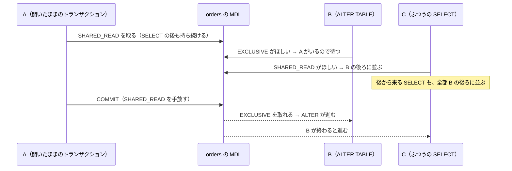

# 15 メタデータロックと Online DDL

## この章で分かるようになること

- テーブルの定義を守るメタデータロックと、それが「ALTER を1本流しただけでサービスが止まる」障害を起こす仕組み
- その障害の防ぎ方
- Online DDL の3つのやり方（INSTANT・INPLACE・COPY）の違いと選び方
- gh-ost と pt-online-schema-change の考え方

## 解説

### メタデータロック（MDL）とは

[14章](14_locks.md)の行ロックは「行」を守るロックだった。**メタデータロック**（MDL）は、テーブルの **定義**（列やインデックスの構成）を守るロック。あるトランザクションがテーブルを使っている間に、別の誰かがそのテーブルの列を消したり、テーブルを消したりしたら困る。それを防ぐために、テーブルを使う文はどれも、そのテーブルの MDL を取る。

| 文 | 取る MDL |
|---|---|
| SELECT | `SHARED_READ` |
| INSERT・UPDATE・DELETE | `SHARED_WRITE` |
| ALTER TABLE | `SHARED_UPGRADABLE` を取ってから、定義を切り替える瞬間に `EXCLUSIVE` |
| DROP TABLE | `EXCLUSIVE` |

`SHARED_*` 同士はぶつからないので、ふだんの読み書きは MDL で待つことはない。ぶつかるのは `EXCLUSIVE` で、これはほかのどの MDL とも一緒には持てない。

大事なのは、MDL を **トランザクションが終わるまで持ち続ける** こと。SELECT が終わっても、そのトランザクションがコミットかロールバックをするまで、`SHARED_READ` を手放さない。MDL はサーバー層の仕組みで（[01章](01_overview.md)）、InnoDB の行ロックとは別物。`performance_schema.metadata_locks` で見られる。

### ALTER を1本流しただけでサービスが止まる仕組み

次の順に起きることを考える。



1. A は、`orders` を読んだトランザクションを開いたまま、何もしていない（[13章](13_undo_mvcc.md)の「開いたまま放置された接続」）
2. B が `ALTER TABLE orders …` を流す。定義を切り替えるには `EXCLUSIVE` が要るので、A が終わるのを待つ
3. C が、ふつうの SELECT を流す。C の `SHARED_READ` は、A の `SHARED_READ` とはぶつからない。それでも C は待たされる。MySQL は、待っている `EXCLUSIVE` の要求を優先して、それより後に来た要求を後ろに並ばせるため（そうしないと、読み取りが絶えないテーブルでは ALTER が永遠に進めない）
4. その後に来る SELECT も UPDATE も、全部 B の後ろに並ぶ。待っている接続がどんどん増えて、やがて接続の上限（[01章](01_overview.md)）に達する

原因は、何もしていない A。ALTER を流した B も、巻き込まれた C も、`SHOW PROCESSLIST` の `State` が `Waiting for table metadata lock` になる。

さらに、`lock_wait_timeout`（MDL を待つ時間の上限）の既定値は31,536,000秒、つまり1年。何もしなければ、ALTER はほぼ永遠に待ち続ける。

### 防ぎ方

- **DDL を流す前に、長いトランザクションを探す**: `information_schema.INNODB_TRX` を、始まった時刻の古い順に見る（[13章](13_undo_mvcc.md)）
- **DDL は短い `lock_wait_timeout` で流す**: `SET SESSION lock_wait_timeout = 5` のようにしてから ALTER を流す。5秒で MDL が取れなければ、ALTER のほうがあきらめて `ERROR 1205` になる。巻き込まれる SELECT の待ちも、最大5秒で済む。あきらめたら、原因を片付けてから流し直す（実験2）
- **原因を見つける**: `sys.schema_table_lock_waits` に、待っている接続と原因の接続（`blocking_pid`）が出る。`sql_kill_blocking_connection` の列には、原因の接続を切る SQL（`KILL …`）まで書いてある。ただし、切る前に誰の何の処理かを確かめる
- **トランザクションを短くする**: [13章](13_undo_mvcc.md)と同じく、これがいちばんの予防になる

### Online DDL: INSTANT・INPLACE・COPY

ALTER TABLE は、やることによって、かかる時間と、その間にほかの書き込みを止めるかどうかが大きく違う。MySQL は3つのやり方（`ALGORITHM`）を持っている。

| ALGORITHM | 何をする | 時間 | ほかの書き込み | 例 |
|---|---|---|---|---|
| `INSTANT` | データディクショナリ（テーブルの定義）だけを書き換える | 一瞬 | 止めない | 列の追加・削除（8.0.29 からは位置も自由）、列の既定値の変更 |
| `INPLACE` | テーブルの中で作業する。テーブルを作り直すものと、作り直さないもの（インデックスの追加など）がある | データの量に比例 | 多くは止めない（`LOCK=NONE`） | セカンダリインデックスの追加 |
| `COPY` | 新しい定義のテーブルを作って、全部の行をコピーする | データの量に比例（いちばん遅い） | 止める | 列の型の変更 |

確かめたときは、約120万行のテーブルで、`INSTANT` の列の追加が約0.2秒、`COPY` の列の追加が約4.3秒、`INPLACE` のインデックスの追加が約1.4秒だった（実験3）。

使うときの注意が3つある。

- `ALGORITHM` を書かないと、MySQL はできる中でいちばん速いやり方を選ぶ。本番では、`ALGORITHM=INSTANT` のように明示するのが定石。そのやり方でできない変更なら、黙って遅いやり方に切り替わるのではなく、エラー（`ERROR 1846`）で止まってくれる
- `INSTANT` でも `INPLACE` でも、最初や最後にごく短く `EXCLUSIVE` の MDL を取る。上の「サービスが止まる仕組み」は、どのやり方でも起きる
- DDL は binlog に文として記録されて、レプリカでも同じように実行される（[21章](21_binlog_events.md)）。ソースで10分かかった `INPLACE` や `COPY` は、レプリカでも10分かかって、その間レプリカは遅れる（[30章](30_replication.md)）

`INSTANT` で列を足したり消したりできるのは、1つのテーブルにつき64回まで。それを超えると、一度テーブルを作り直す必要がある。

### gh-ost と pt-online-schema-change

大きいテーブルで、`INSTANT` ではできず、`INPLACE` や `COPY` だと影響が大きすぎる変更には、外部の道具を使うことがある。どちらも「新しい定義のテーブルを別に作って、少しずつ行をコピーして、最後に名前を入れ替える」という考え方になっている。違いは、コピーしている間に元のテーブルに来た変更を、どうやって追いかけるか。

- **pt-online-schema-change**: 元のテーブルにトリガーを付けて、変更があるたびに新しいテーブルにも同じ変更をする
- **gh-ost**: トリガーを使わずに、**binlog を読んで** 変更を追いかける。レプリカのふりをして binlog を受け取る、という点で、第5部の CDC と同じ仕組みになっている

どちらも、最後の名前の入れ替え（RENAME）では、短く `EXCLUSIVE` の MDL を取る。長いトランザクションへの注意は同じように要る。

## 手を動かして確かめる

### 実験1: 開いたままのトランザクションが、ALTER を止めて、その後ろの SELECT まで止める

**予想:** A がトランザクションを開いたまま何もしていないとき、B の ALTER はどうなる？ その後に来た C のふつうの SELECT は？

ターミナルを4つ使う。A で、テーブルのコピーを作って、読んだまま何もしない。

```sql
CREATE DATABASE dba15;
CREATE TABLE dba15.orders LIKE orders;
INSERT INTO dba15.orders SELECT * FROM orders;
BEGIN;
SELECT * FROM dba15.orders LIMIT 1;
```

B で列を足す（待ちになる）。

```sql
ALTER TABLE dba15.orders ADD COLUMN memo VARCHAR(10);
```

C で読む（これも待ちになる）。

```sql
SELECT * FROM dba15.orders LIMIT 1;
```

4つ目のターミナルで、`make sh` を打ってから `MYSQL_PWD=root mysql -h src -uroot` で入って、様子を見る。

```sql
SHOW PROCESSLIST;
SELECT waiting_pid, waiting_query, blocking_pid, sql_kill_blocking_connection FROM sys.schema_table_lock_waits;
SELECT t.PROCESSLIST_ID, m.LOCK_TYPE, m.LOCK_STATUS
FROM performance_schema.metadata_locks m
JOIN performance_schema.threads t ON t.THREAD_ID = m.OWNER_THREAD_ID
WHERE m.OBJECT_SCHEMA = 'dba15' AND m.OBJECT_NAME = 'orders';
```

最後に、A でコミットする。

```sql
COMMIT;
```

ここを見る: B と C の `State`、`sys.schema_table_lock_waits` の `blocking_pid`、`metadata_locks` の `LOCK_TYPE` と `LOCK_STATUS`。A のコミットの後の B と C。

<details>
<summary>何が起きたか</summary>

B も C も、`State` が `Waiting for table metadata lock` になって止まる。`metadata_locks` は、たとえば次のようになっている。

| 接続 | LOCK_TYPE | LOCK_STATUS |
|---|---|---|
| A | `SHARED_READ` | GRANTED |
| B | `SHARED_UPGRADABLE` | GRANTED |
| B | `EXCLUSIVE` | PENDING |
| C | `SHARED_READ` | PENDING |

C の `SHARED_READ` は、A の `SHARED_READ` とはぶつからないのに PENDING になっている。B の `EXCLUSIVE` の要求が先に並んでいるため。

`sys.schema_table_lock_waits` では、B と C の両方の原因として A（`blocking_pid`）が出る。`sql_kill_blocking_connection` には `KILL <A の番号>` が入っている。

A がコミットすると、B の ALTER が進んで、その後に C の SELECT も終わる。

</details>

### 実験2: 短い lock_wait_timeout で DDL を流す

**予想:** B の `lock_wait_timeout` を3秒にして ALTER を流すと、A がトランザクションを開いている間はどうなる？ 後ろに並んだ C は？

A で、また読んだまま何もしない。

```sql
BEGIN;
SELECT * FROM dba15.orders LIMIT 1;
```

B で、待つ時間を3秒にしてから ALTER を流す。

```sql
SET SESSION lock_wait_timeout = 3;
ALTER TABLE dba15.orders ADD COLUMN memo2 VARCHAR(10);
```

B が待っている3秒の間に、C で読む。

```sql
SELECT * FROM dba15.orders LIMIT 1;
```

最後に、A でコミットする。

```sql
COMMIT;
```

ここを見る: B の結果と、C がいつ終わったか。A がまだ開いているうちに C が終わったか。

<details>
<summary>何が起きたか</summary>

B は3秒後に `ERROR 1205 (HY000): Lock wait timeout exceeded; try restarting transaction` であきらめる。C は、B があきらめた瞬間に終わる。A はまだトランザクションを開いたままなのに、C は進めた。C を止めていたのは A ではなく、A を待っていた B の `EXCLUSIVE` の要求だったため。

本番で DDL を流すときに短い `lock_wait_timeout` を使えば、うまくいかなかったときでも、巻き込まれる時間を数秒に抑えられる。あきらめた後に、A のような長いトランザクションを片付けてから、流し直す。

</details>

### 実験3: INSTANT・COPY・INPLACE の時間を比べる

**予想:** 約120万行のテーブルに列を1つ足すのに、`INSTANT` と `COPY` でそれぞれ何秒かかる？ 列の型を変えるのは `INSTANT` でできる？

大きいテーブルがまだなければ作る（[10章](10_storage.md)）。

```bash
make big
```

A で、時間を見ながら順に流す。

```sql
ALTER TABLE lab_big.orders_big ADD COLUMN c_instant INT, ALGORITHM=INSTANT;
ALTER TABLE lab_big.orders_big ADD COLUMN c_copy INT, ALGORITHM=COPY;
ALTER TABLE lab_big.orders_big MODIFY customer_id BIGINT, ALGORITHM=INSTANT;
ALTER TABLE lab_big.orders_big ADD INDEX idx_customer (customer_id), ALGORITHM=INPLACE, LOCK=NONE;
```

足した列とインデックスを消して、元に戻す。

```sql
ALTER TABLE lab_big.orders_big DROP COLUMN c_instant, DROP COLUMN c_copy, ALGORITHM=INSTANT;
ALTER TABLE lab_big.orders_big DROP INDEX idx_customer;
```

ここを見る: それぞれの時間。3つ目の結果。

<details>
<summary>何が起きたか</summary>

確かめたときは、次のようになった（時間は環境によって変わる）。

| 操作 | 時間 |
|---|---|
| `ADD COLUMN … ALGORITHM=INSTANT` | 約0.2秒 |
| `ADD COLUMN … ALGORITHM=COPY` | 約4.3秒 |
| `ADD INDEX … ALGORITHM=INPLACE, LOCK=NONE` | 約1.4秒 |

同じ「列を1つ足す」でも、`INSTANT` は定義を書き換えるだけで、行の数に関係なく一瞬で終わる。`COPY` は120万行を全部コピーするので、行の数に比例して時間がかかる。

列の型を変える（`INT` を `BIGINT` に）のは、次のエラーになる。

```text
ERROR 1846 (0A000): ALGORITHM=INSTANT is not supported. Reason: Need to rebuild the table to change column type. Try ALGORITHM=COPY/INPLACE.
```

型を変えるには、全部の行を新しい形で書き直す必要があるので、一瞬では終わらない。`ALGORITHM` を明示していたおかげで、黙って遅いやり方で流れずに済んだ。

`COPY` の ALTER は、レプリカでも同じように実行される。`make rep` で入って、同じ時間ほど遅れて列が増えることも確かめられる。

</details>

### 戻す

実験用のデータベースを消して、`make state` で確かめる。

```sql
DROP DATABASE dba15;
```

## Aurora ではどうなる？

### 同じところ

- メタデータロックの仕組み（トランザクションが終わるまで持つこと、待っている `EXCLUSIVE` の後ろに後から来た要求が並ぶこと）は、サーバー層の仕組みなので同じ。「ALTER を1本流しただけでサービスが止まる」障害は、Aurora でも同じように起きる
- `ALGORITHM=INSTANT`・`INPLACE`・`COPY` も同じ。Aurora MySQL v3 は、MySQL 8.0 の INSTANT DDL をそのまま使う
- 防ぎ方（長いトランザクションを探す、短い `lock_wait_timeout` で流す）も同じ

### 違うところ

- **待機イベントの名前**: メタデータロックの待ちは、Database Insights では `synch/cond/sql/MDL_context::COND_wait_status` として出る（v2 と v3）。この待ちが急に増えたら、まず長いトランザクションと、流れている DDL を疑う。原因の接続は、画面ではなく、`sys.schema_table_lock_waits` などのテーブルで探す
- **Aurora 独自の高速 DDL**: Aurora MySQL v2 には、「ラボモード」で使える独自の高速 DDL があった。v3 ではラボモードがなくなって、MySQL 8.0 の INSTANT DDL に置き換わっている。古い記事で「Aurora の高速 DDL」と書いてあったら、v2 の話だと思って読む
- **binlog のレプリカ**: Blue/Green デプロイなど binlog のレプリケーションを使っているときは、DDL がグリーン側でも同じ時間かかって遅れる（[30章](30_replication.md)・[32章](32_upgrade.md)）

### 業務の Aurora で見てみるなら

業務の Aurora を触れる立場なら、DDL を流す前の確認として、ライターで次の軽い読み取りを流してみる。

```sql
SELECT trx_mysql_thread_id, trx_started, TIMESTAMPDIFF(SECOND, trx_started, NOW()) AS seconds
FROM information_schema.INNODB_TRX
ORDER BY trx_started
LIMIT 10;
SELECT waiting_pid, waiting_query, blocking_pid FROM sys.schema_table_lock_waits;
SELECT @@lock_wait_timeout;
```

- 長いトランザクションはないか
- `@@lock_wait_timeout` が既定（1年）のままなら、DDL を流すときはセッションで短くする

業務の Aurora で見た値はこのリポジトリに書かない。

出典:

- [synch/cond/sql/MDL_context::COND_wait_status（AWS）](https://docs.aws.amazon.com/AmazonRDS/latest/AuroraUserGuide/ams-waits.cond-wait-status.html)
- [Altering tables in Amazon Aurora using Fast DDL（AWS）](https://docs.aws.amazon.com/AmazonRDS/latest/AuroraUserGuide/AuroraMySQL.Managing.FastDDL.html)

## 説明できるか確かめる

1. メタデータロックは何を守っている？ 行ロックとは何が違う？
2. 何もしていない接続が1つあるだけで、ALTER を流した後にテーブルへのふつうの SELECT まで止まるのはなぜ？（「サービスが止まる仕組み」）
3. 本番で DDL を流すときに、短い `lock_wait_timeout` を使うと何がよい？（実験2）
4. `INSTANT`・`INPLACE`・`COPY` は、それぞれ何をしている？ `ALGORITHM` を明示するのはなぜ？
5. gh-ost と pt-online-schema-change は、コピーしている間の変更をどうやって追いかけている？

## この章のキーワード

- **メタデータロック（MDL）**: テーブルの定義を守るロック。トランザクションが終わるまで持ち続ける
- **EXCLUSIVE の MDL**: ALTER や DROP が定義を変えるときに取るロック。ほかのどの MDL とも一緒に持てない
- **Waiting for table metadata lock**: MDL を待っている接続の `SHOW PROCESSLIST` の状態
- **lock_wait_timeout**: MDL を待つ時間の上限。既定は1年
- **Online DDL**: ほかの読み書きを止めずにテーブルの定義を変える仕組み
- **ALGORITHM（INSTANT・INPLACE・COPY）**: ALTER のやり方。定義だけを変える、テーブルの中で作業する、全部コピーする
- **gh-ost と pt-online-schema-change**: 別のテーブルにコピーして入れ替える道具。変更の追いかけ方が、binlog とトリガーで違う
