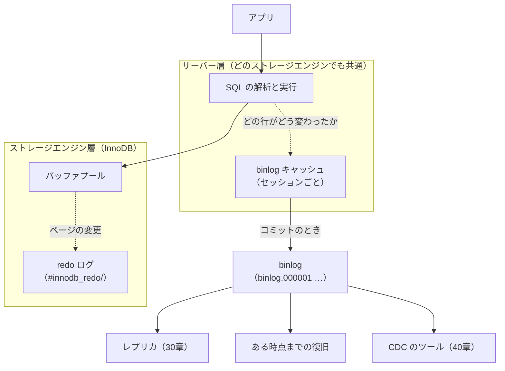

# 20 binlog とは

## この章で分かるようになること

- binlog は何のための記録で、redo ログと何が違うか
- binlog のファイルがどう増えて、いつ消えるか（ローテーションと保持期間）
- binlog を ON にすると、コミットのときに何が増えるか

## 解説

### サーバー層のログ

01章で見たとおり、MySQL は上の **サーバー層**（SQL を解析して実行する）と、下の **ストレージエンジン層**（InnoDB。データを持つ）に分かれている。変更の記録も層ごとにある。



- **redo ログ** は InnoDB が書く。どのページのどこをどう変えたか、という物理的な記録。目的は、落ちたときに InnoDB 自身を元に戻すこと（12章）
- **binlog**（バイナリログ）はサーバー層が書く。どの行がどう変わったか（または、実行した SQL）という論理的な記録。目的は、変更を外に伝えること

binlog はサーバー層のものなので、ストレージエンジンが何であっても同じ形で書かれる。中身も「この表のこの行が、この値からこの値になった」という形なので、別のサーバーでも同じ変更をやり直せる。ページの番号で書かれた redo ログは、そのサーバーのファイルの上でしか意味を持たない。

トランザクションの途中の変更は、セッションごとの **binlog キャッシュ** にためておいて、コミットのときにまとめて binlog のファイルに書く。だから binlog には、コミットしたトランザクションだけが、コミットした順に並ぶ。ロールバックしたトランザクションは書かれない。redo と binlog を食い違わないようにそろえて書く仕組みは、22章で見る。

### redo と binlog の違い

| | redo ログ | binlog |
|---|---|---|
| 書く層 | InnoDB（ストレージエンジン） | サーバー層 |
| 中身 | どのページのどこをどう変えたか（物理） | どの行がどう変わったか、または実行した SQL（論理） |
| 目的 | 落ちたときに、InnoDB を元に戻す | 変更を外へ伝える（レプリカ、復旧、CDC） |
| いつ消えるか | チェックポイントを過ぎた部分を使い回す（12章） | 保持期間を過ぎるか、PURGE するまで残る |
| 形式 | InnoDB の内部の形 | 決まった形のイベントの並び。`mysqlbinlog` で読める（21章） |
| ファイル | `#innodb_redo/` の中に、決まった数だけ | `binlog.000001`、`binlog.000002` … と、その一覧の `binlog.index` |

同じ変更を2つの層がそれぞれの目的で記録している。redo は「自分が元に戻るため」なので、古い部分はすぐいらなくなる。binlog は「誰かが後で読むため」なので、読み終わるまで残しておく必要がある。この目的の違いが、「使い回す redo」と「たまっていく binlog」の違いになっている。

### binlog の3つの使い道

1. **レプリケーション**: レプリカが binlog を受け取って、同じ変更を順に反映する（30章）
2. **ある時点までの復旧**（point-in-time recovery、PITR）: バックアップを戻した後、バックアップを取った時点から先の binlog を `mysqlbinlog` で読み出して流し直す。止めたい時点（誤って `DELETE` を流す直前など）を `--stop-datetime` や `--stop-position` で指定すると、その直前の状態まで戻せる
3. **CDC**（Change Data Capture）: ツールがレプリカのふりをして binlog を受け取り、変更を DWH や検索エンジンなどの別のシステムに流す（40章）

どれも、「必要な binlog が残っていること」と「変更がコミットした順に漏れなく書かれていること」が前提になっている。

MySQL 8.0 から、binlog は既定で ON になっている（`log_bin`）。OFF にするとコミットは少し速くなるけれど、上の3つが全部使えなくなる。

### ファイルと index、ローテーション

binlog は、番号の付いたファイルに追記していく。

```text
データディレクトリ
├─ binlog.000036     … 古いファイル（もう書かない）
├─ binlog.000037     … 今書いているファイル
└─ binlog.index      … ファイルの名前の一覧（1行に1つのテキストファイル）
```

- 今どのファイルの何バイト目まで書いたかは `SHOW BINARY LOG STATUS` で見る（8.0 までの `SHOW MASTER STATUS`。8.4 ではなくなった）
- ファイルの一覧と大きさは `SHOW BINARY LOGS` で見る。中身は `binlog.index` と同じ

新しいファイルに切り替わることを **ローテーション** と呼ぶ。切り替わるのは次のとき。

- ファイルが `max_binlog_size`（既定は1GB）を超えたとき。ただし、1つのトランザクションは途中で分けずに1つのファイルに書くので、大きいトランザクションがあると、1GB より大きいファイルになることもある
- `FLUSH BINARY LOGS`（または `FLUSH LOGS`）を流したとき
- サーバーを起動し直したとき

### 保持期間と PURGE

binlog はたまっていく一方なので、どこかで消す。

- **保持期間**: `binlog_expire_logs_seconds`（既定は 2,592,000 秒 = 30日）より古いファイルは、自動で消える（`binlog_expire_logs_auto_purge` が ON のとき）。消すかどうかを確かめるのは、ローテーションのときと起動のとき
- **手で消す**: `PURGE BINARY LOGS TO 'binlog.000037'`（このファイルより前を全部消す）か、`PURGE BINARY LOGS BEFORE '2026-11-01 00:00:00'`（その日時より前のファイルを消す）。ファイルを `rm` で直接消してはいけない。`binlog.index` と食い違ってしまう

消すときに気をつけるのは、**まだ誰かが読んでいるかもしれない** こと。接続しているレプリカが今読んでいるファイルは PURGE でも消えないけれど、止まっているレプリカや、しばらく繋いでいない CDC のツールが次に読むはずのファイルは消えてしまう。

- レプリカは、必要な binlog が消えていると、受け取りが止まってエラーになる。続きを流す方法がないので、作り直すことになる（31章）
- CDC のツールも同じで、どこまで読んだかの位置が消えたファイルを指していると、最初から全部を取り直すことになる（40章）

保持期間は、「レプリカや CDC が止まってから、気づいて直すまでに、どれくらいかかりそうか」から決める。

## 手を動かして確かめる

### 実験1: binlog のファイルを見る

**予想:** binlog のファイルは今いくつある？ `binlog.index` には何が書いてある？

```sql
SHOW BINARY LOGS;
SHOW BINARY LOG STATUS;
SELECT @@log_bin, @@max_binlog_size, @@binlog_expire_logs_seconds;
```

道具コンテナから、src のデータディレクトリ（`/var/lib/mysql-src` に読み取り専用で見えている）も覗く。

```bash
make sh
ls -l /var/lib/mysql-src/ | grep -E 'binlog|innodb_redo'
cat /var/lib/mysql-src/binlog.index
```

ここを見る: ファイルの名前と大きさ、`SHOW BINARY LOG STATUS` の `File` と `Position`、`binlog.index` の中身。

<details>
<summary>何が起きたか</summary>

`SHOW BINARY LOGS` には、`binlog.0000NN` という名前のファイルが、大きさ（`File_size`）と一緒に並ぶ。いくつあるかは、それまでに何回ローテーションしたかで変わる。12章でクラッシュの実験をした後なら、起動し直すたびに1つずつ増えている。

`binlog.index` は、`./binlog.000037` のように、ファイルの名前を1行に1つ並べただけのテキストファイル。`SHOW BINARY LOGS` はこの一覧を元に出している。

`SHOW BINARY LOG STATUS` の `File` は、今書いているファイル（いちばん番号の大きいもの）。`Position` は、そのファイルの何バイト目まで書いたか。`Executed_Gtid_Set` には、このサーバーでコミットしたトランザクションの GTID の範囲が出る（21章）。

`max_binlog_size` は 1073741824（1GB）、`binlog_expire_logs_seconds` は 2592000（30日）。`#innodb_redo` は redo ログのディレクトリで、binlog とは別の場所にある。

</details>

### 実験2: ローテーションと PURGE

**予想:** `FLUSH BINARY LOGS` を流すと、何が変わる？ `PURGE BINARY LOGS TO` で、どのファイルが消える？

```sql
FLUSH BINARY LOGS;
SHOW BINARY LOGS;
SHOW BINARY LOG STATUS;
-- SHOW BINARY LOG STATUS の File（今書いているファイル）の名前を入れる
PURGE BINARY LOGS TO 'binlog.000038';
SHOW BINARY LOGS;
```

この環境のレプリカは、src の binlog を全部読み終わっているので、消しても困らない。本番で手で消すときは、先にレプリカや CDC がどこまで読んだかを確かめる。

ここを見る: ファイルの数と、`File` の名前。

<details>
<summary>何が起きたか</summary>

`FLUSH BINARY LOGS` で、番号が1つ大きいファイルができて、書き込み先がそちらに移る。前のファイルにはもう書かない。

`PURGE BINARY LOGS TO 'X'` は、`X` より前のファイルを全部消す。`X` 自身は残る。今書いているファイルを指定したので、残るのはそのファイルだけになる。

この環境のレプリカは、空の状態から src の binlog を全部流し込んで作っている。PURGE した後は、同じやり方で空のレプリカを作り直すことはできない（最初からの binlog がもうない）。本番のレプリカも、バックアップから作って、その時点から先の binlog だけを流すのがふつう（31章）。この環境で全部を作り直したくなったら `make reset` を使う。

</details>

### 実験3: 1回の変更が binlog にどう書かれるか

**予想:** `INSERT` を1回流すと、binlog にはいくつのイベントが書かれる？ `CREATE TABLE` はどう書かれる？

```sql
CREATE DATABASE dba20;
CREATE TABLE dba20.t (id INT PRIMARY KEY, v INT);
INSERT INTO dba20.t VALUES (1, 10), (2, 20);
UPDATE dba20.t SET v = v + 1 WHERE id = 1;
```

```bash
make binlog n=80
```

`make binlog` は、今書いているファイルを `mysqlbinlog -vv --base64-output=DECODE-ROWS` で読んで、最後の何行か（`n=`、既定は200行）を出す。ファイルを選ぶなら `f=binlog.000037` のように指定する。

ここを見る: `# at`（ファイルの中の位置）の後に続く、`GTID`、`Query`（`BEGIN`）、`Table_map`、`Write_rows`、`Update_rows`、`Xid` の並び。

<details>
<summary>何が起きたか</summary>

1つのトランザクションが、次のイベントの並びで書かれている。

```text
GTID          SET @@SESSION.GTID_NEXT= '<サーバーの UUID>:<番号>'   … このトランザクションの番号（21章）
Query         BEGIN
Table_map     `dba20`.`t` mapped to number 130                     … これから出てくる表の番号の対応
Write_rows    ### INSERT INTO `dba20`.`t` ### SET @1=1 @2=10 …     … 変わった行そのもの
Xid           COMMIT
```

`UPDATE` では `Update_rows` になって、変える前の行（`### WHERE`）と変えた後の行（`### SET`）の両方が書かれる。列の名前は書かれず、`@1`、`@2` と順番で出る（既定の設定の場合。21章で変えてみる）。

`CREATE TABLE` は、行ではなく、SQL の文がそのまま `Query` のイベントに書かれる。DDL は、いつも文のまま記録される。

それぞれのイベントの意味や、形式の違いは21章で詳しく読む。

</details>

### 実験4: binlog が ON と OFF で、コミットにかかる時間を比べる

**予想:** 1件ずつコミットする `INSERT` を2000回流すと、binlog が OFF のサーバーのほうが速い？ binlog のファイルの fsync は何回になる？

binlog を OFF にしたサーバー（`nobin`。中身は空）を立てて、同じ書き込みを流して比べる。

```bash
make nobin-up
make sh
bash /lab/labs/common/commit_bench.sh src 2000
bash /lab/labs/common/commit_bench.sh nobin 2000
exit
make nobin-down
```

`commit_bench.sh` は、実験用の `dbabench` というデータベースに、自動コミットの `INSERT` を流して、時間と fsync の回数を数える。終わったら `dbabench` を消す。

時間は、環境によって差が小さく出ることがある（Docker Desktop の fsync など）。傾向を見る。

ここを見る: `elapsed_ms`（かかった時間）と `binlog_syncs`（binlog のファイルの fsync などの回数）。

<details>
<summary>何が起きたか</summary>

src（binlog が ON）では、`binlog_syncs` がコミットの回数とほぼ同じになる。`sync_binlog` が既定の 1 なので、コミットのたびに binlog のファイルを fsync している。nobin では 0 になる。

時間も、nobin のほうが短くなる。コミットのたびに、redo ログの fsync（12章）に加えて、binlog の fsync が1回ずつ増えるのが ON の代償になっている。

ただし、OFF にすると、レプリケーションも、ある時点までの復旧も、CDC も使えない。ふつうは ON のままにして、fsync の回数をまとめて減らす仕組み（グループコミット、22章）に任せる。

</details>

### 戻す

実験3で作ったデータベースを消して、nobin を止めてから、`make state` で確かめる。

```sql
DROP DATABASE IF EXISTS dba20;
```

```bash
make nobin-down
make state
```

## Aurora ではどうなる？

### 同じところ

- binlog はサーバー層のログで、形式（ROW、STATEMENT、MIXED）や、イベントの中身、`mysqlbinlog` で読めることは同じ
- Aurora の外にあるサーバーへのレプリケーション、別のリージョンへの binlog を使ったレプリカ、CDC（AWS DMS や Debezium など）、Blue/Green デプロイは、どれも binlog を使う

### 違うところ

- **既定で OFF**: Aurora MySQL では、`binlog_format` の既定が OFF になっている。クラスターの中のリーダーへの複製にも、ある時点への復元（PITR）にも、binlog を使わないため。ON にすると、予期しない再起動の後に binlog の復旧が要るので、再起動に時間がかかる。外へのレプリケーションが要らないなら OFF のままにするよう、AWS は勧めている
- **ON にする方法**: カスタムの DB クラスターのパラメータグループで、`binlog_format` を ROW などにする（既定のパラメータグループは変えられない）。Aurora では静的なパラメータなので、OFF から変えたらクラスターを再起動する。`binlog_format` を ROW などにすると、`log_bin` も ON になる
- **保持期間**: `binlog_expire_logs_seconds` ではなく、`CALL mysql.rds_set_configuration('binlog retention hours', 24);` のように時間で決める。Aurora MySQL 3 では最大 2160時間（90日）。今の値は `CALL mysql.rds_show_configuration;` で見る
- **拡張バイナリログ（enhanced binlog）**: Aurora MySQL 3.03.1 以降で使える。`aurora_enhanced_binlog=1`、`binlog_backup=0`、`binlog_replication_globaldb=0` にすると、binlog とトランザクションのログを並べてストレージに書いて、binlog を ON にしたときの負担を小さくする。ただし、拡張バイナリログのファイルはバックアップに入らないので、復元やクローンの後には残っていない。グローバルデータベースのセカンダリにも複製されない。バックトラックを有効にしたクラスターでは使えない
- **リーダーに binlog は要らない**: リーダーはライターと同じクラスターボリュームを読む。ライターがストレージに送る redo の流れをリーダーも受け取って、自分のキャッシュにあるページだけを更新する（01章）。binlog を受け取って変更をやり直す普通のレプリカとは、仕組みが違う
- **Blue/Green**: ブルーからグリーンへの変更は binlog のレプリケーションで流すので、ON が必須。形式は ROW が勧められていて、保持期間を NULL 以外にしておくことも勧められている（32章）

### 業務の Aurora で見てみるなら

業務の Aurora を触れる立場なら、ライターで次の軽い読み取りを流してみる。

```sql
SELECT @@binlog_format, @@log_bin;
SHOW BINARY LOGS;
CALL mysql.rds_show_configuration;
SHOW GLOBAL STATUS LIKE 'aurora_enhanced_binlog';
```

- `binlog_format` が OFF なら、binlog は書いていない。ON なら、外へのレプリケーションや CDC、Blue/Green のどれに使っているのかを確かめる
- `binlog retention hours` の値が、レプリカや CDC が止まったときに直すまでの時間に足りているかを見る
- 拡張バイナリログを使っていれば、`aurora_enhanced_binlog` が `ACTIVE` になる
- CloudWatch では、binlog のファイルの合計の大きさ（`SumBinaryLogSize`）と数（`NumBinaryLogFiles`）が見られる
- 待機イベントでは、binlog のファイルへの書き込みを待つ `io/file/sql/binlog` が出る。コミットが多いと増える

業務の Aurora で見た値はこのリポジトリに書かない。

出典:

- [Setting up binary log replication for Aurora MySQL（binlog_format の既定と再起動）（AWS）](https://docs.aws.amazon.com/AmazonRDS/latest/AuroraUserGuide/AuroraMySQL.Replication.MySQL.SettingUp.html)
- [Amazon Aurora reliability（binlog がクラスターの中の複製と PITR に要らないこと、復旧の時間）（AWS）](https://docs.aws.amazon.com/AmazonRDS/latest/AuroraUserGuide/Aurora.Overview.Reliability.html)
- [Setting and showing binary log configuration（binlog retention hours）（AWS）](https://docs.aws.amazon.com/AmazonRDS/latest/AuroraUserGuide/mysql-stored-proc-configuring.html)
- [Setting up enhanced binlog for Aurora MySQL（AWS）](https://docs.aws.amazon.com/AmazonRDS/latest/AuroraUserGuide/AuroraMySQL.Enhanced.binlog.html)
- [Replication with Amazon Aurora（リーダーとクラスターボリューム）（AWS）](https://docs.aws.amazon.com/AmazonRDS/latest/AuroraUserGuide/Aurora.Replication.html)
- [Creating a blue/green deployment in Amazon Aurora（binlog が必須なこと）（AWS）](https://docs.aws.amazon.com/AmazonRDS/latest/AuroraUserGuide/blue-green-deployments-creating.html)
- [Amazon CloudWatch metrics for Amazon Aurora（SumBinaryLogSize、NumBinaryLogFiles）（AWS）](https://docs.aws.amazon.com/AmazonRDS/latest/AuroraUserGuide/Aurora.AuroraMonitoring.Metrics.html)
- [Aurora MySQL wait events（io/file/sql/binlog）（AWS）](https://docs.aws.amazon.com/AmazonRDS/latest/AuroraUserGuide/AuroraMySQL.Reference.Waitevents.html)

## 説明できるか確かめる

1. redo ログと binlog は、どちらも変更の記録なのに、なぜ両方あるの？（「redo と binlog の違い」）
2. binlog の3つの使い道は？ どれも「binlog が残っていること」が前提になるのはなぜ？（「binlog の3つの使い道」）
3. 止まっているレプリカがまだ読んでいない binlog を PURGE すると、何が困る？（「保持期間と PURGE」）
4. binlog を ON にすると、コミットが遅くなるのはなぜ？ それでも ON にしておくのはなぜ？（実験4）
5. Aurora で binlog が既定で OFF なのはなぜ？ ON にしないといけないのは、どんなとき？

## この章のキーワード

- **binlog（バイナリログ）**: サーバー層が書く、変更の記録。レプリケーション、ある時点までの復旧、CDC に使う
- **サーバー層とストレージエンジン層**: SQL を扱う上の層と、データを持つ下の層（InnoDB）。binlog は上、redo ログは下が書く
- **binlog キャッシュ**: トランザクションの途中の変更を、セッションごとにためておく場所。コミットのときに binlog に書く
- **ローテーション**: 新しい binlog のファイルに切り替わること。`max_binlog_size`、`FLUSH BINARY LOGS`、再起動で起きる
- **binlog_expire_logs_seconds**: binlog を残しておく期間（既定は30日）
- **PURGE BINARY LOGS**: 古い binlog のファイルを消す SQL。ファイルを直接消さずに、これを使う
- **ある時点までの復旧（PITR）**: バックアップを戻した後に binlog を流し直して、決めた時点まで戻すこと
- **拡張バイナリログ（enhanced binlog）**: binlog を ON にしたときの負担を小さくする、Aurora MySQL の仕組み
