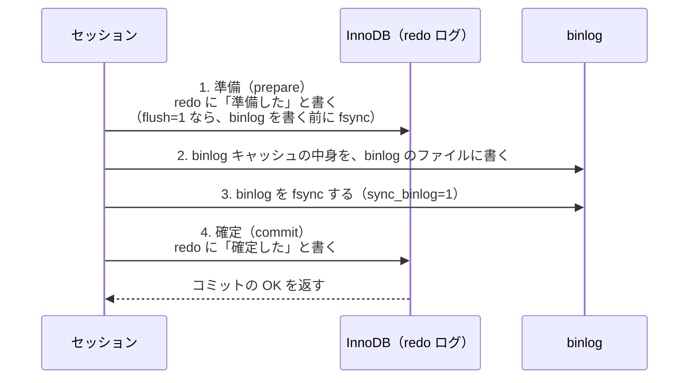

# 22 コミットの裏側

## この章で分かるようになること

- redo ログと binlog を、落ちても食い違わないように、どうやってそろえて書いているか（2段階のコミット）
- 「`innodb_flush_log_at_trx_commit` と `sync_binlog` を両方1にする」の意味
- fsync の回数をまとめて減らす仕組み（グループコミット）と、大きいトランザクションが嫌われる理由

## 解説

### 2つのログを食い違わないようにする

同じ変更が、redo ログ（InnoDB）と binlog（サーバー層）の2か所に書かれる（[20章](20_binlog_basics.md)）。もし落ちた後に、この2つの中身が食い違っていたら困る。

- **binlog にあって、InnoDB にない**: レプリカは binlog を受け取って反映しているので、レプリカにはあるのに、ソースにはない行ができる
- **InnoDB にあって、binlog にない**: ソースにはあるのに、レプリカには届かない。binlog を流し直す復旧（[20章](20_binlog_basics.md)）でも戻ってこない

どちらも、レプリカとソースの中身がずれる。そこで MySQL は、1つのトランザクションのコミットを2段階に分けて、2つのログをそろえている。

### 2段階のコミット



分かれ目は、**binlog に書き終わったかどうか**。落ちた後に起動すると、InnoDB は redo を読み直して、「準備したけれど、確定していない」トランザクションを見つける。それを1つずつ binlog と突き合わせて決める。

- binlog に書いてある → 確定する（レプリカに届いているかもしれないので、ソースもそれに合わせる）
- binlog に書いていない → 取り消す（誰にも届いていない）

これを **XA の復旧**（XA crash recovery）と呼ぶ。InnoDB と binlog の間の2段階のコミットは、MySQL の中で行う XA トランザクション（内部 XA）として扱われている。実験4で、エラーログに出る復旧の記録を見る。

### 両方1

この仕組みが働くのは、1 と 3 の書き込みが、落ちても消えないところまで届いているとき。`innodb_flush_log_at_trx_commit`（[12章](12_redo.md)）と `sync_binlog` が、それぞれを決めている。

| `innodb_flush_log_at_trx_commit` | `sync_binlog` | mysqld が落ちたとき | OS ごと落ちたとき（この環境では試せない） |
|---|---|---|---|
| 1 | 1 | 食い違わない | 食い違わない |
| 0 | 1 | InnoDB から直前のトランザクションが消える。binlog とレプリカには残っている（実験4） | 同じ |
| 2 | 1 | 食い違わない（redo は OS に渡してある） | 0 と同じことが起きうる |
| 1 | 0 | 食い違わない（binlog は OS に渡してある） | binlog の末尾が消えうる。ソースにはあるのに、レプリカに届かない変更が出る |

どちらかを 1 以外にすると、どこかの場面で2つのログが食い違う。だから、レプリケーションを使うサーバーの安全な組み合わせは **両方1** になる。どちらも既定は 1。

### グループコミット

`sync_binlog=1` だと、コミットのたびに binlog を fsync する。fsync は1回で数百マイクロ秒から数ミリ秒かかるので、1件ずつ fsync していたら、1秒に数千件しかコミットできない。

そこで、同じころにコミットしようとしているトランザクションをまとめて、1回の fsync で済ませる。これを **グループコミット** と呼ぶ。コミットは3つの段階に分かれていて、段階ごとに順番待ちの列がある。列の先頭に来たセッション（リーダー）が、後ろに並んだ分もまとめて片付ける。

1. **flush**: 並んだトランザクションの binlog キャッシュを、順に binlog のファイルに書く
2. **sync**: binlog を、グループでまとめて1回だけ fsync する。`binlog_group_commit_sync_delay`（マイクロ秒、既定は0）を設定すると、fsync の前にその時間だけ待って、グループを大きくする
3. **commit**: binlog に書いた順番どおりに、InnoDB で確定する（`binlog_order_commits`）

1本の接続から順にコミットするだけなら、まとめる相手がいないので、1件ごとに fsync する。同時にたくさんの接続がコミットすると、1回の fsync の間に後ろに次の分がたまって、自然にまとまる。`binlog_group_commit_sync_delay` を大きくすると、fsync はさらに減るけれど、1件ごとのコミットは待つ分だけ遅くなる。

同じグループでコミットしたトランザクションは、互いに邪魔をしていなかったことが分かっている。8.0 の COMMIT_ORDER という方式では、それを手がかりにレプリカが並べて反映する（[30章](30_replication.md)）。8.4 では、変えた行が重ならないかどうかで決める WRITESET の方式だけになった。

### binlog キャッシュと大きいトランザクション

トランザクションの途中の変更は、セッションごとの binlog キャッシュにためておく（[20章](20_binlog_basics.md)）。大きさは `binlog_cache_size`（既定は32KB）で、それを超えると一時ファイルに書く。一時ファイルを使ったトランザクションの数が、ステータス変数 `Binlog_cache_disk_use` に数えられる。

キャッシュの中身は、コミットの flush の段階で、まとめて binlog に書く。だから、1つのトランザクションで何十万行も変えると、コミットの瞬間に何十MB も書くことになる。大きいトランザクションが嫌われる理由は、ここから来ている。

- **コミットが重い**: 何十MB を一度に書く。binlog には順番に書くので、その間に来たほかのセッションのコミットも待たされる
- **レプリカが遅れる**: レプリカは、1つのトランザクションを分けて反映できない。反映し終わるまでは、その変更はレプリカから全く見えず、後ろに続くトランザクションも待たされる
- **CDC に一度に押し寄せる**: CDC のツールには、何十万行分の変更が一度に届く。下流のシステムが受け止めきれないことがある（[40章](40_cdc_mechanics.md)）
- **binlog のファイルが大きくなる**: トランザクションは途中で分けずに1つのファイルに書くので、`max_binlog_size` を超える

大きい `UPDATE` や `DELETE` は、主キーの範囲で区切って、数千行くらいずつの小さいトランザクションに分けて流すのが定石。

## 手を動かして確かめる

### 実験1: sync_binlog の 1 と 0 で、binlog の fsync の回数を比べる

**予想:** 1件ずつコミットする `INSERT` を2000回流す。`sync_binlog` が 1 と 0 で、binlog の fsync の回数はそれぞれ何回になる？

`make a` で、まず 0 にする。

```sql
SET GLOBAL sync_binlog = 0;
```

```bash
make sh
bash /lab/labs/common/commit_bench.sh src 2000
exit
```

`make a` で 1 に戻してから、もう一度同じことを流す。

```sql
SET GLOBAL sync_binlog = 1;
```

時間は、環境によって差が小さく出ることがある（Docker Desktop の fsync など）。傾向を見る。

ここを見る: `binlog_syncs` と `elapsed_ms`。

<details>
<summary>何が起きたか</summary>

1 のときは、`binlog_syncs` がコミットの回数とほぼ同じになる。1本の接続から順にコミットしているので、まとめる相手がいない。0 のときは、ほぼ0回になる。binlog のファイルには書いているけれど、ディスクに落とすのは OS に任せている。

時間は 0 のほうが短い。その代わり、OS ごと落ちると、binlog の末尾の、まだディスクに書かれていなかった分が消えうる。

</details>

### 実験2: グループコミットで、fsync がまとまる様子を見る

**予想:** 合計4000件の `INSERT` を、1本の接続から流すときと、16本から同時に流すときで、binlog の fsync の回数はどう変わる？ `binlog_group_commit_sync_delay` を 2000（2ミリ秒）にするとどうなる？

```bash
make sh
bash /lab/labs/22/group_commit.sh src 1 4000 0
bash /lab/labs/22/group_commit.sh src 16 4000 0
bash /lab/labs/22/group_commit.sh src 16 4000 2000
```

`group_commit.sh` は、`mysqlslap` で、指定した本数の接続から自動コミットの `INSERT` を合計4000件流して、binlog の fsync の回数を数える。最後の引数は `binlog_group_commit_sync_delay`（マイクロ秒）で、終わったら 0 に戻す。実験用のデータベース `dbagc` も消す。

時間は、環境によって差が小さく出ることがある。傾向を見る。

ここを見る: `transactions`（コミットした数）と `binlog_syncs`（fsync の回数）の比、`elapsed_ms`。

<details>
<summary>何が起きたか</summary>

1本のときは、`binlog_syncs` が `transactions` とほぼ同じ（1件ごとに1回）。

16本から同時に流すと、`binlog_syncs` はトランザクションの数よりずっと少なくなる。確かめたときは、5回のコミットに1回くらいの fsync で済んでいた。待つ設定をしなくても、1回の fsync をしている間に、後ろに次のコミットがたまって、まとまって片付く。

2ミリ秒待つ設定にすると、さらに減って、確かめたときは15回のコミットに1回くらいになった。ただし、1件ごとのコミットは、その分だけ待たされる。

</details>

### 実験3: 大きいトランザクションは、コミットの瞬間に書かれる

**予想:** 30万行を1つのトランザクションで `UPDATE` する。`UPDATE` が終わってから `COMMIT` するまでの間に、binlog は何バイト進む？ `COMMIT` では？

```bash
make sh
python /lab/labs/22/big_txn.py --rows 300000
```

スクリプトは、`dba22.big` に30万行入れてから、`BEGIN` して全部の行を `UPDATE` し、`COMMIT` の前と後で binlog の位置を比べる。最後に、レプリカが追いつくまでの時間を測る。

ここを見る: `pos_moved_before_commit`、`bytes_at_commit`、`cache_disk_use_delta`、`replica_wait_ms`。

<details>
<summary>何が起きたか</summary>

`UPDATE` が終わっても、`COMMIT` の前までは binlog は1バイトも進まない（`pos_moved_before_commit=0`）。変更は binlog キャッシュにたまっているだけ。

`COMMIT` で、一度に約67MB 進んだ（30万行分の、変える前と後の行）。キャッシュの32KB には収まらないので、一時ファイルにあふれている（`cache_disk_use_delta` が 1 増える）。

`replica_wait_ms` は、コミットしてから、レプリカがこのトランザクションを反映し終わるまでの時間。レプリカは、ソースがコミットするまでこの変更を受け取れず、受け取ってからも、30万行をまとめて反映する。この間、レプリカからはこの変更が全く見えず、後ろに続く変更も待たされている。本番の何千万行の変更なら、これが何分、何時間にもなる。

</details>

### 実験4: redo だけが失われると、ソースとレプリカが食い違う

**予想:** `innodb_flush_log_at_trx_commit=0`（`sync_binlog` は 1 のまま）で、書き込みの途中に mysqld を kill -9 で落とす。ソースとレプリカの行の数は同じになる？ 両方1ならどう？

`make a` で設定を変える。`innodb_log_writer_threads` を OFF にするのは、違いをはっきり見るため。8.0 からは redo を書く裏方のスレッドがすぐに書くので、そのままだと消えるのは直前の1件くらいで、消えないこともある（[12章](12_redo.md)）。OFF にすると、redo は1秒に1回しか書かれなくなる。どちらも、起動し直すと設定ファイルの値（1 と ON）に戻る。

```sql
SET GLOBAL innodb_flush_log_at_trx_commit = 0;
SET GLOBAL innodb_log_writer_threads = OFF;
```

ターミナルを2つ使う。1つ目で、1件ずつコミットし続けるスクリプトを流す（[12章](12_redo.md)と同じ）。

```bash
make sh
python /lab/labs/common/acked_inserts.py --host src --table dba22.acked0 --seconds 60
```

数秒たったら、2つ目のターミナルで mysqld を落として、起動し直す。表示される復旧の記録も読む。

```bash
make crash
```

レプリカが追いつくのを少し待ってから、ソースとレプリカで数える。

```sql
-- make a（ソース）と make rep（レプリカ）の両方で
SELECT COUNT(*) FROM dba22.acked0;
```

起動し直した後は両方1に戻っているので、テーブルを `dba22.acked1` にして、同じことをもう一度試す。

ここを見る: ソースとレプリカの `COUNT(*)` の差。`make crash` が出す復旧の記録の、`XA crash recovery` のあたり。

<details>
<summary>何が起きたか</summary>

0 のときは、ソースのほうが行が少なかった。確かめたときは、レプリカより800行あまり少なかった。消えた行は、binlog には書かれていて（`sync_binlog=1` なので、コミットのたびに fsync している）、レプリカにも届いて反映されている。InnoDB の redo だけが、まだ書かれないまま消えた。ソースの binlog には残っているので、「ソースの binlog を流し直せば戻る」ことと「ソースのテーブルにはない」ことが同時に起きている。

両方1のときは、ソースとレプリカの数が同じになる。コミット済みと返事をした行も、全部残っている。

`make crash` の復旧の記録には、次のような流れが出る（両方1で落としたとき）。

```text
[InnoDB] Transaction 691233 was in the XA prepared state.
[Server] Recovering after a crash using binlog
[Server] Starting XA crash recovery...
[Server] Found 1 prepared transaction(s) in InnoDB
[Server] Crash recovery finished in InnoDB engine. Successfully committed 1 internal transaction(s).
[Server] XA crash recovery finished.
```

落ちた瞬間に、準備までは終わっていて、まだ確定していないトランザクションが1つあった。binlog と突き合わせたら書いてあったので、確定した（2段階のコミットの「binlog に書いてある → 確定する」）。確定の前だったので、クライアントにはまだ OK を返していない。それでも binlog に書いた以上、レプリカには届いているかもしれないので、ソースもそれに合わせる。

</details>

### 戻す

実験で作ったデータベースを消す。`sync_binlog` を 0 にしたままなら 1 に戻す。最後に `make state` で確かめる。

```sql
DROP DATABASE IF EXISTS dba22;
SET GLOBAL sync_binlog = 1;
```

## Aurora ではどうなる？

### 同じところ

- binlog を ON にすれば、InnoDB と binlog の間の2段階のコミットと、落ちた後の XA の復旧は同じように動く
- binlog キャッシュの仕組みと、大きいトランザクションが嫌われる理由も同じ。AWS の binlog レプリケーションの遅れの対処でも、大きい処理は小さいコミットに分けるよう勧めている

### 違うところ

- **sync_binlog は変えられない**: Aurora MySQL のパラメータの一覧で、変更できないものになっている
- **innodb_flush_log_at_trx_commit の意味が違う**: Aurora では「ストレージの確認を待つかどうか」の設定になっていて、v3 で 1 以外にするには、先に `innodb_trx_commit_allow_data_loss` を 1 にする必要がある（[12章](12_redo.md)）
- **binlog_group_commit_sync_delay は変えられる**: Aurora MySQL 3 では、クラスターのパラメータで設定できる。AWS の説明では、待つほどトランザクションがまとまってレプリカで並べて反映しやすくなる代わりに、ソースのコミットが少し遅くなる、としている（COMMIT_ORDER の方式のとき）
- **拡張バイナリログ（enhanced binlog）**: binlog とトランザクションのログを、ストレージに並べて書く。binlog を ON にしたときのコミットの負担が小さくなり、再起動のときの binlog の復旧も速くなる。使うときの設定は `aurora_enhanced_binlog=1`、`binlog_backup=0`、`binlog_replication_globaldb=0`（[20章](20_binlog_basics.md)）。制限の一覧には、`binlog_group_commit_sync_delay` と `binlog_group_commit_sync_no_delay_count` が入っている
- **再起動に時間がかかる**: binlog を ON にすると、予期しない再起動の後に、この章の XA の復旧（binlog の復旧）が要る（[20章](20_binlog_basics.md)）

### 業務の Aurora で見てみるなら

業務の Aurora を触れる立場なら、ライターで次の軽い読み取りを流してみる。

```sql
SELECT @@sync_binlog, @@innodb_flush_log_at_trx_commit, @@binlog_group_commit_sync_delay, @@binlog_cache_size;
SHOW GLOBAL STATUS LIKE 'Binlog_cache%';
```

- `Binlog_cache_use`（binlog キャッシュを使ったトランザクションの数）に比べて `Binlog_cache_disk_use` が多いなら、キャッシュに収まらない大きいトランザクションがよく流れている
- 大きい `UPDATE` や `DELETE` を流す前に、主キーの範囲で分けて、小さいトランザクションにできないかを考える
- 待機イベントの `io/file/sql/binlog`（[20章](20_binlog_basics.md)）が多いなら、コミットの数が多い。まとめて流せる処理は、1つのトランザクションにいくつかの文を入れる

業務の Aurora で見た値はこのリポジトリに書かない。

出典:

- [Aurora MySQL configuration parameters（sync_binlog、binlog_group_commit_sync_delay）（AWS）](https://docs.aws.amazon.com/AmazonRDS/latest/AuroraUserGuide/AuroraMySQL.Reference.ParameterGroups.html)
- [Troubleshooting binary log replication lag for Aurora MySQL（AWS）](https://docs.aws.amazon.com/AmazonRDS/latest/AuroraUserGuide/aurora-mysql-troubleshooting-replication-lag.html)
- [Setting up enhanced binlog for Aurora MySQL（AWS）](https://docs.aws.amazon.com/AmazonRDS/latest/AuroraUserGuide/AuroraMySQL.Enhanced.binlog.html)
- [Amazon Aurora reliability（binlog の復旧と再起動の時間）（AWS）](https://docs.aws.amazon.com/AmazonRDS/latest/AuroraUserGuide/Aurora.Overview.Reliability.html)

## 説明できるか確かめる

1. redo ログと binlog の両方に書くのに、落ちても食い違わないのはなぜ？ 落ちた後、準備の状態のトランザクションはどう決められる？（「2段階のコミット」）
2. `innodb_flush_log_at_trx_commit=0`、`sync_binlog=1` で mysqld が落ちると、ソースとレプリカはどうなる？（実験4）
3. グループコミットは、何をまとめて、何を減らしている？ `binlog_group_commit_sync_delay` を大きくすると、何が良くて何が悪い？（実験2）
4. 大きいトランザクションが嫌われる理由を3つ挙げられる？（「binlog キャッシュと大きいトランザクション」、実験3）
5. Aurora で `sync_binlog` を変えられないとき、binlog を ON にしたときの負担を小さくするには、どんな方法がある？

## この章のキーワード

- **2段階のコミット**: 準備（prepare）→ binlog に書く → 確定（commit）の順に進めて、redo と binlog をそろえる仕組み。内部 XA とも呼ぶ
- **XA の復旧**: 落ちた後、準備の状態のトランザクションを、binlog に書いてあれば確定し、なければ取り消すこと
- **両方1**: `innodb_flush_log_at_trx_commit=1` と `sync_binlog=1`。落ちても redo と binlog が食い違わない組み合わせ
- **sync_binlog**: binlog をいつ fsync するか。1 ならコミットのたび（グループごと）、0 なら OS に任せる
- **グループコミット**: 同じころのコミットをまとめて、binlog の fsync を1回で済ませる仕組み。flush、sync、commit の3つの段階がある
- **binlog_group_commit_sync_delay**: グループコミットで、fsync の前に待つ時間（マイクロ秒）
- **binlog キャッシュ**: トランザクションの途中の変更をためておく場所。`binlog_cache_size` を超えると一時ファイルに書く（`Binlog_cache_disk_use`）
- **大きいトランザクション**: 一度にたくさんの行を変えるトランザクション。コミットが重く、レプリカが遅れ、CDC に一度に押し寄せる
