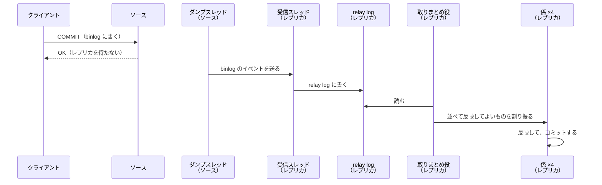

# 30 レプリケーションの仕組み

## この章で分かるようになること

- ソースでコミットした変更が、どのスレッドを通ってレプリカに届き、反映されるか
- どこまで受け取ったかを、ファイルと位置ではなく GTID で合わせる仕組み
- 遅延の正しい測り方と、並列での反映や準同期が何を変えるか

## 解説

### 全体の流れ

レプリケーションは、ソースの binlog を、レプリカが受け取ってやり直す仕組み（[20章](20_binlog_basics.md)）。間に4種類のスレッドがいる。



- **ダンプスレッド**（ソース）: 繋いできたレプリカ1台ごとに1本。binlog を読んで、イベントを送り続ける。`SHOW PROCESSLIST` では、`Binlog Dump GTID` という COMMAND で見える
- **受信スレッド**（レプリカ、`replica_io`）: 受け取ったイベントを、レプリカの **relay log**（`relay-bin.000001` …）に書く。受け取ることと反映することを分けておくので、反映が遅れても、受け取りは止まらない
- **取りまとめ役**（レプリカ、`replica_sql`）: relay log を読んで、どのトランザクションを並べて反映してよいかを決めて、係に渡す
- **係**（レプリカ、`replica_worker`）: 実際に反映する。数は `replica_parallel_workers`（8.4 の既定は4）

レプリカも、反映したトランザクションを自分の binlog に書く（`log_replica_updates`、既定は ON）。だから、レプリカの下にさらにレプリカを繋ぐこともできる。

既定では **非同期**。ソースは、レプリカが受け取ったかどうかを待たずに、クライアントに OK を返す。

### どこまで受け取ったかを合わせる

レプリカが繋ぎ直すときは、「どこから続きを送ってほしいか」をソースに伝える必要がある。その伝え方が2つある。

- **ファイルと位置**: 「`binlog.000048` の 40265462 バイト目から」と伝える。ただし、ファイルの名前と位置は、そのサーバーの binlog の中でしか意味がない。ソースが壊れて、別のサーバーに付け替えるときは、「前のソースのこの位置は、新しいソースのどの位置か」を調べないといけない
- **GTID の自動位置合わせ**（`SOURCE_AUTO_POSITION=1`）: レプリカが「自分が持っている GTID の集まり」を伝えて、ソースが「それに含まれていないトランザクション」を送る。GTID はトランザクションごとに全部のサーバーで同じ番号なので、付け替えた先でも同じやり方で続きを受け取れる（[21章](21_binlog_events.md)）

`SHOW REPLICA STATUS` では、両方が見える。`Source_Log_File` と `Read_Source_Log_Pos`（受け取った位置）、`Exec_Source_Log_Pos`（反映した位置）、`Retrieved_Gtid_Set`（受け取った GTID）、`Executed_Gtid_Set`（反映した GTID）。

### 並列での反映

ソースでは、たくさんの接続が同時に書き込んでいる。レプリカが1本で順番に反映していたら、ソースが速いほど追いつけなくなる。そこで、互いに関係のないトランザクションを、複数の係で並べて反映する。

- **関係があるかどうか**: ソースは、トランザクションごとに「どのトランザクションの後でないと反映できないか」を、GTID のイベントに書いておく（`last_committed`、`sequence_number`。[21章](21_binlog_events.md)）。8.4 では、変えた行が重なっていなければ関係なしとみなす（WRITESET。[22章](22_commit.md)）
- **コミットの順番**: `replica_preserve_commit_order`（既定は ON）で、係が並べて反映しても、コミットはソースと同じ順番にする。レプリカで、ソースではありえなかった状態（後のトランザクションだけが先に見える）が見えないようにするため

### 非同期と準同期

非同期では、ソースが OK を返した後、レプリカが受け取る前にソースが壊れると、そのトランザクションはレプリカにない。レプリカに切り替えると、コミット済みと返したものが消える。

**準同期**（semi-sync）では、ソースは、少なくとも1台のレプリカから「受け取った」（relay log に書いた）という返事が来るまで、クライアントに OK を返さない。

- 待つのは、binlog を書いて fsync した後、InnoDB で確定する前（`rpl_semi_sync_source_wait_point=AFTER_SYNC`、既定）。返事が来るまで、ほかのセッションからもそのトランザクションは見えない
- 返事を待つのは `rpl_semi_sync_source_timeout`（既定は10秒）まで。それまでに返事がなければ、あきらめて非同期に戻って続ける。レプリカが追いつくと、自動で準同期に戻る
- 代わりに、コミットのたびにネットワークの往復の分だけ待つ。レプリカが止まると、タイムアウトまで待たされるコミットが出る
- 「受け取った」までを待つので、反映し終わったかどうかは保証しない

使うには、ソースに `rpl_semi_sync_source`、レプリカに `rpl_semi_sync_replica` のプラグインを入れる。

### 遅延の測り方

いちばんよく見る値は、`SHOW REPLICA STATUS` の `Seconds_Behind_Source`。今反映しているイベントの、ソースでの時刻と、今の時刻の差（秒）になっている。ただし、落とし穴がある。

- **NULL は「分からない」**: 適用のスレッドが止まっているときや、受信のスレッドが止まっていて relay log を読み終えたときは NULL になる。0 とは違う。監視では、NULL も異常として扱う
- **0 でも遅れていることがある**: この値は「受け取ったものを、どれだけ遅れて反映しているか」しか見ていない。受け取り自体が遅れていたり、接続が切れかけていたりすると、反映するものがないので 0 になる
- **秒の単位で粗い**: 数百ミリ秒の遅れは 0 か 1 になる
- **大きいトランザクションで跳ねる**: 大きいトランザクションの反映を始めると、その時刻からの差になるので、急に大きくなる

もっと細かく見るなら、performance_schema のタイムスタンプを使う（8.0 から）。`replication_applier_status_by_worker` には、係ごとに、最後に反映したトランザクションの「ソースで最初にコミットした時刻」（`LAST_APPLIED_TRANSACTION_ORIGINAL_COMMIT_TIMESTAMP`）と「ここで反映し終わった時刻」（`LAST_APPLIED_TRANSACTION_END_APPLY_TIMESTAMP`）が入っている。差を取れば、マイクロ秒の単位で遅れが分かる。

受け取りの遅れも含めて確かめたいときは、ソースで1秒ごとに今の時刻を表に書いて、レプリカでその値を読む方法（pt-heartbeat の考え方）がある。

### super_read_only

レプリカで直接書き込むと、ソースと中身がずれて、レプリケーションが止まる原因になる（[31章](31_replication_trouble.md)）。`read_only` は一般のユーザーの書き込みを止めるけれど、強い権限（`SUPER` や `CONNECTION_ADMIN`）を持つユーザーは書けてしまう。`super_read_only` はそれも止める。レプリケーションの係の反映は止めない。この環境の rep も、`super_read_only` を ON にしている（[00章](00_setup.md)）。

## 手を動かして確かめる

### 実験1: レプリケーションのスレッドを見る

**予想:** ソースとレプリカで、レプリケーションのためのスレッドはそれぞれ何本ある？ 何をしているところ？

```sql
-- make a（ソース）で
SELECT ID, USER, COMMAND, STATE FROM information_schema.PROCESSLIST WHERE USER = 'repl';
-- make rep（レプリカ）で
SELECT NAME, PROCESSLIST_STATE FROM performance_schema.threads WHERE NAME LIKE 'thread/sql/replica%';
```

ここを見る: `COMMAND` と `STATE`、スレッドの名前と数。

<details>
<summary>何が起きたか</summary>

ソースには、`repl` ユーザーの接続が1本あって、`COMMAND` が `Binlog Dump GTID`（GTID で位置を合わせるダンプスレッド）、`STATE` が `Source has sent all binlog to replica; waiting for more updates`（全部送り終わって、次の書き込みを待っている）。

レプリカには、`replica_io`（受信。`Waiting for source to send event`）、`replica_sql`（取りまとめ役。`Replica has read all relay log; waiting for more updates`）、`replica_worker` が4本（係。`Waiting for an event from Coordinator`）。

</details>

### 実験2: レプリケーションを、手で設定し直す

**予想:** レプリカの設定を全部消してから設定し直すと、レプリカはソースの binlog を最初から全部受け取り直す？

```sql
-- make rep で
STOP REPLICA;
RESET REPLICA ALL;
SHOW REPLICA STATUS\G
```

`RESET REPLICA ALL` は、レプリケーションの設定と relay log を消す（レプリカのデータや、反映済みの GTID は消えない）。道具コンテナから、設定し直す SQL を流す。中身は `make up` のときと同じ設定。

```bash
make sh
cat /lab/labs/30/setup_by_hand.sql
mysql -h rep -uroot -proot < /lab/labs/30/setup_by_hand.sql
ls /var/lib/mysql-rep | grep relay
```

```sql
-- make rep で
SHOW REPLICA STATUS\G
```

ここを見る: `Replica_IO_Running` と `Replica_SQL_Running`、`Auto_Position`、`Retrieved_Gtid_Set` と `Executed_Gtid_Set`、relay log のファイル。

<details>
<summary>何が起きたか</summary>

`RESET REPLICA ALL` の後は、`SHOW REPLICA STATUS` に何も出ない。レプリカではなくなっている。

設定し直すと、`Replica_IO_Running` と `Replica_SQL_Running` が両方 `Yes` になって、`Auto_Position` は 1。`relay-bin.000001` のような relay log のファイルが新しくできている。

最初から全部を受け取り直したりはしない。`Executed_Gtid_Set`（反映済みの GTID）は消えていないので、自動位置合わせで、レプリカは「これは持っている」とソースに伝えて、持っていない分だけを受け取る。`Retrieved_Gtid_Set` は、設定し直してから受け取った分だけになる。

もし `Executed_Gtid_Set` に、ソースではなく rep 自身の UUID のトランザクションが出ていたら、それはレプリカで直接書いたもの（[31章](31_replication_trouble.md)）。

</details>

### 実験3: 遅延の値の落とし穴を見る

**予想:** 適用を止めたとき、受信を止めたとき、`Seconds_Behind_Source` はいくつになる？ 書き込みが続いているとき、本当の遅れは何ミリ秒くらい？

```sql
-- make rep で
STOP REPLICA SQL_THREAD;
SHOW REPLICA STATUS\G
START REPLICA SQL_THREAD;
STOP REPLICA IO_THREAD;
-- ここで make a から、CREATE DATABASE dba30; を流す
SHOW REPLICA STATUS\G
START REPLICA IO_THREAD;
```

次に、`make load` で書き込みを続けながら、レプリカで係ごとの遅れを見る。`make load` は、sysbench で `sbtest` というデータベースに書き込む（なければ先に作る）。

```bash
make load t=8 s=30
```

```sql
-- 書き込んでいる間に、make rep で何回か流す
SELECT WORKER_ID,
       TIMESTAMPDIFF(MICROSECOND, LAST_APPLIED_TRANSACTION_ORIGINAL_COMMIT_TIMESTAMP,
                     LAST_APPLIED_TRANSACTION_END_APPLY_TIMESTAMP) / 1000 AS lag_ms
FROM performance_schema.replication_applier_status_by_worker;
SHOW REPLICA STATUS\G
```

ここを見る: `Seconds_Behind_Source`、`lag_ms`。

<details>
<summary>何が起きたか</summary>

適用を止めると、`Seconds_Behind_Source` は NULL になる。受信を止めて、レプリカが受け取った分を反映し終えたときも NULL。どちらも「0秒の遅れ」ではなく、「分からない」。このまま放っておくと、ソースの変更はいつまでも届かない。

書き込みを続けている間は、係ごとの `lag_ms` に、ミリ秒の単位の遅れが出ていた。そのとき `Seconds_Behind_Source` は 0 か 1 で、秒の単位では細かい遅れが見えない。

</details>

### 実験4: 係の数で、追いつく速さを比べる

**予想:** 適用を止めている間に、16本の接続から8000件書き込む。係が1本のときと4本のときで、追いつくまでの時間はどう違う？

```bash
make sh
bash /lab/labs/30/catchup_bench.sh 1
bash /lab/labs/30/catchup_bench.sh 4
```

`catchup_bench.sh` は、レプリカの適用を止めて係の数を変え、ソースに `mysqlslap` で書き込んでから、適用を再開して追いつくまでの時間を測る。全部が relay log に届いてから再開するので、反映にかかった時間だけが分かる。終わったら係の数を4に戻す。

時間は、環境によって差が小さく出ることがある。傾向を見る。

ここを見る: `catchup_ms`（追いつくまでの時間）と `workers_used`（実際に反映した係の数）。

<details>
<summary>何が起きたか</summary>

1本のときは、1つの係が8000件を順番に反映する。4本のときは、4つの係が並べて反映して、確かめたときは半分以下の時間で追いついた。

16本の接続が書いたのは、それぞれ別の行への `INSERT` なので、変えた行が重ならない。だから、ほとんどのトランザクションを並べて反映できる。同じ行を何度も書き換えるような書き込みなら、並べられる量は減る。

</details>

### 実験5: 準同期で、コミットがレプリカを待つことを見る

**予想:** 準同期にしてから、レプリカの受信を止めて1件コミットする。コミットにはどれくらいかかる？ その後は準同期のまま？

```bash
make sh
python /lab/labs/30/semisync.py
```

スクリプトは、ソースとレプリカに準同期のプラグインを入れて、待つ時間の上限を2000ミリ秒にする。レプリカの受信を止めて1件コミットしてから、受信を再開して、プラグインを外す（レプリカは `super_read_only` なので、プラグインを入れたり外したりする間だけ外している）。

ここを見る: `status_on`、`commit_ms_without_replica`、`status_after_timeout`。

<details>
<summary>何が起きたか</summary>

準同期で繋がると、`status_on` は `ON`。

レプリカが返事をしない状態でコミットすると、ちょうどタイムアウトの2000ミリ秒くらい待たされた。その後の `status_after_timeout` は `OFF` で、ソースは待つのをあきらめて非同期に戻っている。このときにソースが壊れると、そのトランザクションはレプリカにない。準同期でも、タイムアウトの後は非同期と同じになる。

</details>

### 戻す

実験で作ったデータベースを消して、`make state` で確かめる。`sbtest` は `make load` が作ったもので、残しておいてよい（`make reset` で消える）。

```sql
DROP DATABASE IF EXISTS dba30;
```

## Aurora ではどうなる？

### 同じところ

- Aurora の binlog レプリケーション（Aurora と外の MySQL の間、Aurora のクラスターどうし、別のリージョンへの binlog のレプリカ、Blue/Green デプロイ、移行）は、この章と同じ仕組み（ダンプスレッド、受信、relay log、並列での反映）で動く
- 遅延の値の落とし穴も同じ。binlog のレプリカになっているクラスターの `AuroraBinlogReplicaLag`（秒）は、`SHOW REPLICA STATUS` の `Seconds_Behind_Source` をそのまま出している。-1 は、遅延が分からない（レプリケーションが動いていないかもしれない）という意味

### 違うところ

- **クラスターの中のリーダーは、この仕組みを使わない**: リーダーはライターと同じクラスターボリュームを読んで、ライターから redo の流れを受け取って、キャッシュにあるページを更新する（[01章](01_overview.md)、[20章](20_binlog_basics.md)）。relay log も、係もない
- **リーダーの遅延は AuroraReplicaLag で見る**: 単位はミリ秒で、ライターからリーダーに変更が届くまでの時間。ライターでは、全部のリーダーの中の最大と最小（`AuroraReplicaLagMaximum`、`AuroraReplicaLagMinimum`）が見られる
- **binlog レプリケーションはライターでだけ動く**: binlog のレプリカになっているクラスターでは、ライターの指標を見る
- **グローバルデータベース**: リージョンをまたぐ複製をストレージの層で行うので、binlog を使わない

- **8.4 互換版**: Aurora の仕組みは同じ（[00章](00_setup.md)）。ただし MySQL 8.4 では、古い名前の文（`SHOW SLAVE STATUS`、`START SLAVE` など）がなくなって、構文のエラー（1064）になる。新しい名前の文を使う（[32章](32_upgrade.md)）

### 業務の Aurora で見てみるなら

業務の Aurora を触れる立場なら、次の軽い読み取りを流してみる。

```sql
-- クラスターの中のインスタンスと、リーダーの遅延
SELECT * FROM information_schema.replica_host_status;
-- binlog のレプリカになっているクラスターなら、そのライターで
SHOW REPLICA STATUS\G
```

- CloudWatch では、リーダーごとの `AuroraReplicaLag`（ミリ秒）を見る。binlog のレプリカがあるなら、そのクラスターのライターの `AuroraBinlogReplicaLag`（秒）も見る
- `AuroraBinlogReplicaLag` や `Seconds_Behind_Source` が 0 でも、受信が止まっていないか（`Replica_IO_Running`）を合わせて見る

業務の Aurora で見た値はこのリポジトリに書かない。

出典:

- [Replication with Amazon Aurora MySQL（AWS）](https://docs.aws.amazon.com/AmazonRDS/latest/AuroraUserGuide/AuroraMySQL.Replication.html)
- [Replication between Aurora and MySQL or between Aurora and another Aurora DB cluster（binlog レプリケーション）（AWS）](https://docs.aws.amazon.com/AmazonRDS/latest/AuroraUserGuide/AuroraMySQL.Replication.MySQL.html)
- [Amazon CloudWatch metrics for Amazon Aurora（AuroraReplicaLag、AuroraBinlogReplicaLag）（AWS）](https://docs.aws.amazon.com/AmazonRDS/latest/AuroraUserGuide/Aurora.AuroraMonitoring.Metrics.html)
- [Replicating Amazon Aurora MySQL DB clusters across AWS Regions（AWS）](https://docs.aws.amazon.com/AmazonRDS/latest/AuroraUserGuide/AuroraMySQL.Replication.CrossRegion.html)

## 説明できるか確かめる

1. ソースでコミットした変更は、どのスレッドを通ってレプリカで反映される？ relay log は何のためにある？（「全体の流れ」）
2. ファイルと位置で合わせるより、GTID で合わせるほうが、ソースを付け替えるときに楽なのはなぜ？（「どこまで受け取ったかを合わせる」）
3. `Seconds_Behind_Source` が NULL のとき、0 のときは、それぞれ何を意味している？ 0 なのに遅れていることがあるのはなぜ？（実験3）
4. 並べて反映しても、レプリカの中身がおかしくならないのはなぜ？（「並列での反映」）
5. 準同期にすると何が守られて、代わりに何を払う？ タイムアウトの後はどうなる？（実験5）

## この章のキーワード

- **ダンプスレッド**: ソースで binlog を読んで、レプリカに送るスレッド（`Binlog Dump GTID`）
- **受信スレッド**: レプリカで、受け取ったイベントを relay log に書くスレッド（`replica_io`）
- **relay log**: レプリカが受け取った binlog のイベントを、反映する前にためておくファイル
- **取りまとめ役と係**: relay log を読んで割り振るスレッド（`replica_sql`）と、反映するスレッド（`replica_worker`）。係の数は `replica_parallel_workers`
- **GTID の自動位置合わせ**: レプリカが持っている GTID を伝えて、足りない分だけを受け取る仕組み（`SOURCE_AUTO_POSITION=1`）
- **Seconds_Behind_Source**: レプリカの遅れ（秒）。NULL は「分からない」で、0 でも遅れていることがある
- **replica_preserve_commit_order**: 並べて反映しても、コミットはソースと同じ順番にする設定
- **準同期（semi-sync）**: 少なくとも1台のレプリカが受け取るまで、ソースがコミットの OK を待つ方式
- **super_read_only**: 強い権限のユーザーの書き込みも止める設定。レプリカで使う
- **AuroraReplicaLag**: Aurora のクラスターの中の、リーダーの遅れ（ミリ秒）
