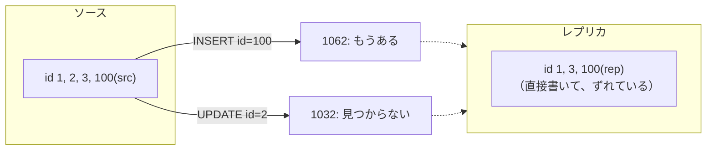

# 31 止まる・ずれるとき

## この章で分かるようになること

- レプリケーションが止まる、よくある3つのエラー（1062、1032、1236）が、なぜ起きるか
- 止まったときの調べ方と、直し方の選び方（データを直す、飛ばす、作り直す）
- 止まっていないけれど中身がずれている状態の見つけ方と、防ぎ方

## 解説

### 止まるのは、同じ変更をやり直せないとき

ROW 形式（[21章](21_binlog_events.md)）では、レプリカは「この行を入れる」「主キーが 2 の行を、この値からこの値に変える」「この行を消す」という変更を、そのままやり直す。レプリカの中身がソースと同じなら、必ずやり直せる。

やり直せないのは、レプリカの中身がソースとずれているとき。そのとき MySQL は、勝手に合わせたりせずに、適用を止めて知らせる。ずれる原因は、ほとんどが次の2つ。

- **レプリカで直接書いた**: `super_read_only` を外して書いた、レプリカに繋ぐアプリケーションの設定を間違えた
- **レプリカがトランザクションを取りこぼした**: 前に止まったときに飛ばした、ずれた状態のバックアップからレプリカを作った



### 3つのエラー

| エラー | 止まるスレッド | 何が起きたか | よくある原因 |
|---|---|---|---|
| 1062（Duplicate entry） | 適用 | 入れようとした行が、レプリカにもうある | レプリカで同じ主キーの行を直接入れた |
| 1032（Can't find record） | 適用 | 変えたり消したりしようとした行が、レプリカにない | レプリカで行を消した。前に飛ばしたトランザクションが入れた行だった |
| 1236（受信のエラー 13114） | 受信 | 必要な binlog が、ソースにもうない | レプリカが止まっている間に、保持期間や PURGE でソースが binlog を消した（[20章](20_binlog_basics.md)） |

### 調べ方

- `SHOW REPLICA STATUS\G`: `Replica_IO_Running` と `Replica_SQL_Running` のどちらが `No` か。`Last_IO_Errno` と `Last_IO_Error`（受信）、`Last_SQL_Errno` と `Last_SQL_Error`（適用）。並列で反映しているときの `Last_SQL_Error` は、「係のどれかが失敗したので止まった」という取りまとめ役の要約になっている
- `performance_schema.replication_applier_status_by_worker`: 失敗した係の `LAST_ERROR_MESSAGE` に、止まったトランザクションの GTID、ソースの binlog のファイルと位置、イベントの種類、テーブル、ぶつかったキーまで出る
- `performance_schema.replication_connection_status`: 受信のエラー（1236 など）
- 止まったトランザクションが何をしたのかは、ソースの binlog の、そのファイルと位置を `mysqlbinlog` で読むと分かる（`make binlog f=…`）

### 直し方の選び方

| 直し方 | やること | 良いところ | 危ないところ |
|---|---|---|---|
| データを直す | レプリカの行をソースに合わせてから、`START REPLICA` | ずれが残らない | ずれがどこまで広がっているか分からないと、直しきれない |
| 飛ばす | 止まったトランザクションを、反映したことにして先へ進む | すぐに動き出す | ずれはそのまま残る。後で別の行で、また止まる |
| 作り直す | ソースのデータをまるごと写して、そこから繋ぎ直す | 確実にそろう | 時間がかかる。その間、そのレプリカは使えない |

GTID を使っているときの「飛ばす」は、止まったトランザクションと同じ GTID で、中身のないトランザクションをコミットする。レプリカは、もう持っている GTID のトランザクションは反映しないので、そのトランザクションを済んだことにして先へ進む。

```sql
STOP REPLICA;
SET GLOBAL super_read_only = OFF;
SET GTID_NEXT = 'd10e7af6-e4f2-11f1-9ca6-3e4b86605c0f:480515';  -- 止まったトランザクションの GTID
BEGIN;
COMMIT;                                                          -- 中身のない、同じ GTID のトランザクション
SET GTID_NEXT = 'AUTOMATIC';
SET GLOBAL super_read_only = ON;
START REPLICA;
```

飛ばしてよいのは、「そのトランザクションの変更は、もうレプリカに入っている」と確かめられたときだけ。そうでなければ、ずれを1つ増やしただけになる。

1236 は、飛ばしても直らない。足りないのはトランザクションそのもので、それを持っているソースの binlog がもうないため。作り直すしかない。

### ずれの見つけ方

止まっていないレプリカでも、ずれていることがある。止まるのは、ずれた行にたまたま変更が来たときだけ。

- **CHECKSUM TABLE**: ソースとレプリカで `CHECKSUM TABLE t;` を流して、値を比べる。テーブルを全部読むので、大きいテーブルでは重い
- **pt-table-checksum の考え方**: 行を少しずつ区切って、区切りごとのチェックサムをソースで計算して表に書く。その書き込みを文のまま（STATEMENT 形式で）レプリカに流すと、レプリカでも同じ範囲のチェックサムが自分のデータで計算される。区切りごとに比べれば、どこがずれているかが分かる
- **レプリカだけにある GTID**: レプリカの `gtid_executed` に、ソースにない GTID（ふつうはレプリカ自身の UUID のもの）があれば、それはレプリカで直接書いたトランザクション（errant transaction とも呼ぶ）。`GTID_SUBTRACT(レプリカの gtid_executed, ソースの gtid_executed)` で分かる。この環境の `make state` も、これを見ている

### 作り直す: clone プラグイン

MySQL 8.0.17 からは、clone プラグインで、動いているサーバーの中身をネットワーク越しにまるごと写せる。

- 写す先（レプリカ）で `CLONE INSTANCE FROM 'root'@'src':3306 IDENTIFIED BY '…';` を流すと、写す元（ソース）の InnoDB のデータを、ある一瞬の状態でそろえて写して、自分のデータを置き換える
- 写し終わると、写す先の mysqld は起動し直す。起動し直す仕組み（監視するプロセス）がないと、止まったままになる。この環境では、`make rebuild-rep` が起動し直す
- 写した後の `gtid_executed` は、写した時点のソースと同じになる。そこから GTID の自動位置合わせで繋げば、続きを受け取れる
- 両方に clone プラグインを入れて、写す先に `clone_valid_donor_list`（どこから写してよいか）を設定しておく。写す先は、`super_read_only` を外しておく必要がある
- `server_uuid` は写されない。写す先は自分の UUID のまま

### 防ぐ

- レプリカは全部 `super_read_only` にする（[30章](30_replication.md)）。root でも書けなくなる
- binlog の保持期間を、「レプリカが止まってから、気づいて直すまで」より長くする（[20章](20_binlog_basics.md)）。1236 を防ぐ
- レプリカだけにある GTID を監視して、直接の書き込みに早く気づく

## 手を動かして確かめる

### 実験1: レプリカで直接書いて、1062 で止める

**予想:** レプリカで行を足したり消したりした後、ソースで同じ主キーの行を入れると、どうなる？ `make state` は、レプリカでの書き込みに気づく？

```sql
-- make a（ソース）で
CREATE DATABASE dba31;
CREATE TABLE dba31.t (id INT PRIMARY KEY, v VARCHAR(10));
INSERT INTO dba31.t VALUES (1, 'a'), (2, 'b'), (3, 'c');
-- make rep（レプリカ）で。super_read_only を外して、わざと書く
SET GLOBAL super_read_only = OFF;
INSERT INTO dba31.t VALUES (100, 'rep');
DELETE FROM dba31.t WHERE id = 2;
SET GLOBAL super_read_only = ON;
```

```bash
make state
```

```sql
-- make a で
INSERT INTO dba31.t VALUES (100, 'src');
-- make rep で
SHOW REPLICA STATUS\G
SELECT WORKER_ID, LAST_ERROR_NUMBER, LAST_ERROR_MESSAGE
FROM performance_schema.replication_applier_status_by_worker WHERE LAST_ERROR_NUMBER <> 0;
```

ここを見る: `make state` の出力、`Replica_SQL_Running`、`Last_SQL_Error`、`LAST_ERROR_MESSAGE` の中身。

<details>
<summary>何が起きたか</summary>

`make state` は、「rep に、src にないトランザクションがある」と出す。レプリカで直接書いた2つのトランザクションには、レプリカ自身の UUID の GTID が付いている。

ソースで `INSERT` すると、レプリカの適用が止まる。`Replica_SQL_Running` は `No`、`Last_SQL_Errno` は 1062。`Last_SQL_Error` は「係でエラーが起きたので止まった」という要約で、詳しいことは `replication_applier_status_by_worker` を見るように書いてある。そちらには、次のように出る。

```text
Worker 1 failed executing transaction 'd10e7af6-…:480515' at source log binlog.000054, end_log_pos 1559;
Could not execute Write_rows event on table dba31.t; Duplicate entry '100' for key 't.PRIMARY', Error_code: 1062; …
```

止まったトランザクションの GTID、ソースの binlog のファイルと位置、イベント（`Write_rows`）、テーブル、ぶつかったキーまで分かる。

</details>

### 実験2: 飛ばして直す。ずれは残る

**予想:** 止まったトランザクションを飛ばすと、レプリケーションは動き出す。ソースとレプリカの中身は同じになる？

```sql
-- make rep で。GTID は、実験1の LAST_ERROR_MESSAGE の transaction '…' の値を入れる
STOP REPLICA;
SET GLOBAL super_read_only = OFF;
SET GTID_NEXT = 'd10e7af6-…:480515';
BEGIN;
COMMIT;
SET GTID_NEXT = 'AUTOMATIC';
SET GLOBAL super_read_only = ON;
START REPLICA;
-- make a と make rep の両方で
CHECKSUM TABLE dba31.t;
SELECT * FROM dba31.t;
```

続けて、レプリカで消した行を、ソースで変える。

```sql
-- make a で
UPDATE dba31.t SET v = 'x' WHERE id = 2;
-- make rep で
SELECT LAST_ERROR_NUMBER, LAST_ERROR_MESSAGE
FROM performance_schema.replication_applier_status_by_worker WHERE LAST_ERROR_NUMBER <> 0;
```

止まったら、同じやり方でもう一度飛ばしておく。

ここを見る: 2つの `CHECKSUM TABLE` の値、`SELECT *` の中身、2回目のエラーの番号。

<details>
<summary>何が起きたか</summary>

飛ばすと、レプリケーションは動き出す。でも `CHECKSUM TABLE` の値はソースとレプリカで違う。ソースは `1, 2, 3, 100('src')`、レプリカは `1, 3, 100('rep')` のまま。

ソースで `id = 2` の行を変えると、レプリカにはその行がないので、今度は 1032 で止まる。

```text
Could not execute Update_rows event on table dba31.t; Can't find record in 't', Error_code: 1032; …
```

飛ばすのは、エラーを消すだけで、ずれは直さない。ずれた行に変更が来るたびに、また止まる。

</details>

### 実験3: 必要な binlog を消して、1236 で止める

**予想:** レプリカが止まっている間に、ソースがその先の binlog を消す。レプリカを再開すると、どうなる？

```sql
-- make rep で
STOP REPLICA;
-- make a で
INSERT INTO dba31.t VALUES (4, 'd');
FLUSH BINARY LOGS;
INSERT INTO dba31.t VALUES (5, 'e');
FLUSH BINARY LOGS;
SHOW BINARY LOG STATUS;
-- File に出た名前を入れる
PURGE BINARY LOGS TO 'binlog.000056';
-- make rep で
START REPLICA;
SHOW REPLICA STATUS\G
```

ここを見る: `Replica_IO_Running`、`Last_IO_Errno`、`Last_IO_Error`。

<details>
<summary>何が起きたか</summary>

今度は受信のスレッドが止まる。`Last_IO_Errno` は 13114 で、`Last_IO_Error` には、ソースから返ってきた 1236 のエラーが入っている。

```text
Got fatal error 1236 from source when reading data from binary log: 'Cannot replicate because the source purged
required binary logs. … The GTID set sent by the replica is '…', and the missing transactions are '…:480490-480491''
```

レプリカが「自分はここまで持っている」と伝えた GTID と、足りないトランザクションの GTID まで出る。足りない2つ（`id = 4` と `id = 5` の `INSERT`）は、それを書いた binlog ごとソースから消えているので、どこからも受け取れない。

</details>

### 実験4: clone で作り直す

**予想:** レプリカを、ソースのデータをまるごと写して作り直す。ずれは消える？ レプリカだけにあった GTID はどうなる？

```bash
make rebuild-rep
```

`make rebuild-rep` は、clone プラグインで src の中身を rep に写して、rep を起動し直してから、レプリケーションを設定し直す。数十秒から数分かかる。

```sql
-- make a と make rep の両方で
CHECKSUM TABLE dba31.t;
-- make rep で
SELECT @@server_uuid, @@gtid_executed, @@super_read_only;
```

```bash
make state
```

ここを見る: 2つの `CHECKSUM TABLE` の値、レプリカの `gtid_executed`、`make state` の出力。

<details>
<summary>何が起きたか</summary>

`CHECKSUM TABLE` の値がソースとレプリカで同じになって、`id = 4` と `id = 5` の行もレプリカに入っている。レプリカの `gtid_executed` はソースと同じになって、レプリカだけにあった GTID は消えている。`make state` も「ずれなし」に戻る。

`server_uuid` は、作り直す前と同じレプリカ自身のもの。`super_read_only` も ON に戻っている（`make rebuild-rep` が設定し直している）。

</details>

### 戻す

実験で作ったデータベースを消して、`make state` で確かめる。

```sql
DROP DATABASE IF EXISTS dba31;
```

## Aurora ではどうなる？

### 同じところ

- Aurora の binlog レプリケーション（外の MySQL や、別の Aurora のクラスターから受け取るもの）は、この章と同じエラーで止まる。調べ方も同じで、`SHOW REPLICA STATUS` と performance_schema を見る
- 飛ばしてもずれは残る、という危険も同じ

### 違うところ

- **飛ばすには、ストアドプロシージャを使う**: `CALL mysql.rds_skip_repl_error;` で、今のエラーを1つ飛ばす。GTID を使っているなら、`CALL mysql.rds_skip_transaction_with_gtid('…');` で GTID を指定して飛ばすよう、AWS は勧めている
- **作り直すには、Aurora のクローンを使える**: Aurora のクローンは、ストレージのコピーオンライトで作るので、データを写さずにすぐ作れる。binlog レプリケーションの相手を作り直すときは、クローンを作って、そのクローンの binlog の位置（イベントやエラーログに出る）から、`mysql.rds_set_external_source` と `mysql.rds_start_replication` で繋ぎ直す
- **クラスターの中のリーダーには、この章のエラーは起きない**: リーダーは binlog を使わず、ライターと同じストレージを読んでいる（[30章](30_replication.md)）
- **Blue/Green のグリーン側は、最初から書き込めない**: Aurora MySQL 3 では、作ったグリーン側のクラスターは書き込みを受け付けない（`read_only`）。AWS は、テストの間も読み取り専用にしておくよう勧めている。書き込むと、ブルーから流れてくる変更とぶつかって（この章の 1062 や 1032）、切り替えた後の本番にも意図しないデータが残るため。ただし、`CONNECTION_ADMIN` の権限を持つユーザー（マスターユーザーを含む）は、`read_only` でも書けてしまう（[30章](30_replication.md)の `read_only` と `super_read_only` の違い）

### 業務の Aurora で見てみるなら

業務の Aurora を触れる立場で、binlog のレプリカになっているクラスターがあるなら、そのライターで次の軽い読み取りを流してみる。

```sql
SHOW REPLICA STATUS\G
SELECT WORKER_ID, LAST_ERROR_NUMBER, LAST_ERROR_MESSAGE, LAST_ERROR_TIMESTAMP
FROM performance_schema.replication_applier_status_by_worker;
```

- 飛ばす前に、止まったトランザクションが何をしたのかを、ソースの binlog で確かめる
- Blue/Green のグリーン側に、アプリケーションやバッチが繋いで書き込んでいないかを確かめる

業務の Aurora で見た値はこのリポジトリに書かない。

出典:

- [Configuring, starting, and stopping binary log (binlog) replication（mysql.rds_skip_repl_error）（AWS）](https://docs.aws.amazon.com/AmazonRDS/latest/AuroraUserGuide/mysql-stored-proc-replicating.html)
- [Replicating transactions using GTIDs（mysql.rds_skip_transaction_with_gtid）（AWS）](https://docs.aws.amazon.com/AmazonRDS/latest/AuroraUserGuide/mysql-stored-proc-gtid.html)
- [Cloning a volume for an Amazon Aurora DB cluster（AWS）](https://docs.aws.amazon.com/AmazonRDS/latest/AuroraUserGuide/Aurora.Managing.Clone.html)
- [Setting up binary log replication for Aurora MySQL（クローンから binlog レプリケーションを始める）（AWS）](https://docs.aws.amazon.com/AmazonRDS/latest/AuroraUserGuide/AuroraMySQL.Replication.MySQL.SettingUp.html)
- [Limitations and considerations for Amazon Aurora blue/green deployments（グリーン側の read_only）（AWS）](https://docs.aws.amazon.com/AmazonRDS/latest/AuroraUserGuide/blue-green-deployments-considerations.html)

## 説明できるか確かめる

1. 1062 と 1032 は、それぞれどんなときに起きる？ どちらも「レプリカの中身がソースと違う」ことが原因なのはなぜ？（「3つのエラー」）
2. 止まったトランザクションを飛ばすと、なぜ後で別のエラーが出やすい？（実験2）
3. 1236 は、飛ばしても直らない。なぜ？ どう直す？（実験3、実験4）
4. 止まっていないけれど、ずれているレプリカは、どうやって見つける？（「ずれの見つけ方」）
5. ずれやエラーを防ぐために、レプリカとソースにそれぞれ何をしておく？（「防ぐ」）

## この章のキーワード

- **1062（Duplicate entry）**: 入れようとした行が、レプリカにもうある
- **1032（Can't find record）**: 変えたり消したりしようとした行が、レプリカにない
- **1236**: レプリカに必要な binlog が、ソースにもうない（受信のエラー 13114 として出る）
- **飛ばす**: 止まったトランザクションと同じ GTID で、中身のないトランザクションをコミットして、済んだことにする。ずれは直らない
- **ずれ（データの不一致）**: ソースとレプリカの中身が違う状態。止まらないまま続くこともある
- **CHECKSUM TABLE / pt-table-checksum**: テーブルや行の範囲ごとのチェックサムを比べて、ずれを見つける方法
- **レプリカだけにある GTID（errant transaction）**: レプリカで直接書いたトランザクション。ソースにない GTID として残る
- **clone プラグイン**: 動いているサーバーの中身を、ネットワーク越しにまるごと写す仕組み（`CLONE INSTANCE`）
- **mysql.rds_skip_repl_error**: Aurora や RDS で、binlog レプリケーションのエラーを1つ飛ばすストアドプロシージャ
