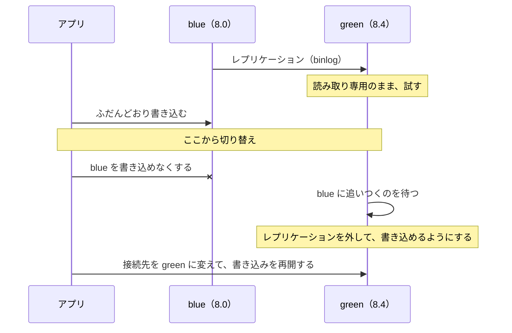

# 32 バージョンをまたぐ

## この章で分かるようになること

- 古い版のサーバーから新しい版のサーバーへ、レプリケーションを使って移る（Blue/Green）という考え方
- 8.0 から 8.4 で何が変わったかと、アップグレードのチェッカーの読み方
- 切り替えた後に、元の版へ戻すのが難しい理由

## 解説

### レプリケーションで移す

版を上げるやり方は、大きく2つある。

- **その場で上げる**: サーバーを止めて、MySQL のプログラムを新しい版に入れ替えて、起動し直す。起動したときに、データの形（データディクショナリなど）が新しい版の形に書き換わる。止めている間は使えないし、問題が出ても、その場で前の版に戻すことはできない
- **レプリケーションで移す**: 新しい版のサーバー（green）を、今のサーバー（blue）のレプリカとして作って、追いつかせる。green で試してから、書き込みの行き先を green に切り替える。止めるのは切り替えの間だけで、切り替えるまでは blue がそのまま残る

古い版のソースから新しい版のレプリカへのレプリケーション（8.0 → 8.4）は、MySQL が認めている向き。だから、移すときは古い版の側がソースになる。



### 8.0 から 8.4 で変わったこと

8.4 は、8.0 の次の長期サポート版（LTS）。8.0 の間に非推奨になっていたものが、まとめてなくなったり、既定値が変わったりしている。この環境で確かめたものを挙げる。

| 種類 | 8.0 | 8.4 |
|---|---|---|
| 認証 | `mysql_native_password` が使える（8.0.34 から非推奨） | 既定で使えない（`--mysql-native-password=ON` で起動したときだけ使える） |
| なくなった変数 | `default_authentication_plugin` | `authentication_policy` を使う |
| | `expire_logs_days` | `binlog_expire_logs_seconds` を使う（[20章](20_binlog_basics.md)） |
| | `binlog_transaction_dependency_tracking` | WRITESET だけになった（[22章](22_commit.md)） |
| なくなった SQL | `SHOW MASTER STATUS` | `SHOW BINARY LOG STATUS` |
| | `CHANGE MASTER TO`、`START SLAVE` | `CHANGE REPLICATION SOURCE TO`、`START REPLICA` |
| | `RESET MASTER` | `RESET BINARY LOGS AND GTIDS` |
| なくなった権限 | `SET_USER_ID` | なし |
| 既定値（一部） | `innodb_adaptive_hash_index=ON`、`innodb_change_buffering=all`、`innodb_io_capacity=200`、`innodb_log_buffer_size=16MB` | `OFF`、`none`、`10000`、`64MB`。`innodb_flush_method` は `O_DIRECT` になった |

既定値の中には、CPU の数などで決まるようになったものもある（`innodb_buffer_pool_instances` など）。設定ファイルに書いていない変数は、版を上げると黙って新しい既定値になる。今の値に頼っているなら、上げる前に設定ファイルに書いておく。

### アップグレードのチェッカー

MySQL Shell には、上げる前の古いサーバーに繋いで、問題を探す道具がある（`util.checkForServerUpgrade()`、コマンドでは `util check-for-server-upgrade`）。なくなる変数、既定値が変わる変数、非推奨の認証方式を使うユーザー、なくなる権限などを調べて、重さを3段階で出す。

- **Error**: このままだと上げられない、上げた後に動かないもの。必ず直す
- **Warning**: 上げられるけれど、動きが変わるもの。自分の使い方に関係するかを1つずつ見る
- **Notice**: 知っておけばよいもの

### 移している途中で止まる

レプリケーションで移しているときは、blue で流れた変更を、green が自分の版のルールでやり直す。8.4 で受け付けない変更が来ると、green の適用が止まる。実験2では、`mysql_native_password` のユーザーを blue で作ると、green でそのユーザーを作れずに止まる（1524）。

直し方は2つある。

- **本来の直し方**: 移す前に、blue でそのユーザーを `caching_sha2_password` に変えておく。アプリケーションのドライバが対応しているかも確かめる。チェッカーが Warning として教えてくれる
- **つなぎの直し方**: green を `--mysql-native-password=ON` で起動し直す。止まったところから続きが進む。ただし、このプラグインはいずれなくなるので、本来の直し方までの時間稼ぎにしかならない

### 戻すのが難しい

切り替えた後は、新しい書き込みが green（8.4）にだけ入る。blue（8.0）に戻すには、その書き込みを blue に持って行く必要がある。

- **その場で戻す（その場でのダウングレード）はできない**: データの形が 8.4 のものになっているため。同じ LTS の中（8.4.x どうし）でしかできない
- **逆向きのレプリケーション（8.4 → 8.0）**: MySQL のレプリケーションの互換性の説明では、新しい版のソースから古い版のレプリカへのレプリケーションは、一般には保証していない。binlog の形が変わることがあり、新しい版にしかない機能を使った変更は、古い版でやり直せない。一方で、LTS 間のダウングレードの説明では、8.4 から 8.0 へは「ダンプと読み込み、またはレプリケーションで、新しい機能をデータに使っていない場合の、元に戻す目的に限って」としている
- 実験4では、行の変更と簡単な DDL は、8.4 から 8.0 へ流れた。ただし、それは「この変更は流れた」というだけで、8.4 の機能を使った途端に止まるかもしれない

だから、切り替えの前に green で十分に試して、切り替えた後に戻す必要が出ないようにするのが基本になる。

## 手を動かして確かめる

### 実験1: アップグレードのチェッカーを流す

**予想:** 8.0 の blue に `mysql_native_password` のユーザーを作ってから、8.4 に上げられるかを調べる。Error、Warning、Notice はそれぞれいくつ出る？

```bash
make bg-up
```

`make bg-up` は、8.0.46 の blue（src と同じ初期データ入り）と、8.4.13 の green（空）を立てる。blue に古い認証方式のユーザーを作る。

```sql
-- make blue で
CREATE USER 'legacy'@'%' IDENTIFIED WITH mysql_native_password BY 'legacy';
```

green のコンテナに入っている MySQL Shell から、blue を調べる。

```bash
docker compose --profile bg exec green mysqlsh --uri root:root@blue:3306 -- util check-for-server-upgrade --target-version=8.4.13
```

ここを見る: 最後の Errors、Warnings、Notices の数。認証方式（`authMethodUsage`）、既定値が変わる変数（`sysVarsNewDefaults`）、なくなる権限（`invalidPrivileges`）の指摘。

<details>
<summary>何が起きたか</summary>

確かめたときは、Error が0、Warning が21、Notice が2だった。

- 既定値が変わる変数が20個挙がる。`innodb_adaptive_hash_index`（ON → OFF）、`innodb_change_buffering`（all → none）、`innodb_io_capacity`（200 → 10000）、`binlog_transaction_dependency_tracking`（COMMIT_ORDER → WRITESET）など。設定ファイルに書いていないものだけが挙がる
- `legacy@%` が、非推奨の `mysql_native_password` を使っていると指摘される
- `root` の `SET_USER_ID` の権限が、上げるとなくなると知らせてくれる（Notice）

Error が0なので、上げること自体はできる。でも Warning の認証方式は、実験2で見るとおり、レプリケーションで移すときには止まる原因になる。

</details>

### 実験2: blue から green へのレプリケーションを始める

**予想:** green を blue のレプリカにすると、blue の変更は全部 green に流れる？ `legacy` のユーザーはどうなる？

```bash
make sh
mysql -h green -uroot -proot < /lab/labs/32/start_replication.sql
exit
```

```sql
-- make green で
SHOW REPLICA STATUS\G
SELECT LAST_ERROR_NUMBER, LAST_ERROR_MESSAGE
FROM performance_schema.replication_applier_status_by_worker WHERE LAST_ERROR_NUMBER <> 0;
```

止まっていたら、green を `mysql_native_password` を使えるようにして起動し直す（データとレプリケーションの設定はそのまま残る）。

```bash
make bg-up native=ON
```

```sql
-- make green で
SHOW REPLICA STATUS\G
SELECT user, plugin FROM mysql.user WHERE user = 'legacy';
```

ここを見る: `Replica_SQL_Running`、`LAST_ERROR_MESSAGE`、起動し直した後の `mysql.user`。

<details>
<summary>何が起きたか</summary>

受信は動いているけれど、適用が 1524 で止まる。

```text
Worker 1 failed executing transaction '…:24' at source log binlog.000003, end_log_pos 496;
Error 'Plugin 'mysql_native_password' is not loaded' on query. … Query: 'CREATE USER IF NOT EXISTS 'legacy'@'%'
IDENTIFIED WITH 'mysql_native_password' AS '*2864…''
```

blue の初期データ（`lab.orders` など）は、その前のトランザクションなので、もう green に入っている。止まったのは、`legacy` を作るトランザクションから先。

`make bg-up native=ON` で起動し直すと、止まったところから続きが進んで、green にも `legacy` が `mysql_native_password` で作られる。

</details>

### 実験3: 切り替える

**予想:** blue で変更してから切り替える。切り替えた時点で、blue と green は同じデータになっている？ 切り替えた後、blue と green はそれぞれ書き込める？

```sql
-- make blue で
CREATE DATABASE dba32;
CREATE TABLE dba32.t (id INT PRIMARY KEY, v VARCHAR(30));
INSERT INTO dba32.t VALUES (1, 'from blue 8.0');
```

```bash
make sh
bash /lab/labs/32/switchover.sh
```

`switchover.sh` は、blue を `super_read_only` にして新しい書き込みを止め、green が blue に追いつくのを待ってから、両方の `lab.orders` のチェックサムを取る。最後に、green のレプリケーションの設定を消して、書き込めるようにする。

```sql
-- make green で
SELECT * FROM dba32.t;
SELECT @@read_only, @@super_read_only;
-- make blue で
SELECT @@super_read_only;
```

ここを見る: `blue_checksum` と `green_checksum`、`green_writable`、両方の `read_only` と `super_read_only`。

<details>
<summary>何が起きたか</summary>

2つのチェックサムは同じで、blue で入れた `from blue 8.0` の行も green に届いている。green は `read_only` も `super_read_only` も 0 になって書き込める。blue は `super_read_only` が 1 で、書き込めない。

順番が大事で、先に blue を書き込めなくしてから、green が追いつくのを待っている。逆にすると、待っている間に blue に来た書き込みが、green に届かないまま取り残される。

</details>

### 実験4: 逆向き（8.4 → 8.0）に流してみる

**予想:** 切り替えた後に、blue を green のレプリカにして、green で変更する。8.4 の変更は 8.0 に流れる？

```sql
-- make blue で
CHANGE REPLICATION SOURCE TO
  SOURCE_HOST = 'green', SOURCE_PORT = 3306, SOURCE_USER = 'repl', SOURCE_PASSWORD = 'repl',
  SOURCE_AUTO_POSITION = 1, GET_SOURCE_PUBLIC_KEY = 1, SOURCE_CONNECT_RETRY = 5;
START REPLICA;
-- make green で
INSERT INTO dba32.t VALUES (2, 'from green 8.4');
ALTER TABLE dba32.t ADD COLUMN note VARCHAR(10);
-- make blue で
SELECT * FROM dba32.t;
SHOW REPLICA STATUS\G
```

ここを見る: blue の `dba32.t` の中身と列、`Replica_IO_Running` と `Replica_SQL_Running`。

<details>
<summary>何が起きたか</summary>

この環境では、green で入れた行も、足した列も、blue に届いた。受信も適用も動いている。

ただし、これは「この変更は流れた」というだけ。MySQL は新しい版から古い版へのレプリケーションを一般には保証しておらず、8.4 から 8.0 へは、新しい機能をデータに使っていない場合の、元に戻す目的に限って認めている。8.4 にしかない機能を使った変更が来た時点で、止まるかもしれない。

</details>

### 戻す

blue と green を、データのボリュームごと消す。src と rep には影響しない。最後に `make state` で確かめる。

```bash
make bg-down
make state
```

## Aurora ではどうなる？

### 同じところ

- Aurora の Blue/Green デプロイも、中身は「ブルーからグリーンへの binlog レプリケーション」で、この章と同じ考え方で動く。メジャーバージョンを上げるときにも使える
- MySQL そのものの変更（認証、なくなった変数や SQL）は、Aurora MySQL 3（8.0 互換）から 8.4 互換版に上げるときにも効く。既定値は Aurora のパラメータグループで決まるので、Aurora の側で確かめる

### 違うところ

- **自動でやってくれること**: グリーン側の環境を作って、ブルーからレプリケーションする。Aurora MySQL 3 では、グリーン側は最初から書き込めない（[31章](31_replication_trouble.md)）。切り替えのときは、次の順に進む
  1. 切り替えてよいかの確認（ガードレール）。レプリケーションが正常か、遅延が大きすぎないか、外へのレプリケーションがないか、長く続いている書き込みや DDL がないか
  2. 両方の環境で新しい書き込みを止めて、接続を切り、新しい接続を受け付けない
  3. グリーンがブルーに追いつくのを待つ
  4. クラスター、インスタンス、エンドポイントの名前を入れ替える。アプリケーションは、同じエンドポイントのまま新しい環境に繋がる
- **前提**: binlog を有効にする（カスタムのクラスターのパラメータグループで `binlog_format` を設定して、再起動する。ROW を勧めている）。binlog の保持期間も NULL 以外にしておく（[20章](20_binlog_basics.md)）
- **切り替える前に確かめること**: グリーン側の `AuroraBinlogReplicaLag` がほぼ0か。長いトランザクションや DDL が流れていないか（切り替えが長引く）。アプリケーションの DNS のキャッシュが5秒より長くないか（長いと、切り替えた後も古い環境に書きに行く）
- **切り替えた後**: 元のブルー側は読み取り専用にされて、Blue/Green デプロイを消すまでそのまま残る

### 業務の Aurora で見てみるなら

業務の Aurora を触れる立場なら、次の軽い読み取りを流してみる。

```sql
SELECT @@version, @@aurora_version;
SELECT @@binlog_format;
SELECT COUNT(*) FROM mysql.user WHERE plugin = 'mysql_native_password';
```

- v3（8.0 互換）なら、8.4 互換版に上げる前に、`mysql_native_password` のユーザーを `caching_sha2_password` に変えられるかを確かめる（アプリケーションのドライバも）
- Blue/Green を使うなら binlog が要る。`binlog_format` が OFF なら、有効にして再起動するところから始まる
- 8.0 の SQL の名前（`SHOW MASTER STATUS` など）を使っているスクリプトや監視がないかも確かめる

業務の Aurora で見た値はこのリポジトリに書かない。

出典:

- [Overview of Amazon Aurora Blue/Green Deployments（AWS）](https://docs.aws.amazon.com/AmazonRDS/latest/AuroraUserGuide/blue-green-deployments-overview.html)
- [Switching a blue/green deployment in Amazon Aurora（ガードレールと切り替えの手順）（AWS）](https://docs.aws.amazon.com/AmazonRDS/latest/AuroraUserGuide/blue-green-deployments-switching.html)
- [Creating a blue/green deployment in Amazon Aurora（binlog が前提）（AWS）](https://docs.aws.amazon.com/AmazonRDS/latest/AuroraUserGuide/blue-green-deployments-creating.html)
- [Limitations and considerations for Amazon Aurora blue/green deployments（グリーン側の read_only）（AWS）](https://docs.aws.amazon.com/AmazonRDS/latest/AuroraUserGuide/blue-green-deployments-considerations.html)
- [Best practices for Amazon Aurora blue/green deployments（DNS のキャッシュ、遅延）（AWS）](https://docs.aws.amazon.com/AmazonRDS/latest/AuroraUserGuide/blue-green-deployments-best-practices.html)
- [Aurora MySQL version 8.4 compatible with MySQL 8.4（AWS）](https://docs.aws.amazon.com/AmazonRDS/latest/AuroraUserGuide/AuroraMySQL.MySQL84.html)
- [Replication Compatibility Between MySQL Versions（MySQL 8.4 Reference Manual）](https://dev.mysql.com/doc/refman/8.4/en/replication-compatibility.html)
- [Downgrading MySQL（MySQL 9.7 Reference Manual。LTS 間のダウングレードの表）](https://dev.mysql.com/doc/refman/9.7/en/downgrading.html)

## 説明できるか確かめる

1. その場で版を上げるのではなく、レプリケーションで新しい版に移すと、何が良い？（「レプリケーションで移す」）
2. アップグレードのチェッカーの Error、Warning、Notice は、それぞれどう扱う？ 既定値が変わる変数について、上げる前に何をしておく？（実験1）
3. `mysql_native_password` のユーザーがあると、8.0 から 8.4 へのレプリケーションで何が起きる？ 本来の直し方と、つなぎの直し方は？（実験2）
4. 切り替えのとき、blue を先に書き込めなくしてから green が追いつくのを待つのはなぜ？（実験3）
5. 切り替えた後に 8.0 に戻すのが難しいのはなぜ？（「戻すのが難しい」、実験4）

## この章のキーワード

- **Blue/Green**: 今の環境（blue）のレプリカとして新しい環境（green）を作り、試してから切り替えるやり方
- **アップグレードのチェッカー**: MySQL Shell の `util.checkForServerUpgrade()`。上げる前の問題を Error、Warning、Notice で出す
- **mysql_native_password**: 古い認証方式。8.0.34 から非推奨で、8.4 では既定で使えない
- **caching_sha2_password**: 8.0 からの既定の認証方式
- **LTS（長期サポート版）**: 8.0 や 8.4 のような、長く保守される版。同じ LTS の中なら、データの形は変わらない
- **切り替え（switchover）**: 書き込みの行き先を、blue から green に移すこと
- **逆向きのレプリケーション**: 新しい版から古い版へのレプリケーション。一般には保証されていない
- **ガードレール**: Aurora の Blue/Green で、切り替えてよいかを先に確かめる仕組み
