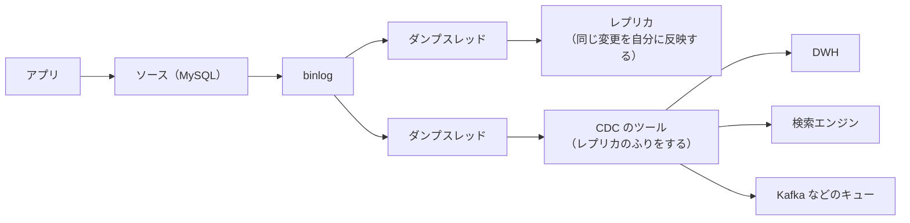

# 40 CDC の仕組み

## この章で分かるようになること

- CDC のツールが、MySQL から変更をどうやって受け取っているか（レプリカのふりをする）
- 最初からあるデータ（スナップショット）とその後の変更を、漏れも重なりもなくつなぐ方法
- どこまで読んだかを覚えておく仕組みと、止まっていた間の binlog が消えたときに何が起きるか

## 解説

### レプリカのふりをする

**CDC**（Change Data Capture）は、データベースの変更を取り出して、別のシステムに流す仕組み。DWH への取り込み、検索エンジンの索引の更新、キャッシュの消し込み、マイクロサービス間のデータの連携などに使う。

MySQL の CDC のツールは、レプリカのふりをして binlog を受け取る。



- CDC のツールは、レプリカと同じように、`REPLICATION SLAVE` の権限を持つユーザーでソースに繋いで、「この GTID の集まりより後を送って」と頼む（30章の自動位置合わせと同じ）。ソースからは、ふつうのレプリカと見分けがつかない。`SHOW PROCESSLIST` にも、ダンプスレッドとして出る
- 違うのは、受け取った後。レプリカは変更を自分のテーブルにやり直すけれど、CDC のツールは、行のイベント（変える前と後の行。21章）を「この表のこの行が、こう変わった」という記録に作り直して、別のシステムに渡す
- レプリカと同じく、サーバーの番号（`server_id`）を名乗る。ほかのレプリカや CDC のツールと重ならないようにする

### 要る設定と権限

| 種類 | 何を | なぜ |
|---|---|---|
| 設定 | binlog を ON（`log_bin`） | 変更の流れそのもの（20章） |
| | `binlog_format=ROW` | 文ではなく、変わった行が要る（21章） |
| | `binlog_row_image=FULL` | 変える前と後の、全部の列の値が要る（21章） |
| | GTID を ON | どこまで読んだかを、サーバーをまたいで続けられる（30章） |
| | binlog の保持期間を十分に | CDC のツールが止まっている間に消えると、続きから読めない（20章） |
| 権限 | `REPLICATION SLAVE` | binlog を受け取る |
| | `REPLICATION CLIENT` | `SHOW BINARY LOGS` などで、binlog の状態を見る |
| | `SELECT` | 最初のスナップショットで、テーブルを読む |
| | `RELOAD`、`LOCK TABLES` | スナップショットのときに、読み取りのロックをかける |

この環境の `cdc` ユーザーには、この権限を付けてある。

### スナップショットと、その後の変更をつなぐ

binlog には、ある時点から後の変更しかない。それより前からあるデータは、最初に一度テーブルを読んで取る必要がある。これを **スナップショット** と呼ぶ。大きいテーブルなら何時間もかかり、その間にも変更は続く。どこまでがスナップショットに入っていて、どこからを binlog で受け取ればよいかの境目を、ぴったり決めないといけない。

境目は、次の順番で決める（実験4で、この通りに動かす）。

1. `FLUSH TABLES WITH READ LOCK` で、全部の書き込みを一瞬止める
2. 今の GTID の集まり（`@@gtid_executed`）を記録する。これが境目になる
3. `START TRANSACTION WITH CONSISTENT SNAPSHOT` で、その瞬間の読み取りの視点を作る（MVCC。13章）
4. `UNLOCK TABLES` で、書き込みを再開させる。止めていたのはここまで
5. 作った視点から、テーブルを全部読む。時間がかかっても、見えるのは境目の時点のデータだけ
6. 読み終えたら、記録した GTID の集まりより後の変更を、binlog から受け取る

スナップショットに入った変更は、記録した GTID の集まりに入っているので、binlog からは受け取らない。境目より後の変更は、スナップショットには見えず、binlog から受け取る。だから、**スナップショット＋その後の変更＝全部** になって、漏れも重なりもない。

気をつけることが2つある。

- `FLUSH TABLES WITH READ LOCK` は、長く動いているクエリがあると、それが終わるまで待つ。その間、後ろに来た書き込みも全部止まる（15章のメタデータロックの行列と同じ形）
- スナップショットを読んでいる間は、長いトランザクションを開いたままになる。履歴リストが伸びて、purge が進まない（13章）

### どこまで読んだかと、続きから読む

CDC のツールは、受け取った変更を流し終えるたびに、「どこまで読んだか」（**オフセット**。GTID の集まりや、binlog のファイルと位置）を保存しておく。止まって起動し直したときは、保存したところから続きを頼む。止まっていた間の変更も、続きとして受け取れる。

ただし、止まっていた間に、続きの binlog がソースから消えていたら（保持期間や PURGE。20章）、続きから読めない。レプリカと同じく、「必要な binlog が消えている」というエラーになる（31章の 1236）。スナップショットから取り直すことになる。

`mysqlbinlog` で読むときは、注意がいる。読み始めるファイルの名前を渡すと、ソースはそのファイルから送り始めて、消えた分を黙って飛ばしてしまう（実験3）。ファイルの名前を空にして GTID の集まりだけで頼めば、レプリカと同じく、ソースが確かめてエラーにしてくれる。

### 順番と重複

- **順番**: 変更は binlog の順、つまりソースでコミットした順に届く。1つのトランザクションの中の行も、変えた順に並ぶ
- **重複**: 多くの CDC のツールが約束しているのは「少なくとも1回は届く」（at-least-once）。変更を流してから、オフセットを保存するまでの間に落ちると、起動し直したときに同じ変更をもう一度流す。だから、受け取る側は、同じ変更が2回来ても結果が変わらないように作る（主キーで上書きする、など。冪等にする）
- **大きいトランザクション**: コミットの瞬間に、何十万行分の変更がまとめて届く（22章）

## 手を動かして確かめる

### 実験1: binlog を受け取って、変更が流れてくるのを見る

**予想:** CDC のふりをして binlog を受け取っている間に、ソースで INSERT、UPDATE、DELETE をする。どんな形で届く？ ソースから、この接続はどう見える？

ターミナルを2つ使う。1つ目で、今の GTID の集まりより後を受け取り続ける。`stream.sh` は、`cdc` ユーザーで、`mysqlbinlog` をレプリカのふりで繋いで、指定した秒数のあいだ binlog を受け取って表示する。

```bash
make sh
g=$(mysql -h src -uroot -proot -N -B -e 'SELECT @@gtid_executed')
bash /lab/labs/40/stream.sh --exclude-gtids "$g" --seconds 60
```

2つ目のターミナルで、変更する。

```sql
-- make a で
CREATE DATABASE dba40;
CREATE TABLE dba40.t (id INT PRIMARY KEY, v VARCHAR(20));
INSERT INTO dba40.t VALUES (1, 'a');
UPDATE dba40.t SET v = 'b' WHERE id = 1;
DELETE FROM dba40.t WHERE id = 1;
SELECT ID, USER, COMMAND, STATE FROM information_schema.PROCESSLIST WHERE USER = 'cdc';
```

ここを見る: 1つ目のターミナルに出る `### INSERT INTO`、`### UPDATE`、`### DELETE FROM`。`cdc` ユーザーの接続の `COMMAND`。

<details>
<summary>何が起きたか</summary>

変更するたびに、1つ目のターミナルに行のイベントが流れてくる。`CREATE` は文のまま、INSERT は `### INSERT INTO`、UPDATE は `### WHERE`（変える前）と `### SET`（変えた後）を持つ `### UPDATE`、DELETE は `### DELETE FROM` になる。CDC のツールは、これを「どの行が、どう変わったか」の記録に作り直して流す。

ソースからは、`cdc` ユーザーの接続が `Binlog Dump GTID`（ダンプスレッド）に見える。レプリカと同じ扱いで、ソースは相手が CDC のツールだとは知らない。

</details>

### 実験2: 止めている間の変更を、続きから読む

**予想:** 受け取るのを止めている間にソースで変更する。止めたところの GTID の集まりから再開すると、何が届く？ 前に受け取った変更は、もう一度届く？

```bash
make sh
g=$(mysql -h src -uroot -proot -N -B -e 'SELECT @@gtid_executed')
# ここで make a から: INSERT INTO dba40.t VALUES (10, 'x'), (11, 'y');
bash /lab/labs/40/stream.sh --exclude-gtids "$g" --seconds 5
```

ここを見る: `@1=10` と `@1=11` の行が届くか。実験1の行（`'a'`）が、もう一度届いていないか。

<details>
<summary>何が起きたか</summary>

止めていた間の INSERT（`id` が 10 と 11）だけが届く。実験1の変更は、渡した GTID の集まりに入っているので、もう一度は届かない。

本物の CDC のツールは、この「渡す GTID の集まり」（オフセット）を、自分で保存しておいて、起動し直すたびに渡している。

</details>

### 実験3: 止めている間に binlog が消えると

**予想:** 実験2の最初に記録した GTID の集まりから、もう一度読もうとする。その前に、ソースで binlog を消しておくと、どうなる？

```sql
-- make a で
FLUSH BINARY LOGS;
SHOW BINARY LOG STATUS;
-- File に出た名前を入れる
PURGE BINARY LOGS TO 'binlog.000060';
```

```bash
# make sh で、実験2で記録した g から読む
bash /lab/labs/40/stream.sh --exclude-gtids "$g" --seconds 5
```

比べるために、読み始めるファイルの名前を渡して読んでみる（`SHOW BINARY LOGS` の最初のファイルの名前を入れる）。

```bash
MYSQL_PWD=cdc mysqlbinlog --read-from-remote-source=BINLOG-DUMP-GTIDS --host=src --user=cdc \
  --get-server-public-key --exclude-gtids="$g" binlog.000060 | head -20
```

ここを見る: エラーのメッセージ。ファイルの名前を渡したときに、エラーになるかどうか。

<details>
<summary>何が起きたか</summary>

`stream.sh` は、すぐにエラーで止まる。

```text
ERROR: Got error reading packet from server: Cannot replicate because the source purged required binary logs. …
```

`id` が 10 と 11 の INSERT を書いた binlog は、もう消えている。レプリカと同じで、続きがないので読めない（31章の 1236）。こうなったら、スナップショットから取り直す。

ファイルの名前を渡したほうは、エラーにならずに、そのファイルの中身を読み始める。消えた分（`id` が 10 と 11 の INSERT）は、黙って飛ばされている。CDC の下流からは、その変更がなかったように見える。`stream.sh` がファイルの名前を空にして渡しているのは、このためで、空ならソースが GTID の集まりを見て、どのファイルから送るかを決めて、足りなければエラーにする。

</details>

### 実験4: スナップショットとその後の変更をつなぐ

**予想:** 書き込みが続いている最中にスナップショットを取って、その後の変更を binlog から受け取る。2つを足すと、最後の行の数とぴったり同じになる？

```bash
make sh
bash /lab/labs/40/snapshot_check.sh
```

スクリプトは、`dba40.k` に1件ずつ INSERT を6秒流し続けて、その最中に、解説の 1〜5 の手順（`FLUSH TABLES WITH READ LOCK` → GTID の集まりを記録 → `START TRANSACTION WITH CONSISTENT SNAPSHOT` → `UNLOCK TABLES` → `SELECT COUNT(*)`）を `cdc` ユーザーの1つのセッションで流す。INSERT が終わってから、記録した集まりより後の INSERT を、`stream.sh` で数える。

ここを見る: `snapshot_rows`、`streamed_inserts`、`final_rows`。

<details>
<summary>何が起きたか</summary>

確かめたときは、スナップショットが456行、その後に binlog から届いた INSERT が831件、最後の行の数が1287行だった。456 + 831 = 1287 で、ぴったり同じになる。何回流しても、数は変わるけれど、足し算は必ず合う。

書き込みを止めたのは、GTID の集まりを記録してスナップショットの視点を作るまでの一瞬だけ。スナップショットの行を読んでいる間も、INSERT は進んでいる。

ただし、長く動いているクエリがあると、`FLUSH TABLES WITH READ LOCK` はそれを待つ。確かめたときは、6秒かかる SELECT の途中で流すと、`FLUSH TABLES WITH READ LOCK` が約5秒待たされて、その後ろに来た INSERT も約4秒止まった。

</details>

### 戻す

実験で作ったデータベースを消して、`make state` で確かめる。

```sql
DROP DATABASE IF EXISTS dba40;
```

## Aurora ではどうなる？

### 同じところ

- AWS DMS や Debezium などの CDC のツールは、Aurora のライターに binlog を読む相手として繋ぐ。要る設定（ROW、FULL、保持期間）と、スナップショットとその後の変更をつなぐ考え方は同じ
- binlog はライターにしかないので、CDC はライターから読む（30章）
- 最初のスナップショットのつなぎ方も同じ考え方。ただし、RDS や Aurora では `FLUSH TABLES WITH READ LOCK`（全体の読み取りのロック）を使えないので、ツールはテーブルごとのロックなどで代わりにする（42章の Debezium）

### 違うところ

- **binlog は既定で OFF**: クラスターのパラメータグループで `binlog_format` を ROW にして、再起動する（20章）
- **保持期間**: `CALL mysql.rds_set_configuration('binlog retention hours', 24);` のように決める（最大 2160時間）。AWS の DMS の説明でも、AWS の管理するデータベースは binlog をできるだけ早く消すので、保持期間を延ばすよう書かれている
- **AWS DMS の要件**: CDC には `binlog_format=ROW` と `binlog_row_image=FULL` が要る。Aurora MySQL の拡張バイナリログには対応していない
- **ゼロ ETL 統合**: Redshift などへの連携を AWS が自動でする仕組み。Aurora MySQL では、拡張バイナリログ（`aurora_enhanced_binlog=1`、`binlog_backup=0`、`binlog_replication_globaldb=0`）と `binlog_format=ROW` が要る。スナップショットとその後の変更のつなぎも、AWS の側でやる
- **拡張バイナリログのファイルは、バックアップやクローンに入らない**: 復元したクラスターやクローンでは、元のクラスターの binlog の続きは読めない（20章）

### 業務の Aurora で見てみるなら

業務の Aurora を触れる立場なら、ライターで次の軽い読み取りを流してみる。

```sql
SELECT @@binlog_format, @@binlog_row_image, @@gtid_mode;
CALL mysql.rds_show_configuration;
SHOW GLOBAL STATUS LIKE 'aurora_enhanced_binlog';
SELECT ID, USER, HOST, COMMAND, TIME, STATE
FROM information_schema.PROCESSLIST WHERE COMMAND LIKE 'Binlog Dump%';
```

- 最後の SQL で、今 binlog を読んでいる相手（DMS のタスク、Debezium、外のレプリカなど）が分かる
- binlog の保持期間が、CDC のツールが止まってから直すまでにかかりそうな時間より長いかを確かめる

業務の Aurora で見た値はこのリポジトリに書かない。

出典:

- [Using a MySQL-compatible database as a source for AWS DMS（ROW、FULL、拡張バイナリログ、保持期間）（AWS）](https://docs.aws.amazon.com/dms/latest/userguide/CHAP_Source.MySQL.html)
- [Getting started with Aurora zero-ETL integrations（AWS）](https://docs.aws.amazon.com/AmazonRDS/latest/AuroraUserGuide/zero-etl.setting-up.html)
- [Setting up enhanced binlog for Aurora MySQL（AWS）](https://docs.aws.amazon.com/AmazonRDS/latest/AuroraUserGuide/AuroraMySQL.Enhanced.binlog.html)
- [Setting and showing binary log configuration（binlog retention hours）（AWS）](https://docs.aws.amazon.com/AmazonRDS/latest/AuroraUserGuide/mysql-stored-proc-configuring.html)

## 説明できるか確かめる

1. CDC のツールは、どうやって MySQL から変更を受け取っている？ ソースからは、どう見えている？（実験1）
2. 最初のスナップショットとその後の変更を、漏れも重なりもなくつなぐには、何をどの順番で行う？（「スナップショットと、その後の変更をつなぐ」、実験4）
3. CDC のツールが、どこまで読んだかを保存しておくのはなぜ？ 止まっていた間の binlog が消えていると、何が起きる？（実験2、実験3）
4. 「少なくとも1回は届く」とは、どういうこと？ 受け取る側は何に気をつける？（「順番と重複」）
5. Aurora で CDC をするために、設定しておくことは何？（「Aurora ではどうなる？」）

## この章のキーワード

- **CDC（Change Data Capture）**: データベースの変更を取り出して、別のシステムに流す仕組み
- **レプリカのふり**: CDC のツールが、レプリカと同じやり方でソースに繋いで binlog を受け取ること
- **スナップショット**: CDC を始めるときに、もとからあるデータを一度全部読むこと
- **FLUSH TABLES WITH READ LOCK**: 全部のテーブルに読み取りのロックをかけて、書き込みを止める。スナップショットの境目を決めるのに使う
- **START TRANSACTION WITH CONSISTENT SNAPSHOT**: その瞬間の読み取りの視点を、すぐに作るトランザクションの始め方
- **オフセット**: CDC のツールが保存しておく「どこまで読んだか」（GTID の集まりや、ファイルと位置）
- **少なくとも1回（at-least-once）**: 変更が漏れずに届く代わりに、同じ変更が2回届くことがある、という約束
- **冪等**: 同じ変更を何回やり直しても、結果が同じになること
- **ゼロ ETL 統合**: Aurora から Redshift などへの連携を、AWS が自動で行う仕組み
