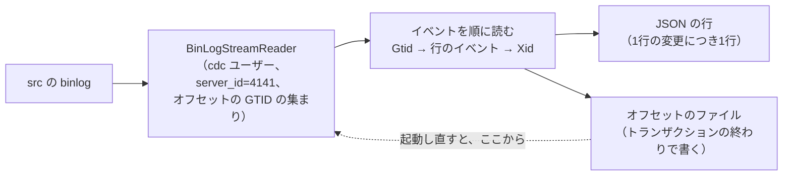

# 41 小さな CDC を自分で作る

## この章で分かるようになること

- CDC のツールの中身（レプリカのふり、行の変更の読み解き、どこまで読んだかの記録）を、小さなプログラムで確かめる
- 列の名前、変える前と後の値、テーブルの定義の変更が、CDC にとってなぜ難しいか
- 実際の CDC のツールが解いている問題と、業務のデータ連携で気をつける設定

## 解説

### cdc.py のつくり

`labs/41/cdc.py` は、説明のコメントを入れても140行ほどの小さな CDC。Python のライブラリ python-mysql-replication を使って、[40章](40_cdc_mechanics.md)の「レプリカのふり」を自分で書いている。



中身は3つの部分に分かれる。

- **レプリカのふりをするところ**: `BinLogStreamReader` に、`cdc` ユーザー、名乗る `server_id`（4141）、どこから読むかの GTID の集まり（`auto_position`）を渡す。ソースから見ると、[30章](30_replication.md)のレプリカと同じ
- **行の変更を読み解くところ**: `Gtid` のイベントで今のトランザクションの GTID を覚えて、`Write_rows`、`Update_rows`、`Delete_rows` のイベントの行を、`op`（`c`、`u`、`d`）と `before`、`after` を持つ JSON にして出す。DDL は、`Query` のイベントの文を `op: "ddl"` として出す
- **どこまで読んだかを覚えるところ**: `Xid` のイベント（トランザクションの終わり）や DDL が来るたびに、そのトランザクションの GTID を「読み終わった集まり」に足して、オフセットのファイルに書く。起動し直すと、その集まりの続きから読む

```python
elif isinstance(event, XidEvent):
    # トランザクションの終わり。ここまで読んだことを覚える
    in_transaction = False
    done = done + Gtid(current)
    save_offset(done)
```

### CDC が解かないといけない問題

小さな CDC でも、実際のツールが苦労している問題にそのままぶつかる。

| 問題 | cdc.py で起きること | 実際のツールの解き方 |
|---|---|---|
| 列の名前 | `binlog_row_metadata=MINIMAL`（既定）だと、列の名前が binlog にないので `UNKNOWN_COL0` のようになる（実験1） | `binlog_row_metadata=FULL` を使う。または DDL を読んで、テーブルの定義の移り変わりを自分で持つ（Debezium のスキーマの履歴など） |
| 変える前と後の値 | `binlog_row_image=MINIMAL` だと、前は主キーだけ、後は変えた列だけになる（実験4） | `binlog_row_image=FULL` を求める（AWS DMS や Debezium） |
| 書かれていない列と NULL | ライブラリは、row image に書かれていない列を null で埋める。そのまま下流に流すと、本当の値を NULL で上書きしてしまう | イベントの `columns_present_bitmap`（どの列が書かれているかの印）を見る。cdc.py もそうしている |
| テーブルの定義の変更 | DDL は文のまま届く。cdc.py は文を流すだけ（実験5） | DDL を読み解いて、下流のテーブルの定義も変える。列の名前や型の変更は特に難しい |
| 主キーのないテーブル | 下流で、どの行を変えればよいかを決める手がかりがない | 主キーを必須にする。または全部の列の値で行を見分ける |
| 大きいトランザクション | `Xid` が来るまで、オフセットが進まない。何十万行が一度に出る（[22章](22_commit.md)） | 下流に流す量を調節する |
| 届き方 | 行を出してから、オフセットを書くまでの間に落ちると、起動し直したときに同じトランザクションをもう一度出す | 受け取る側を冪等にする（主キーで上書きする、など） |

### 少なくとも1回か、多くても1回か

cdc.py は、トランザクションの行を全部出し終えてから、オフセットを書く。だから、その間に落ちても、変更が漏れることはない（もう一度出すだけ）。これが **少なくとも1回**（at-least-once）。

逆に、先にオフセットを書いてから行を出すと、その間に落ちたときに、そのトランザクションは二度と出てこない。漏れる代わりに重ならない、**多くても1回**（at-most-once）になる。データの連携では、漏れるほうがずっと困るので、ほとんどのツールが少なくとも1回を選んで、重なりは受け取る側で吸収する。

## 手を動かして確かめる

### 実験1: 列の名前が分からない

**予想:** `binlog_row_metadata` が既定の MINIMAL のまま、cdc.py で INSERT を受け取る。JSON の列の名前はどうなる？

ターミナルを2つ使う。1つ目で、今から後の変更を受け取る。オフセットは `/tmp/my.offset` に書かれる。

```bash
make sh
python /lab/labs/41/cdc.py --offset-file /tmp/my.offset --from-now --schema dba41
```

2つ目のターミナルで、変更する。

```sql
-- make a で
CREATE DATABASE dba41;
CREATE TABLE dba41.t (id INT PRIMARY KEY, v INT, note VARCHAR(20));
INSERT INTO dba41.t VALUES (1, 1, 'a');
```

1つ目のターミナルは、Ctrl+C で止める。

ここを見る: `after` の中の、列の名前。

<details>
<summary>何が起きたか</summary>

`CREATE DATABASE` と `CREATE TABLE` は `op: "ddl"` で届く。INSERT の行は、次のようになる。

```json
{"after": {"UNKNOWN_COL0": 1, "UNKNOWN_COL1": 1, "UNKNOWN_COL2": "a"}, "before": null, "gtid": "d10e7af6-…:504831", "op": "c", "schema": "dba41", "table": "t"}
```

binlog には列の名前がないので（[21章](21_binlog_events.md)）、ライブラリは「0番目の列」「1番目の列」としか言えない。ライブラリは、`BINLOG_ROW_METADATA = FULL` と `BINLOG_ROW_IMAGE = FULL` にするよう、警告も出す（標準エラー出力）。

</details>

### 実験2: 列の名前を記録して、追加・更新・削除を受け取る

**予想:** `binlog_row_metadata` を FULL にしてから、オフセットの続きから受け取る。INSERT、UPDATE、DELETE は、どんな JSON になる？

```sql
-- make a で
SET GLOBAL binlog_row_metadata = FULL;
```

```bash
# make sh で。--from-now を付けないので、/tmp/my.offset の続きから読む
python /lab/labs/41/cdc.py --offset-file /tmp/my.offset --schema dba41
```

```sql
-- make a で
INSERT INTO dba41.t VALUES (3, 3, 'c');
UPDATE dba41.t SET v = 4 WHERE id = 3;
DELETE FROM dba41.t WHERE id = 3;
```

ここを見る: `op`、`before`、`after`。

<details>
<summary>何が起きたか</summary>

```json
{"after": {"id": 3, "note": "c", "v": 3}, "before": null, "gtid": "…:504832", "op": "c", "schema": "dba41", "table": "t"}
{"after": {"id": 3, "note": "c", "v": 4}, "before": {"id": 3, "note": "c", "v": 3}, "gtid": "…:504833", "op": "u", "schema": "dba41", "table": "t"}
{"after": null, "before": {"id": 3, "note": "c", "v": 4}, "gtid": "…:504834", "op": "d", "schema": "dba41", "table": "t"}
```

列の名前が付いて、追加は `after` だけ、更新は `before` と `after` の両方、削除は `before` だけになる。変更した順に届いて、トランザクションごとに GTID が1つずつ増えている。実験1の INSERT は、オフセットに入っているので、もう一度は届かない。

</details>

### 実験3: 止めている間の変更を、続きから受け取る

**予想:** cdc.py を止めている間に、1つの文で5行を入れる。起動し直すと、何行届く？ オフセットのファイルには何が書いてある？

1つ目のターミナルの cdc.py を Ctrl+C で止めてから、変更する。

```sql
-- make a で
INSERT INTO dba41.t VALUES (10,10,'x'), (11,11,'x'), (12,12,'x'), (13,13,'x'), (14,14,'x');
```

```bash
# make sh で
python /lab/labs/41/cdc.py --offset-file /tmp/my.offset --schema dba41
# Ctrl+C で止めてから
cat /tmp/my.offset
```

ここを見る: 届いた行の数と、`gtid`。オフセットのファイルの中身。

<details>
<summary>何が起きたか</summary>

`id` が 10〜14 の5行が、1回ずつ届く。5行とも同じ `gtid` で、1つのトランザクションだったことが分かる。止める前に受け取った変更は、もう一度は届かない。

オフセットのファイルには、`d10e7af6-…:1-504837,…` のような GTID の集まりが1行だけ書いてある。cdc.py は、これを `auto_position` に渡して、「これより後を送って」と頼んでいる。

</details>

### 実験4: row image を MINIMAL にする

**予想:** `binlog_row_image` を MINIMAL にして、1つの列だけを UPDATE する。`before` と `after` には何が入る？

```sql
-- make a で（新しい接続から効くので、make a に入り直してから UPDATE する）
SET GLOBAL binlog_row_image = MINIMAL;
UPDATE dba41.t SET note = 'y' WHERE id = 10;
```

cdc.py を起動したまま流す。見終わったら、FULL に戻しておく。

```sql
SET GLOBAL binlog_row_image = FULL;
```

ここを見る: `before` と `after` の中の列。

<details>
<summary>何が起きたか</summary>

```json
{"after": {"note": "y"}, "before": {"id": 10}, "gtid": "…", "op": "u", "schema": "dba41", "table": "t"}
```

前の値は主キー（`id`）だけ、後の値は変えた列（`note`）だけ。`v` の値はどこにもない。下流に「行をまるごと」送りたいなら、これでは足りない。

実は、ライブラリそのものは、書かれていない列も null で埋めて返してくる（`{"id": 10, "note": null, "v": null}`）。そのまま下流に流すと、`v` が NULL になったように見えて、本当の値を NULL で上書きしてしまう。cdc.py は、イベントの `columns_present_bitmap`（どの列が書かれているかの印）を見て、書かれていた列だけを残している（`present()` という関数）。

</details>

### 実験5: DDL と、主キーのないテーブル

**予想:** 列を足す `ALTER TABLE` は、cdc.py にどう届く？ その後の INSERT には、新しい列が入る？ 主キーのないテーブルで、同じ値の行の1つだけを UPDATE すると、MINIMAL の `before` には何が入る？ 主キーのないテーブルを作らせない設定はある？

```sql
-- make a で
ALTER TABLE dba41.t ADD COLUMN extra INT;
INSERT INTO dba41.t VALUES (20, 20, 'z', 7);
-- 主キーのないテーブルに、同じ値の行を2つ入れて、1つだけ変える（この接続だけ MINIMAL にする）
SET SESSION binlog_row_image = MINIMAL;
CREATE TABLE dba41.nopk (a INT, b CHAR(1));
INSERT INTO dba41.nopk VALUES (1, 'x'), (1, 'x');
UPDATE dba41.nopk SET b = 'y' LIMIT 1;
SET SESSION binlog_row_image = FULL;
-- 主キーのないテーブルを作らせない設定
SET SESSION sql_require_primary_key = ON;
CREATE TABLE dba41.nopk2 (a INT);
```

ここを見る: cdc.py の `op: "ddl"` の行と、その後の INSERT の `after`。`nopk` の UPDATE の `before` と `after`。最後の `CREATE TABLE` のエラー。

<details>
<summary>何が起きたか</summary>

```json
{"after": null, "before": null, "gtid": "…", "op": "ddl", "query": "ALTER TABLE dba41.t ADD COLUMN extra INT", "schema": "", "table": null}
{"after": {"extra": 7, "id": 20, "note": "z", "v": 20}, "before": null, "gtid": "…", "op": "c", "schema": "dba41", "table": "t"}
```

DDL は文のまま届く。`schema` には、その文を流したときの既定のデータベース（`USE` で選んだもの）が入る。上の結果は `USE` をしていない接続で流したので空で、`make a` から流すと `lab` になる。DDL の対象のテーブルと同じとは限らないので、実際のツールは文を読み解いて、どのテーブルの変更かを決めている。その後の INSERT には、新しい列 `extra` が入っている。`binlog_row_metadata=FULL` なので、`Table_map` に新しい定義の列の名前が並んでいる（[21章](21_binlog_events.md)）。

`nopk` の UPDATE は、次のように届く。

```json
{"after": {"b": "y"}, "before": {"a": 1, "b": "x"}, "gtid": "…", "op": "u", "schema": "dba41", "table": "nopk"}
```

主キーのないテーブルでは、MINIMAL でも `before` に全部の列が入る。行を見分けるのに使える列がないので、全部の列の値で行を探すしかないから。それでも、同じ値の行が2つあると、どちらを変えたのかは、このイベントからは分からない。入れたときの2つの INSERT のイベントも、中身が全く同じになっている。下流で、`before` の値を条件にして UPDATE を写すと、2行とも変わってしまう。

`sql_require_primary_key` を ON にすると、主キーのないテーブルは作れない（エラー 3750）。CDC で流すテーブルに主キーがないと、下流でどの行を変えればよいかを決められないので、最初から作らせないようにできる。

</details>

### 戻す

設定を戻して、実験で作ったデータベースを消す。最後に `make state` で確かめる。

```sql
SET GLOBAL binlog_row_metadata = MINIMAL;
SET GLOBAL binlog_row_image = FULL;
DROP DATABASE IF EXISTS dba41;
```

## Aurora ではどうなる？

### 同じところ

- binlog を ON にすれば、binlog を読むツールは Aurora のライターに同じやり方で繋げる。列の名前、前と後の値、DDL、主キー、届き方の問題も同じ

### 違うところ

業務のデータ連携でつまずきやすい設定を、表にまとめる。

| 設定や状態 | 起きること | 確かめ方 |
|---|---|---|
| `binlog_format` が ROW でない（既定の OFF を含む） | 行の変更が取れない。AWS DMS の CDC は ROW が必須 | `SELECT @@binlog_format;` |
| `binlog_row_image` が FULL でない | 前と後の値が欠ける（実験4）。DMS は FULL が必須 | `SELECT @@binlog_row_image;` |
| `binlog_row_metadata` が MINIMAL | binlog に列の名前がない。ツールの側でテーブルの定義を追う必要がある（実験1） | `SELECT @@binlog_row_metadata;` |
| binlog の保持期間が短い | CDC のツールが止まっている間に binlog が消えて、続きから読めない。取り直しになる（[40章](40_cdc_mechanics.md)） | `CALL mysql.rds_show_configuration;` |
| 拡張バイナリログ | DMS が対応していない。ゼロ ETL 統合では必須。バックアップやクローンに入らない（[20章](20_binlog_basics.md)） | `SHOW GLOBAL STATUS LIKE 'aurora_enhanced_binlog';` |
| 主キーやユニークキーのないテーブル | 下流で行を見分けられない。DMS の事前の評価でも、ターゲット側の更新や削除が全件の走査になると注意している | 下の SQL |
| 大きいトランザクション | 何十万行の変更が一度に届いて、下流が詰まる（[22章](22_commit.md)） | `SHOW GLOBAL STATUS LIKE 'Binlog_cache%';` |

`sql_require_primary_key` は MySQL 8.0.13 からある変数。Aurora で設定できるかは、使っているパラメータグループで確かめる。

- **8.4 互換版**: 同じ。AWS は、8.4 互換版は最新の v3 と同じ Aurora の機能を持つ、としている（違うのは例外の一覧にあるものだけ。[00章](00_setup.md)）

### 業務の Aurora で見てみるなら

業務の Aurora を触れる立場なら、ライターで次の軽い読み取りを流してみる。

```sql
SELECT @@binlog_format, @@binlog_row_image, @@binlog_row_metadata;
CALL mysql.rds_show_configuration;
-- 主キーのないテーブル
SELECT t.TABLE_SCHEMA, t.TABLE_NAME
FROM information_schema.TABLES t
LEFT JOIN information_schema.TABLE_CONSTRAINTS c
  ON c.TABLE_SCHEMA = t.TABLE_SCHEMA AND c.TABLE_NAME = t.TABLE_NAME AND c.CONSTRAINT_TYPE = 'PRIMARY KEY'
WHERE t.TABLE_TYPE = 'BASE TABLE' AND c.CONSTRAINT_NAME IS NULL
  AND t.TABLE_SCHEMA NOT IN ('mysql', 'sys', 'information_schema', 'performance_schema');
```

- データ連携に使っているツールが、どの設定を前提にしているか（ROW、FULL、保持期間）と、今の設定が合っているかを確かめる
- 主キーのないテーブルが連携の対象に入っていないかを見る

業務の Aurora で見た値はこのリポジトリに書かない。

出典:

- [Using a MySQL-compatible database as a source for AWS DMS（ROW、FULL、拡張バイナリログ）（AWS）](https://docs.aws.amazon.com/dms/latest/userguide/CHAP_Source.MySQL.html)
- [Assessments for all endpoint types（主キーやユニークキーのないテーブル）（AWS）](https://docs.aws.amazon.com/dms/latest/userguide/CHAP_Tasks.AssessmentReport.Assessments.All.html)
- [Setting up enhanced binlog for Aurora MySQL（AWS）](https://docs.aws.amazon.com/AmazonRDS/latest/AuroraUserGuide/AuroraMySQL.Enhanced.binlog.html)
- [Getting started with Aurora zero-ETL integrations（AWS）](https://docs.aws.amazon.com/AmazonRDS/latest/AuroraUserGuide/zero-etl.setting-up.html)

## 説明できるか確かめる

1. cdc.py の中で、「レプリカのふり」をしているのはどこ？ 「どこまで読んだか」を覚えているのはどこ？（「cdc.py のつくり」）
2. `binlog_row_metadata` が MINIMAL だと、CDC は何に困る？ 実際のツールは、どう解いている？（実験1）
3. `binlog_row_image` が MINIMAL のまま、ライブラリの返した行をそのまま下流に流すと、何が起きる？（実験4）
4. cdc.py が「少なくとも1回は届く」になっているのはなぜ？ 受け取る側は何をすればよい？（「少なくとも1回か、多くても1回か」）
5. 業務のデータ連携で確かめておくべき設定を、3つ挙げられる？（「Aurora ではどうなる？」の表）

## この章のキーワード

- **python-mysql-replication**: Python から binlog をレプリカのふりで受け取るライブラリ（`BinLogStreamReader`）
- **server_id**: CDC のツールも名乗る、サーバーの番号。ほかのレプリカと重ならないようにする
- **オフセット**: どこまで読んだかの記録。cdc.py では GTID の集まりをファイルに書く
- **columns_present_bitmap**: 行のイベントで、どの列が書かれているかを表す印
- **スキーマの履歴**: DDL を読んで、テーブルの定義の移り変わりを覚えておく仕組み（Debezium など）
- **少なくとも1回（at-least-once）と多くても1回（at-most-once）**: 漏れない代わりに重なりうるか、重ならない代わりに漏れうるか
- **冪等な書き込み先**: 同じ変更が2回届いても、結果が同じになる受け取り方（主キーで上書きするなど）
- **sql_require_primary_key**: 主キーのないテーブルを作らせないようにする変数
