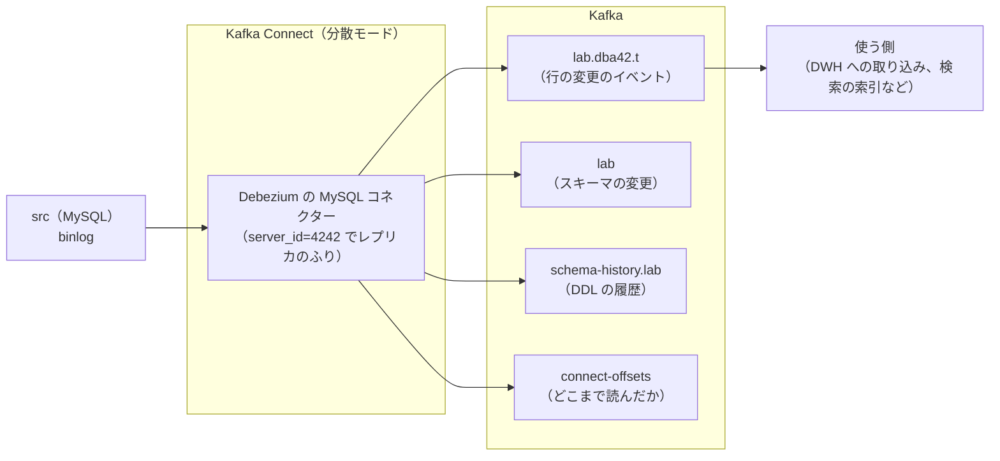

# 42 Debezium を動かす（任意）

## この章で分かるようになること

- 実際の CDC のツール（Debezium）が、MySQL の変更をどんなイベントにして Kafka に流すか
- スナップショットから変更の流し込みへの切り替えと、どこまで読んだかを保存している場所
- Debezium、AWS DMS、Aurora のゼロ ETL 統合の違い

この章は任意。Kafka と Kafka Connect を動かすので、メモリを多く使う（それぞれ最大512MB に絞ってある）。ルートの Spark の環境は止めておく（ルートで `make down`）。

## 解説

### 全体の構成

Debezium は、オープンソースの CDC のツール。Kafka Connect（Kafka にデータを出し入れするための仕組み）の上で動くコネクターとして作られている。MySQL のコネクターは、40章と同じくレプリカのふりをして binlog を受け取って、行の変更を1件ずつイベントにして、Kafka のトピックに書く。



- トピックの名前は「`topic.prefix`.データベース.テーブル」。この環境では `lab.dba42.t`
- `schema-history.lab` には、Debezium が読んだ DDL が順にたまる。起動し直したときに、これを読み直して、そのときのテーブルの定義を組み立てる（41章の「スキーマの履歴」）
- `connect-offsets` は、Kafka Connect の内部のトピック。どこまで読んだかが入る

### 変更のイベントの形

1件の変更は、次のような JSON のイベントになる（実験2で、UPDATE を流したときのもの）。

```json
{
  "op": "u",
  "before": {"id": 1, "v": "a"},
  "after": {"id": 1, "v": "z"},
  "source": {
    "connector": "mysql", "name": "lab", "db": "dba42", "table": "t", "server_id": 1,
    "gtid": "d10e7af6-…:504878", "file": "binlog.000064", "pos": 3541, "row": 0,
    "snapshot": "false", "ts_ms": 1795237332700
  },
  "ts_ms": 1795237332710
}
```

- `op`: 何の変更か。`r`（スナップショットで読んだ）、`c`（追加）、`u`（更新）、`d`（削除）
- `before`、`after`: 変える前と後の行。追加の `before` と、削除の `after` は null
- `source`: どこから来た変更か。データベースとテーブル、ソースの `server_id`、GTID、binlog のファイルと位置、スナップショットかどうか、ソースでコミットした時刻（`ts_ms`）
- いちばん外の `ts_ms`: Debezium がこのイベントを作った時刻。`source.ts_ms` との差が、CDC の遅れになる

41章の cdc.py が出していたものと、ほぼ同じ形をしている。

### スナップショットから、変更の流し込みへ

`snapshot.mode=initial`（初めて起動したとき、オフセットがなければ、まずスナップショットを取る）にすると、Debezium は次の順に進む。

1. 全体の読み取りのロック（40章の `FLUSH TABLES WITH READ LOCK`）をかけて、REPEATABLE READ のトランザクションを始め、binlog の位置と GTID の集まり、テーブルの定義を読む。ここまで済んだら、ロックを外す（`snapshot.locking.mode=minimal`、既定）。40章の境目と同じ考え方
2. 対象のテーブルを全部読んで、1行ずつ `op: "r"` のイベントにする。最初の行には `snapshot: "first"`、最後の行には `snapshot: "last"` の印が付く
3. 読み終わったら、記録した位置から binlog の変更を流し始める。ここから先のイベントは `snapshot: "false"` で、`source.gtid` が入る

一度スナップショットを終えて、オフセットが保存された後は、起動し直してもスナップショットは取り直さない。保存したところから、変更の続きを読む。

### どこまで読んだか: Kafka Connect の内部のトピック

Debezium のオフセットは、`connect-offsets` というトピックに入る。実験3で見ると、次のような中身だった。

```text
["lab-mysql",{"server":"lab"}]
{"file":"binlog.000064","pos":3701,"gtids":"d10e7af6-…:1-504878,…","event":2,"row":1,"server_id":1,"ts_sec":1795237332}
```

GTID の集まり（`gtids`）と、binlog のファイルと位置に加えて、そのトランザクションの中で何番目のイベントの何行目まで送ったか（`event`、`row`）まで覚えている。起動し直したときは、トランザクションの頭から読み直して、送り済みの分を飛ばす。

ただし、Kafka Connect がオフセットを書くのは、一定の間隔ごと（`offset.flush.interval.ms`、既定は60秒）と、きちんと止めたとき。きちんと止めずに落ちると、最後に書いたオフセットから読み直すので、その間のイベントがもう一度届く。Debezium の約束も「少なくとも1回」（40章）で、使う側は同じイベントが来ても困らないように作る。

### 削除と tombstone

削除のイベント（`op: "d"`）の後には、同じキーで値が null のメッセージがもう1つ来る。これを **tombstone**（墓石）と呼ぶ。Kafka には、キーごとに最新の値だけを残す「コンパクション」の機能があって、tombstone が来ると、そのキーのメッセージを全部消してよいと分かる。削除した行が、トピックにいつまでも残らないようにするためのもの。使う側は、値が null のメッセージを読み飛ばす必要がある。

### Debezium、AWS DMS、ゼロ ETL 統合

| | Debezium | AWS DMS | Aurora のゼロ ETL 統合 |
|---|---|---|---|
| 何をする | 変更のイベントを Kafka に流す | データベースから別のデータベースや S3 などへ、データを移して、写し続ける | Aurora から Redshift や SageMaker Lakehouse へ、分析用に写し続ける |
| binlog への要件 | ROW と FULL。GTID があると、続きから読みやすい | ROW と FULL。拡張バイナリログには対応していない | 拡張バイナリログ、ROW、`binlog_backup=0`、`binlog_replication_globaldb=0` |
| 最初のデータ | スナップショット（`snapshot.mode`） | 全部を読み込んでから CDC を始める（full-load-and-cdc） | 最初に全部を読み込んでから、写し続ける（AWS がやる） |
| どこまで読んだか | Kafka Connect の内部のトピック | タスクの、CDC のリカバリーのチェックポイント | AWS が管理する |
| 自分で運用するもの | Kafka、Kafka Connect、コネクター | レプリケーションのインスタンスとタスク | 統合の設定 |

変更のイベントを、複数のシステムが好きなように使いたいなら Debezium と Kafka。データベースを移したり、決まった先へ写したりするなら DMS。Aurora から Redshift などへ分析用に写すだけなら、ゼロ ETL 統合が手間が少ない。

## 手を動かして確かめる

### 実験1: Debezium を立てて、スナップショットを見る

**予想:** もとから2行あるテーブルで、Debezium を動かし始める。最初に何件、どんなイベントが届く？

```sql
-- make a で
CREATE DATABASE dba42;
CREATE TABLE dba42.t (id INT PRIMARY KEY, v VARCHAR(20));
INSERT INTO dba42.t VALUES (1, 'a'), (2, 'b');
```

`make cdc-up` で Kafka と Kafka Connect を立てて、道具コンテナからコネクターを登録する。`register.sh` は、`labs/42/mysql-connector.json` の設定で登録して、動き出す（RUNNING になる）まで待つ。

```bash
make cdc-up
make sh
cat /lab/labs/42/mysql-connector.json
bash /lab/labs/42/register.sh
exit
```

トピックの中身は、ホスト（`mysql-dba/`）で `consume.sh` を使って読む。kafka のコンテナの中の `kafka-console-consumer.sh` で、トピックを最初から読んで、値を1行ずつ出す。

```bash
bash labs/42/consume.sh lab.dba42.t 2
```

ここを見る: `op`、`source.snapshot`、`source.gtid`。

<details>
<summary>何が起きたか</summary>

2件届いて、どちらも `op: "r"`（スナップショットで読んだ行）。`after` に行の中身が入っていて、`before` は null。1件目の `source.snapshot` は `"first"`、2件目は `"last"` で、スナップショットの始まりと終わりが分かる。

スナップショットのイベントには GTID が入らない（`source.gtid` は null）。binlog から読んだ変更ではなく、テーブルを読んだものだから。`source.file` と `source.pos` には、スナップショットを取った時点の binlog の位置が入っている。

</details>

### 実験2: 変更のイベントを見る

**予想:** 追加、更新、削除を1つずつ流す。届くイベントは何件で、それぞれどんな形？

```sql
-- make a で
INSERT INTO dba42.t VALUES (3, 'c');
UPDATE dba42.t SET v = 'z' WHERE id = 1;
DELETE FROM dba42.t WHERE id = 2;
```

```bash
bash labs/42/consume.sh lab.dba42.t 6
```

ここを見る: 3件目からの `op`、`before`、`after`、`source.gtid`。最後の1件。

<details>
<summary>何が起きたか</summary>

スナップショットの2件に続いて、`op: "c"`、`op: "u"`、`op: "d"` の3件と、値が `null` の1件が届く（合わせて6件）。

- 追加は `after` だけ、更新は `before`（`v` が `a`）と `after`（`v` が `z`）の両方、削除は `before` だけ
- どれも `source.gtid` に、そのトランザクションの GTID が入る
- 最後の `null` が tombstone。削除した行のキーを、Kafka のコンパクションで消せるようにするためのもの

</details>

### 実験3: Connect を止めている間の変更

**予想:** Kafka Connect を止めている間に、2行追加する。起動し直すと、その2行は届く？ 何回届く？ オフセットには何が書いてある？

```bash
docker compose --profile cdc stop connect
```

```sql
-- make a で
INSERT INTO dba42.t VALUES (4, 'd'), (5, 'e');
```

```bash
docker compose --profile cdc start connect
make sh
bash /lab/labs/42/register.sh
exit
bash labs/42/consume.sh lab.dba42.t 9
docker compose --profile cdc exec kafka /opt/kafka/bin/kafka-console-consumer.sh --bootstrap-server kafka:9092 \
  --topic connect-offsets --from-beginning --property print.key=true --timeout-ms 5000
```

ここを見る: `op: "c"` のイベントの `after.id`。`connect-offsets` の中身。

<details>
<summary>何が起きたか</summary>

`id` が 4 と 5 の追加が、1回ずつ届く。止めている間の変更も、保存してあったオフセットの続きから読んでいる。スナップショットは取り直していない（`op: "r"` は最初の2件のまま）。

`connect-offsets` には、コネクターの名前をキーにして、GTID の集まり、binlog のファイルと位置、トランザクションの中のどこまで送ったか（`event`、`row`）が入っている。

ちょうど1回ずつ届いたのは、Kafka Connect をきちんと止めたので、止める前にオフセットを書いていたから。確かめたときも、変更を流した直後には `connect-offsets` はまだ空で、きちんと止めた後に書かれていた。プロセスが急に落ちたときは、最後に書いたオフセットから読み直して、同じイベントがもう一度届くことがある。

</details>

### 戻す

Kafka と Kafka Connect を消して（トピックもオフセットも消える）、実験で作ったデータベースを消す。最後に `make state` で確かめる。

```bash
make cdc-down
```

```sql
DROP DATABASE IF EXISTS dba42;
```

```bash
make state
```

## Aurora ではどうなる？

### 同じところ

- Debezium も AWS DMS も、Aurora のライターの binlog を、レプリカのふりをして読む（40章）。ROW、FULL、保持期間の要件と、スナップショットからのつなぎ方の考え方は同じ
- Debezium の約束が「少なくとも1回」なのも同じで、使う側は重なりを吸収する

### 違うところ

- **binlog を有効にするところから**: Aurora では binlog が既定で OFF なので、クラスターのパラメータグループで有効にして、再起動する（20章）
- **スナップショットのロック**: RDS や Aurora では全体の読み取りのロック（`FLUSH TABLES WITH READ LOCK`）を使えないので、Debezium はテーブルごとのロックに切り替えてスナップショットを取る。そのために `LOCK TABLES` の権限が要る（この環境の `cdc` ユーザーにも付けてある）
- **AWS DMS**: 移し方の種類に、全部を移す（full-load）、変更だけを写す（cdc）、全部を移してから変更を写し続ける（full-load-and-cdc）がある。CDC には `REPLICATION CLIENT` と `REPLICATION SLAVE` の権限、ROW と FULL が要る。どこまで読んだかは、タスクの CDC のリカバリーのチェックポイントとして残って、そこから再開できる。全部を移している途中でソースが止まると、タスクはエラーにならずに終わるのに、ターゲットがずれていることがある（AWS のドキュメントの注意）
- **ゼロ ETL 統合**: 送り先は Amazon Redshift か Amazon SageMaker Lakehouse。最初に全部を読み込んだ後、Aurora に書かれてから数秒のうちに写し続ける。Aurora MySQL では、拡張バイナリログが要る

### 業務の Aurora で見てみるなら

業務の Aurora を触れる立場なら、ライターで次の軽い読み取りを流してみる。

```sql
SELECT ID, USER, HOST, COMMAND, TIME, STATE
FROM information_schema.PROCESSLIST WHERE COMMAND LIKE 'Binlog Dump%';
SELECT @@binlog_format, @@binlog_row_image;
SHOW GLOBAL STATUS LIKE 'aurora_enhanced_binlog';
```

- binlog を読んでいる接続の `USER` と `HOST` から、どのツール（DMS、Debezium、外のレプリカなど）が読んでいるかを確かめる
- DMS のタスクがあるなら、コンソールで、CDC のリカバリーのチェックポイントと、CDC の遅れを見る

業務の Aurora で見た値はこのリポジトリに書かない。

出典:

- [Debezium connector for MySQL（snapshot.locking.mode、RDS と Aurora でのテーブルごとのロック）（Debezium）](https://debezium.io/documentation/reference/stable/connectors/mysql.html)
- [Using a MySQL-compatible database as a source for AWS DMS（ROW、FULL、権限、拡張バイナリログ）（AWS）](https://docs.aws.amazon.com/dms/latest/userguide/CHAP_Source.MySQL.html)
- [Creating tasks for ongoing replication using AWS DMS（CDC とリカバリーのチェックポイント）（AWS）](https://docs.aws.amazon.com/dms/latest/userguide/CHAP_Task.CDC.html)
- [Aurora zero-ETL integrations（送り先と、写し続ける仕組み）（AWS）](https://docs.aws.amazon.com/AmazonRDS/latest/AuroraUserGuide/zero-etl.html)
- [Getting started with Aurora zero-ETL integrations（拡張バイナリログ）（AWS）](https://docs.aws.amazon.com/AmazonRDS/latest/AuroraUserGuide/zero-etl.setting-up.html)

## 説明できるか確かめる

1. Debezium の変更のイベントの `op`、`before`、`after`、`source` には、それぞれ何が入っている？（実験2）
2. Debezium は、スナップショットから変更の流し込みに、どうやって漏れなく切り替えている？ 40章のやり方と比べて説明できる？（「スナップショットから、変更の流し込みへ」）
3. Debezium は、どこまで読んだかをどこに保存している？ Kafka Connect が急に落ちると、何が起きる？（実験3）
4. 削除の後に、値が null のメッセージが来るのはなぜ？（「削除と tombstone」）
5. Debezium、AWS DMS、ゼロ ETL 統合は、それぞれどんなときに選ぶ？（「Debezium、AWS DMS、ゼロ ETL 統合」）

## この章のキーワード

- **Debezium**: オープンソースの CDC のツール。Kafka Connect のコネクターとして動く
- **Kafka Connect**: Kafka にデータを出し入れするための仕組み。分散モードでは、設定やオフセットを Kafka のトピックにしまう
- **変更のイベント**: 1件の変更を表す JSON。`op`、`before`、`after`、`source` を持つ
- **スナップショットのイベント（op=r）**: CDC を始めたときに、もとからある行を読んだもの
- **connect-offsets**: Kafka Connect の内部のトピック。Debezium がどこまで読んだかが入る
- **スキーマの履歴のトピック**: Debezium が読んだ DDL をためておくトピック。起動し直したときに、テーブルの定義を組み立て直す
- **tombstone**: 削除の後に来る、値が null のメッセージ。コンパクションでキーを消せるようにする
- **AWS DMS（full-load-and-cdc）**: 全部を移してから、変更を写し続ける AWS のサービスの移し方
- **ゼロ ETL 統合**: Aurora から Redshift などへ、AWS が自動で写し続ける仕組み
